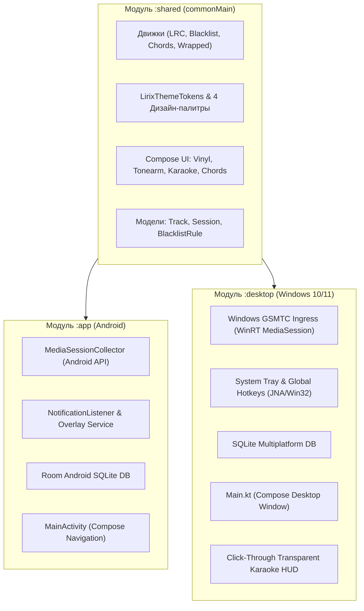

# Архитектурный проект: Портирование Lirix на Compose Multiplatform Desktop (Windows + Android)

- **Статус:** DRAFT (Gate 1)
- **Основание:** [ADR-020 в .sdd/decisions.md](file:///c:/Users/DaniilTuT/Documents/antigravity/quick-nobel/.sdd/decisions.md)
- **Исходный бриф:** [.sdd/intake/KMP_DESKTOP_WINDOWS.md](file:///c:/Users/DaniilTuT/Documents/antigravity/quick-nobel/.sdd/intake/KMP_DESKTOP_WINDOWS.md)

---

## 1. Концепция и цель
Переход от монолитного Android-модуля `:app` к модульной мультиплатформенной архитектуре Kotlin Multiplatform (KMP), где до 75% кодовой базы переиспользуется между Android и Windows без изменений:
- Все 4 темы оформления (`Spotify`, `Yandex`, `Obsidian`, `Pastel`)
- Аналоговый винил `AnalogTurntable` и кинетика тонарма
- Синхронизированный плеер караоке LRC
- Вкладка аккордов, гитарные аппликатуры и автопрокрутка
- Движки `LrcSyncEngine`, `BlacklistMatcher`, `AmDmChordParser`, `MyChordsParser`
- Аналитика `WrappedStatsEngine` и ачивки `GamificationEngine`

---

## 2. Модульная диаграмма архитектуры



---

## 3. Детальный разбор зон

### Зона 1: Модуль `:shared` (Pure Kotlin & Compose Multiplatform)
- **Пакет:** `com.lirix.shared.*`
- **Что переносится из `app/`:**
  - `ui/theme/*` (`LirixThemeTokens`, `AppColors`, `ThemePreferences`) — 100% совместимо с Desktop.
  - `ui/components/AnalogTurntable.kt` (пластинка, игла, физика вращения Canvas).
  - `feature/lyrics/LrcSyncEngine.kt`, `AmDmChordParser.kt`, `MyChordsParser.kt`, `GuitarChordDictionary.kt`, `GuitarFretboardDiagram.kt`, `ChordAutoscrollCalculator.kt`.
  - `feature/blacklist/BlacklistMatcher.kt`, `BlacklistPurgeEngine.kt`.
  - `analytics/WrappedStatsEngine.kt`, `GamificationEngine.kt`.
  - Базовые модели: `TrackEntity`, `ListeningSessionEntity`, `BlacklistRuleEntity`.

### Зона 2: Windows Ingress (`:desktop`)
- **Технология:** WinRT API `Windows.Media.Control.GlobalSystemMediaTransportControlsSessionManager`
- **Доступ из JVM:**
  - Вариант A: Готовая библиотека `windows-media-session` (обертка над WinRT через DLL/JNI).
  - Вариант B: Легковесный JNA интерфейс к `Windows.Media.Control`.
- **Контракт:**
  Реализует общий интерфейс `MediaIngressProvider`:
  ```kotlin
  interface MediaIngressProvider {
      val playbackState: StateFlow<LivePlaybackSnapshot>
      suspend fun play()
      suspend fun pause()
      suspend fun seekTo(positionMs: Long)
      suspend fun skipToNext()
      suspend fun skipToPrevious()
  }
  ```

### Зона 3: Windows Desktop UX (`:desktop`)
1. **Главное окно плеера:**
   - Compose Desktop `Window(title = "Lirix", icon = painterResource("icon.ico"))`.
   - Поддержка переключения 4 тем, винил, караоке и аккорды на большом экране.
2. **Плавающий HUD (Desktop Overlay):**
   - Полупрозрачное окно без рамок (`undecorated = true`, `alwaysOnTop = true`, `transparent = true`).
   - Настройка `WS_EX_TRANSPARENT | WS_EX_LAYERED` через Win32 API для click-through (клики проходят сквозь караоке прямо в игру).
3. **Системный трей:**
   - `Tray(icon = ..., tooltip = "Lirix")` с выпадающим меню (Плей/Пауза, Тема, Выход).

---

## 4. План декомпозиции задач (SDD Tasks)
1. `TASK-KMP-01`: Создание структуры мульти-проекта Gradle (`settings.gradle.kts`: `include(":shared", ":app", ":desktop")`).
2. `TASK-KMP-02`: Настройка плагина `org.jetbrains.compose` и KMP в `:shared/build.gradle.kts`.
3. `TASK-KMP-03`: Перенос движков ядра (LRC, Chords, BlacklistMatcher, Wrapped) в `:shared/commonMain`.
4. `TASK-KMP-04`: Перенос дизайн-токенов (`LirixThemeTokens`) и винила (`AnalogTurntable`) в `:shared/commonMain`.
5. `TASK-KMP-05`: Модуль `:desktop`: Базовый Compose Desktop Window со стилями Lirix.
6. `TASK-KMP-06`: Windows GSMTC Ingress: перехват живого трека и воспроизведения из Windows.
7. `TASK-KMP-07`: Click-Through плавающий HUD караоке поверх рабочего стола и игр.
8. `TASK-KMP-08`: Сборка дистрибутива Windows `.exe` / `.msi`.
