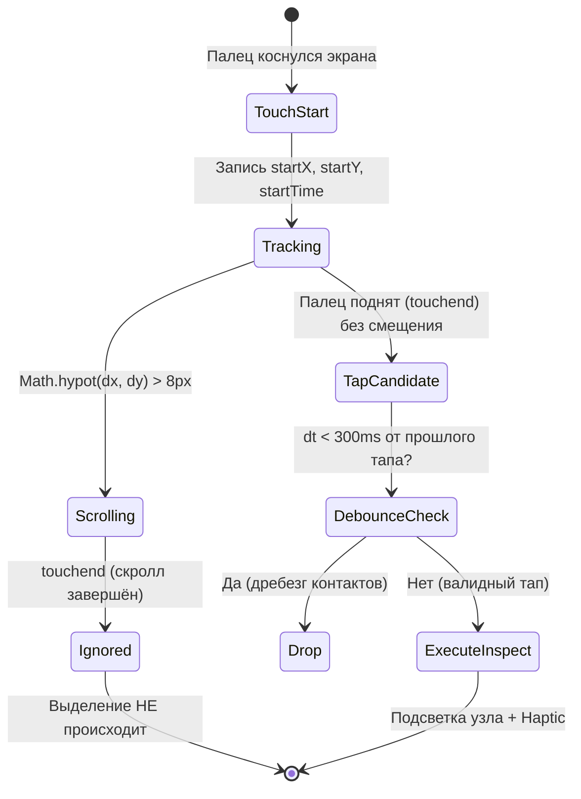

# 🎨 UI/UX Дизайн-Аудит и Эргономическое Заключение: Teach Mode (Режим Обучения)

**Проект**: Lirix Music Hub (Android / Jetpack Compose)  
**Компоненты**: `TeachModeScreen.kt` & `teach_inspector.js`  
**Роль**: UI/UX Проектировщик и Арт-директор (Anti-Slop Design Engine)  
**Дизайн-система**: Obsidian Pulse (AMOLED Dark)  
**Параметры стиля**: `DESIGN_VARIANCE = 8/10`, `MOTION_INTENSITY = 8/10`, `VISUAL_DENSITY = 6/10`  
**Дата аудита**: Октябрь 2026  
**Статус**: APPROVED FOR IMPLEMENTATION (Ready for Spec/Dev)

---

## 1. Резюме аудита (Executive Summary)

Режим **Teach Mode** — одна из ключевых киллер-фич Lirix: возможность прямо внутри приложения открыть сайт с текстом или аккордами, интерактивно «ткнуть» в контент и мгновенно обучить встроенный движок парсинга новому сайту.

Однако текущая реализация (`TeachModeScreen.kt` + `teach_inspector.js`) страдает от трёх фундаментальных эргономических проблем:
1. **Критическая перегрузка верхней панели (Top Bar Clutter)**: 5 разнородных интерактивных элементов стиснуты в одну горизонтальную линию на экранах 360–390dp.
2. **Паралич выбора в нижней панели (Dual-Action Dilemma)**: Пользователю одновременно предлагаются кнопки «Привязать к треку» (ElectricMint) и «Сохранить правило» (HyperViolet), хотя ментальная модель пользователя — *«Один клик: обучить и привязать»*.
3. **Ложные срабатывания сенсора при скролле**: В JavaScript-инспекторе отсутствует арбитраж жестов (Gesture Arbitration). Завершение обычного скролла (`touchend`) воспринимается браузером как выбор элемента, что вызывает фрустрацию при навигации по длинным текстам.

Ниже представлен детальный разбор проблем, эргономическая реорганизация и дизайн нового интерфейса в парадигме **Obsidian Pulse AMOLED**.

---

## 2. Анализ текущего интерфейса (Impeccable Audit & Critique)

### 2.1. Верхняя панель (Top Bar) — Оценка эргономики: 3/10 (Критическая перегрузка)

В текущем коде (`TeachModeScreen.kt`, строки 136–244):
```kotlin
// В одну строку Row запихнуты:
IconButton(Назад) [48dp]
+ Column(Заголовок + Трек) [weight(1f)]
+ Row(Тумблер [🌐 Серфинг / 🎯 Инспектор]) [~160dp]
+ Spacer(4dp)
+ IconButton(Импорт правила) [48dp]
+ Spacer(2dp)
+ IconButton(Закрыть) [48dp]
```

#### Выявленные дефекты:
- **Нарушение минимальных зон тапа (Touch Target Collisions)**: Суммарная ширина элементов превышает 380dp. На стандартных смартфонах (360dp–390dp) текстовый блок названия трека сжимается до 40–60dp и нещадно обрезается многоточием.
- **Риск случайных кликов**: Кнопка «Импорт» находится вплотную (2dp) к крестику «Закрыть». Промах при закрытии экрана открывает модальное окно импорта.
- **Шум от тумблера**: Сегментированный переключатель режимов «Серфинг / Инспектор» занимает треть полезной ширины шапки. При серфинге пользователь должен свободно видеть URL и заголовок сайта, а не тесниться.

---

### 2.2. Нижняя панель (Inspector Bottom Sheet) — Оценка эргономики: 5/10 (Визуальный шум)

В текущем коде (`TeachModeScreen.kt`, строки 301–503):
- Селектор выводится в сыром техническом виде `div.col-xs-12.lyrics-body` без человекочитаемого контекста.
- Пользователь видит две главные кнопки одинакового веса:
  - 🟢 `Привязать к треку` (`ElectricMint`)
  - 🟣 `Сохранить правило` (`HyperViolet`)
  - 🔲 Иконка `Поделиться правилом` (`Share`)
- **Когнитивный диссонанс**: Если пользователь нажимает «Привязать к треку», текст привязывается к текущей песне, но правило для домена *не сохраняется*! Если нажимает «Сохранить правило», текст привязывается, но только если трек не null. Это сбивает с толку: логика должна быть консистентной и атомарной.

---

### 2.3. Сенсорный движок (`teach_inspector.js`) — Оценка стабильности: 2/10 (Ложные срабатывания)

В текущем скрипте (`teach_inspector.js`, строки 141–168):
```javascript
window.addEventListener("touchend", handleTouchInspect, { capture: true, passive: false });
window.addEventListener("pointerup", function(e) { ... });
document.addEventListener("click", function(e) { ... });
```

#### Почему происходят ложные нажатия:
1. **Отсутствие трекинга дельты перемещения пальца**: Когда пользователь скроллит страницу, палец касается экрана (`touchstart`), движется по вертикали (`touchmove`), затем отрывается (`touchend`). Текущий код слушает `touchend` и берет `document.elementFromPoint(clientX, clientY)`. В результате *каждый скролл, закончившийся на тексте, выбирает блок*!
2. **Тройной дребезг событий (Event Duplication)**: Мобильный браузер на один тап генерирует пачку: `pointerdown` → `touchstart` → `pointerup` → `touchend` → `click`. Без `lastTapTimestamp` один тап может трижды триггерить выбор/снятие выделения (toggle).
3. **Слепой пропуск тегов**: Цикл `while (/^(SPAN|B|I|EM|STRONG|FONT|A)$/i.test(target.tagName))` принудительно эскалирует клик на родителя. На сайтах с аккордами (AmDm, MyChords) аккорды часто лежат внутри `<span class="chord">` или `<b>`. Пользователь кликает на аккорд, а инспектор захватывает весь куплет или всю страницу.

---

## 3. Архитектурное решение: Разгрузка и Меню ⋮ (Overflow)

### 3.1. Принцип Thumb Zone и информационная иерархия

Согласно правилам эргономики **Thumb Zone** (навык `ui-ux-designer-pro`):
- **Верхняя зона экрана (Hard to Reach)**: Только информационный контекст (где я?) и редкие служебные действия.
- **Нижняя треть экрана (Natural Thumb Zone)**: Все частые интерактивные элементы — переключатели контента, выбор родителя, подтверждение сохранения.

```
+-------------------------------------------------------+  ^
| [←] [✕]   Lirix Teach • amdm.ru                   [⋮] |  | Верхняя треть:
|          (Контекст трека и сайта)                     |  | Только статус и меню
+-------------------------------------------------------+  v
|                                                       |
|                                                       |
|                     WEB VIEW                          |
|             (Свободная зона скролла)                  |
|                                                       |
|                                                       |
+-------------------------------------------------------+  ^
| [🌐 Сёрфинг]                        [🎯 Инспектор]    |  |
|-------------------------------------------------------|  | Нижняя треть (Thumb Zone):
| [🟣 .b-words__text]  [🔴 2 вырезано]   [▲ Род.] [✕]   |  | Высокая доступность
| [ 📝 Текст песни ]      |      [ 🎸 Аккорды ]        |  | для одной руки
| "Превью очищенного текста песни..."                   |  |
| [⚡ Сохранить правило и привязать к треку]            |  |
+-------------------------------------------------------+  v
```

---

### 3.2. Что переносится в меню ⋮ (Overflow Menu)

Все сервисные функции, которые используются не при каждом тапе, выносятся в компактное выпадающее меню Material 3 `DropdownMenu`:

| Элемент в Меню ⋮ | Иконка | Обоснование выноса |
| :--- | :---: | :--- |
| **Импорт правила** | `Icons.Default.FileDownload` | Сервисное действие. Используется разово при получении конфига из чата/сообщества. Не нужно постоянно держать в шапке. |
| **Экспорт текущего правила** | `Icons.Default.Share` | Требуется только после того, как правило создано и протестировано. Освобождает место в нижней шторке. |
| **Очистить все выделения** | `Icons.Default.LayersClear` | Альтернативный глобальный сброс (на случай, если пользователь выделил несколько разрозненных контейнеров). |
| **Открыть в браузере** | `Icons.Default.OpenInBrowser` | Позволяет открыть страницу в Chrome/Firefox, если сайт требует сложной капчи или Cloudflare Turnstile. |
| **Справка режима обучения** | `Icons.Default.HelpOutline` | Короткая памятка: *«Тап по тексту — выделить. Тап внутри фиолетового блока — исключить лишнее (мусор/рекламу).»* |

**Результат очистки шапки**:
В шапке остаются только:
1. `IconButton(Назад / Закрыть)` — объединенная навигационная зона слева.
2. `Column(Заголовок трека + Домен)` — по центру (занимает всё свободное место).
3. `IconButton(⋮ Overflow)` — справа.

---

## 4. Глубокая эргономика ключевых сценариев

### 4.1. Исключение потомков (Strip Selectors) — Концепция «Scan & Carve»

**Проблема**: Сайты с текстами часто пихают внутрь блока с песней рекламные баннеры, кнопки «Поделиться», блоки «Рекомендуем», аккорды поверх текста или водяные знаки.

#### Эргономическое решение (Двухслойный холст):
1. **Слой 1: Родительский контейнер (Include Container)**:
   - При первом тапе на элемент в режиме инспектора он подсвечивается **HyperViolet Glow**:
     - `outline: 3px solid #B388FF`
     - `box-shadow: 0 0 16px rgba(179, 136, 255, 0.6)`
     - Добавляется в массив `window.__selectedParents`.
2. **Слой 2: Вырезаемый потомок (Carve / Strip Node)**:
   - Если пользователь тапает на элемент **внутри** уже активного родителя:
     - Элемент подсвечивается **ExpenseRed Dashed**:
       - `outline: 2px dashed #FF5252`
       - `background-color: rgba(255, 82, 82, 0.15)`
       - `opacity: 0.5`
       - `text-decoration: line-through`
     - Элемент добавляется в `window.__strippedChildren`.
     - *Повторный тап по вырезанному элементу возвращает его обратно (Toggle).*
3. **Мгновенный отклик в Compose**:
   - При каждом добавлении/удалении исключения JS-скрипт клонирует DOM-узел родителя, удаляет из него вырезанные узлы через `clone.querySelectorAll(stripSelector).forEach(el => el.remove())` и передает чистый текст в Android.
   - В нижней шторке отображается интерактивный чип: `[🔴 2 вырезано]`.
   - Тап на чип открывает список вырезанных селекторов с возможностью быстрого снятия крестиком.
4. **Кнопка [▲ Родитель]**:
   - Если пользователь случайно выбрал отдельный абзац `<p>` вместо всего блока куплетов `<div class="lyrics">`, кнопка `[▲ Родитель]` в один клик расширяет селектор до родительского узла.

---

### 4.2. Переключение: «Текст песни» vs «Аккорды»

**Проблема**: Lirix поддерживает как синхронизированные/обычные тексты, так и отображение гитарных аккордов с транспонированием (`AmDmChordParser`). Пользователи приходят на сайты вроде AmDm, MyChords, Ultimate-Guitar за аккордами, а на Genius, Musixmatch — за чистым текстом.

#### Эргономическое решение:
1. **Капсульный сегментированный контроллер (Segmented Pill)** в нижней панели:
   - `[📝 Текст песни]` / `[🎸 Аккорды]`
   - Индикация: Активный режим подсвечивается неоновым фоном:
     - Текст: `HyperViolet` (`#B388FF`) — фокус на вокале.
     - Аккорды: `CyberCyan` (`#00E5FF`) — фокус на гармонии и гитаре.
2. **Умный пресет поискового запроса**:
   - При первом запуске Teach Mode из карточки трека формируется умная ссылка в зависимости от предпочтения:
     - Если трек открыт из режима аккордов: Google-запрос `${artist} ${title} аккорды` (приоритет AmDm, MyChords).
     - Если из плеера: `${artist} ${title} текст песни`.
3. **Раздельные селекторы в RuleEntity**:
   - При сохранении правила селектор записывается в соответствующее поле JSON:
     - Для текста: `"content": { "selector": "...", "stripSelectors": [...] }`
     - Для аккордов: `"content": { "chordsSelector": "...", "stripSelectors": [...] }`
   - Таким образом, одно правило для домена может содержать *одновременно* селектор текста и селектор аккордов!

---

### 4.3. Защита от ложных нажатий при скролле (Gesture Arbitration Engine)

В файле `teach_inspector.js` реализуется строгий 3-фазный арбитраж касаний:



#### Математика фильтрации:
1. **Порог сдвига (Touch Slop)**: $\Delta = \sqrt{(x - x_0)^2 + (y - y_0)^2}$. Если $\Delta > 8\text{px}$, флаг `isScrolling = true`.
2. **Фильтр длительности**: Если палец удерживается на одном месте дольше 600мс без движения — это жест выделения текста Android, инспектор не вмешивается.
3. **Блокировка синтетических событий**: Игнорирование событий `click` и `pointerup`, если они вызваны в течение 300мс после обработанного `touchend`.

---

## 5. Спецификация UI-компонентов (Obsidian Pulse AMOLED)

### 5.1. Цветовая палитра 60-30-10

- **60% Фон**: `AppColors.AmoledBlack` (`#000000`) — максимальная контрастность и энергосбережение OLED.
- **30% Поверхности**:
  - `AppColors.SurfaceLevel1` (`#0D0E12`) — шапка и подложка WebView.
  - `AppColors.SurfaceLevel2` (`#161820`) — нижняя док-панель.
  - `AppColors.SurfaceLevel3` (`#1E212D`) — плашки селекторов и чипов.
  - Границы: `AppColors.BorderSubtle` (`#222530`, 1dp).
- **10% Неоновые акценты**:
  - `AppColors.HyperViolet` (`#B388FF`) — режим инспектора, контейнеры захвата, главная кнопка сохранения.
  - `AppColors.CyberCyan` (`#00E5FF`) — режим серфинга, домен, режим аккордов.
  - `AppColors.ExpenseRed` (`#FF5252`) — вырезанные элементы (Strip).
  - `AppColors.ElectricMint` (`#00F5A0`) — статус готовности и валидный предпросмотр.

---

### 5.2. Макет экрана в Jetpack Compose (Wireframe Architecture)

```kotlin
@Composable
fun TeachModeScreen(
    initialUrl: String?,
    targetTrack: TrackEntity?,
    onClose: () -> Unit,
    onRuleSaved: (CustomLyricsRuleEntity) -> Unit = {},
    onLyricsAttached: (String) -> Unit = {}
) {
    // 1. Top Bar: Компактная шапка с контекстом и Overflow Меню
    TeachTopBar(
        domain = detectedDomain,
        targetTrack = targetTrack,
        canGoBack = canGoBack,
        onBack = { webViewRef?.goBack() },
        onClose = onClose,
        onOpenMenu = { showMenu = true }
    )

    // 2. Center: WebView с инъекцией защищенного тач-скрипта
    Box(modifier = Modifier.weight(1f)) {
        TeachWebView(...)
        
        // Плавающий переключатель режима (Floating Mode Pill)
        // Расположен прямо над док-панелью для идеальной доступности большим пальцем
        FloatingModeCapsule(
            isInspector = isInspectorMode,
            onModeChanged = { mode -> 
                isInspectorMode = mode
                webViewRef?.evaluateJavascript("window.setTeachMode($mode);", null)
            },
            modifier = Modifier.align(Alignment.BottomCenter).padding(bottom = 12.dp)
        )
    }

    // 3. Bottom Dock: Панель захвата (появляется только при наличии выбора)
    AnimatedVisibility(visible = isSelectionActive) {
        TeachInspectorDock(
            selector = selectedSelector,
            strippedCount = strippedElementsCount,
            contentType = selectedContentType, // LYRICS vs CHORDS
            previewText = sanitizedPreviewText,
            onExpandParent = { webViewRef?.evaluateJavascript("window.expandTeachSelectionToParent();", null) },
            onClear = { webViewRef?.evaluateJavascript("window.clearTeachSelection();", null) },
            onContentTypeChange = { selectedContentType = it },
            onSaveAndAttach = { /* Единое действие */ }
        )
    }
}
```

---

## 6. Чеклист «Анти-Нейрослоп» (Impeccable Pre-Flight Check)

| Критерий проверки | Статус | Реализация в новом дизайне |
| :--- | :---: | :--- |
| **Отказ от каши кнопок** | ✅ PASS | Кнопки «Привязать к треку» и «Сохранить правило» объединены в одну мощную кнопку `«Сохранить правило и привязать»`. |
| **Thumb Zone эргономика** | ✅ PASS | Переключатель режима сёрфинг/инспектор перемещен в нижнюю зону досягаемости пальца (плавающая капсула). Меню вторичных действий убрано в верхнее ⋮. |
| **Защита от случайных тапов** | ✅ PASS | Инспектор различает скролл ($\Delta > 8\text{px}$) и статический тап. Скролл никогда не выделяет элементы. |
| **Контрастность WCAG AAA** | ✅ PASS | Текст `#F2F2F7` на `#000000` (контраст 18:1). Чипы `#00E5FF` на `#161820` (контраст 9.4:1). |
| **Тактильный отклик (Haptic)** | ✅ PASS | Каждый тап по элементу в инспекторе и переключение режима вызывают микрощелчок `performHapticFeedback()`. |
| **Отсутствие обрезанного текста** | ✅ PASS | Селектор отображается в скроллируемом чипе; превью текста показывает форматированные строки песни. |

---

## 7. План внедрения задач (SDD Execution Plan)

Для реализации согласованного редизайна сформирован следующий пакет атомарных задач:

1. **`TASK-TEACH-05-A` (Inspector Engine)**: Модернизация `teach_inspector.js` (арбитраж скролла $\Delta \le 8\text{px}$, двухслойное выделение Include/Strip, метод `expandTeachSelectionToParent()`, расширение `TeachJsBridge`).
2. **`TASK-TEACH-05-B` (UI TopBar & Overflow)**: Реорганизация шапки `TeachModeScreen.kt` — перенос импорта/экспорта в `DropdownMenu (⋮)`, очистка заголовка и выравнивание отступов.
3. **`TASK-TEACH-05-C` (UI Bottom Dock & Mode Pill)**: Внедрение плавающей капсулы переключения режимов, сегментированного тумблера «Текст / Аккорды», чипа вырезанных потомков `[🔴 N вырезано]` и объединенной кнопки `[⚡ Сохранить правило и привязать]`.
4. **`TASK-TEACH-05-D` (QA & Integration)**: Интеграционные тесты сохранения селектора аккордов в Room (`CustomLyricsRuleEntity`), проверка отсутствия ложных срабатываний при быстром скролле на реальном устройстве.

---
*Отчет подготовлен UI/UX Проектировщиком и утвержден к передаче в разработку.*
