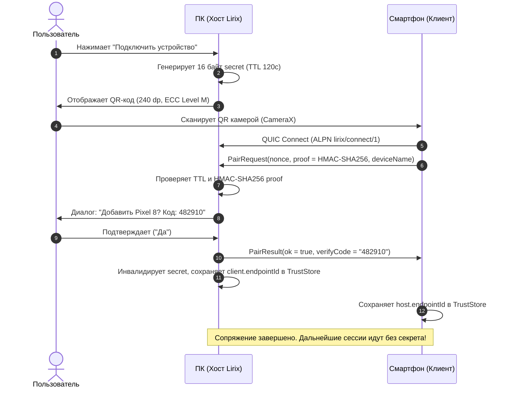

# SPEC-CONNECT-01: Lirix Connect — P2P Сопряжение устройств по QR и воспроизведение на любом устройстве

## 1. Введение и Цель
Цель спецификации — спроектировать функцию **«Воспроизвести на устройстве»** (Lirix Connect), аналогичную функционалу *Яндекс Музыки («Играть на устройстве»)* и *Spotify Connect*, позволяющую:
1. Связывать устройства (ПК с Windows, Android-смартфон, планшет) без облачных аккаунтов через разовое сканирование **QR-кода**.
2. В один клик переключать активный вывод звука между устройствами с сохранением позиции трека (`positionMs`), текста караоке и очереди.
3. Использовать любое связанное устройство как **полноценный пульт ДУ** (изменение громкости, пауза, перемотка по таймкодам LRC).
4. Опционально транслировать сырой аудио-поток в реальном времени (Audio Cast, Opus 48 kHz), если воспроизводится сторонний источник или локальный файл.

---

## 2. Анализ кодовой базы Lyten02/AudioBridge и Аудит Безопасности

Проект [Lyten02/AudioBridge](https://github.com/Lyten02/AudioBridge) решает фундаментальную задачу прямой передачи звука и управления между ПК и телефоном без облаков. Нами проверена кодовая база проекта (`crates/core`, `crates/desktop`, `android`):

### 2.1. Лицензия
- Проект лицензирован под **MIT License** (Copyright 2026 Konstantin / Lyten02).
- Полная совместимость для переиспользования архитектурных решений, алгоритмов сериализации и сетевых абстракций в Lirix с сохранением авторского копирайта.

### 2.2. Разрешение отметок `[проверить]` по Iroh и проверке PSK в AudioBridge
- **Транспортная безопасность Iroh**: Iroh использует QUIC с TLS 1.3, где криптографической идентичностью (`EndpointId`) служит публичный ключ Ed25519 (генерируется самоподписанный X.509 сертификат).
- **Фактический механизм PSK в AudioBridge**:
  - Аутентификация по секрету происходит **НЕ на уровне TLS 1.3 PSK**, а на уровне приложения.
  - В AudioBridge секрет хранится в постоянном файле `%APPDATA%\AudioBridge\pairing.secret` и передаётся в открытом виде в полезной нагрузке стрима: `ControlMsg::Hello { secret: [u8; 16], ... }`.
  - Сервер проверяет равенство секрета в постоянном времени: `secret_eq(&secret, &self.secret)`.
  - **Уязвимость AudioBridge**: секрет бессрочный и статичный. Любой, кто однажды сфотографировал экран с QR-кодом, может подключаться к ПК бесконечно.
- **Архитектурное решение Lirix Connect**:
  - Секрет сопряжения (`pairingSecret`) является **кратковременным одноразовым бутстрапом** (TTL 120 с).
  - Секрет **никогда не передаётся по сети в открытом виде**: знание секрета доказывается через `PairRequest.proof = HMAC-SHA256(secret, nonce ‖ clientEndpointId ‖ serverEndpointId)`.
  - Требуется явное подтверждение пользователя на хосте («Добавить устройство Pixel 8?» с 6-значным кодом сверки).
  - После успеха сопряжения устройства **закрепляют (pinning)** `EndpointId` друг друга в `TrustedDevice`. Последующие подключения используют аутентификацию ключей Ed25519 на уровне Iroh QUIC без передачи каких-либо секретов.

---

## 3. Архитектура Lirix Connect (Два режима работы)

```mermaid
graph TD
    subgraph UI ["Интерфейс Lirix (NowPlaying / TopBar)"]
        btn["Кнопка 'Воспроизвести на устройстве'"] --> sheet["Меню выбора устройств"]
    end

    subgraph Modes ["Режимы Lirix Connect"]
        sheet -->|Сценарий 1: Handoff / Remote Control| handoff["Handoff (Перенос трека)"]
        sheet -->|Сценарий 2: Live Audio Cast| cast["Audio Cast (Прямой P2P Стрим)"]
    end

    subgraph HandoffFlow ["1. Handoff: Независимый плеер + Пульт ДУ"]
        handoff --> msgHandoff["LirixConnectMsg::HandoffRequest(TrackRef, posMs, queue)"]
        msgHandoff --> checkCaps{"Цель может сыграть локально?"}
        checkCaps -->|Да| targetEngine["Целевое устройство запускает трек локально"]
        checkCaps -->|Нет (suggestCast)| fallbackCast["Автоматический fallback на Audio Cast"]
        targetEngine --> remoteState["Исходное устройство становится Пультом ДУ"]
    end

    subgraph CastFlow ["2. Audio Cast: Беспроводная колонка"]
        cast --> opusStream["Capture (WASAPI/AudioPlaybackCapture) -> Opus 192kbps -> QUIC Datagrams"]
        opusStream --> neteq["Jitter Buffer (40-80ms) -> Playout (AAudio/WASAPI)"]
    end
```

### 3.1. Сценарий 1: Сессионный Handoff (Передача сессии)
1. Пользователь слушает трек на телефоне.
2. Придя домой, нажимает **«Воспроизвести на устройстве»** и выбирает `«Домашний ПК (Windows)»`.
3. Стороны проверяют взаимные `Capabilities` (наличие провайдера трека, поддержка локальных файлов по `contentHash`).
4. Телефон отправляет через Iroh QUIC команду `HandoffRequest`:
   - `TrackRef`: `provider`, `trackId`, `uri`, `contentHash`, метаданные.
   - `QueueSnapshot`: синхронизация очереди треков.
   - `positionMs` + `positionAtMonoMs`: временная засечка монотонных часов.
   - `LyricsRef`: query-хэш и кэш LRC караоке со сдвигом `syncOffsetMs`.
5. Целевое устройство подхватывает трек секунда-в-секунду.
   - *Важное архитектурное ограничение*: сторонними приложениями (например, Яндекс Музыка на ПК) можно управлять только через системный SMTC (Play/Pause, Seek, Volume). Для прямой загрузки произвольного трека без участия пользователя целевое устройство должно использовать встроенный KMP-плеер Lirix, либо веб-API провайдера. Если провайдер недоступен, хост возвращает `HandoffAck(accepted=false, suggestCast=true)`.
6. Телефон глушит локальный звук (кроссфейд 300 мс) **только после** получения подтверждения `RemoteStateUpdate(isPlaying=true)` от цели.
7. Телефон переходит в режим **«Пульт ДУ»**:
   - Строки караоке бегут локально по интерполяции времени.
   - Внизу экрана закреплена плашка: `● Воспроизводится на: Домашний ПК [Изменить]`.

### 3.2. Сценарий 2: Live Audio Cast (Режим беспроводной колонки)
1. Если трек не может быть воспроизведён автономно (YouTube, фильм, игра, защищённый DRM стрим):
2. Активируется P2P-трансляция Audio Cast:
   - Захват звука: WASAPI Loopback (на ПК) или `AudioPlaybackCapture` с `MediaProjection` (на Android 10+).
   - Сжатие кодеком Opus (192 кбит/с, 48 кГц, 10 мс фреймы, размер датаграммы ~240 байт ≤ 1200 байт MTU).
   - Приёмник принимает QUIC-датаграммы с адаптивным джиттер-буфером (цель 40–80 мс), PLC и in-band FEC.
   - Реалистичная задержка по Wi-Fi: **60–120 мс** (компенсация lip-sync через отчёт `CastStatus.receiverLatencyMs`).

---

## 4. Протокол Lirix Connect (`LirixConnectProto`)

### 4.1. Транспорт и кодирование
- **ALPN:** `lirix/connect/1` (полная изоляция от AudioBridge).
- **Каналы QUIC:**
  - один bi-stream «control» для всех управляющих `LirixConnectMsg`, открывается сразу после рукопожатия;
  - QUIC-датаграммы исключительно для потокового Audio Cast.
- **Кодирование:** CBOR (`kotlinx.serialization.cbor`), каждое сообщение обёрнуто в конверт с длиной-префиксом (u32 LE, максимум 64 КБ).
- **Версионирование:** `Hello.supportedVersions` и `Welcome.chosenVersion`. Неизвестные поля игнорируются, неизвестные типы сообщений отвечают `Error(UNSUPPORTED)` и не рвут соединение.
- **Идентичность:** `deviceId` = `endpoint_id` (Ed25519). Доверие строится на закреплении публичного ключа (pinning).

### 4.2. Сопряжение (Pairing Phase)

QR-payload: `lirix://pair?d=<base64url(CBOR)>`

```kotlin
@Serializable
data class PairingPayload(
    val version: Int,
    val endpointId: Bytes,          // 32 байта Ed25519
    val pairingSecret: Bytes,       // 16 байт, одноразовый криптографический секрет
    val deviceName: String,
    val addrs: List<String>,        // локальные IP:port (раскрытие топологии в LAN)
    val relayUrl: String?,          // iroh-relay URL
    val expiresAtEpochSec: Long     // TTL 120 с по умолчанию, максимум 300 с
)
```



Правила безопасности:
1. Секрет одноразовый: удаляется сразу после сопряжения или по истечении TTL (120 с). После 3 неверных попыток QR аннулируется.
2. Секрет не передаётся по сети: клиент доказывает знание через `proof = HMAC-SHA256(secret, nonce ‖ clientEndpointId ‖ serverEndpointId)`.
3. Хост показывает диалог подтверждения с 6-значным кодом сверки хэша ключей.
4. Стороны закрепляют `endpoint_id` друг друга в `TrustedDevice`. Дальше `Hello` идёт без секрета. Подключение неизвестных `endpoint_id` получает `Reject(UNTRUSTED_DEVICE)`.
5. Кнопка «Скопировать код текстом» копирует тот же payload с тем же TTL и предупреждением о безопасности.
6. «Забыть устройство» удаляет запись из локальной базы и отправляет `Bye(UNPAIRED)`.

### 4.3. Конверт, роли, сессия

```kotlin
@Serializable
data class Envelope(
    val msgId: Long,                 // монотонный счётчик отправителя
    val inReplyTo: Long? = null,
    val sessionId: String? = null,   // UUID активной сессии воспроизведения
    val epoch: Long = 0,             // инкрементируется при каждой смене владельца сессии
    val sentAtMonoMs: Long,          // монотонные часы отправителя
    val body: LirixConnectMsg
)

enum class DeviceRole { PLAYER, CONTROLLER }
```

**Правило конфликтов:** Источник истины — текущий `PLAYER`. Команды контроллеров исполняются по порядку прихода. Команды с `epoch` меньше текущей отбрасываются с ошибкой `Error(STALE_EPOCH)`.

### 4.4. Сообщения Протокола

```kotlin
@Serializable
sealed interface LirixConnectMsg {

    // ── Рукопожатие ──
    @Serializable
    data class Hello(
        val supportedVersions: List<Int>,
        val deviceName: String,
        val deviceType: DeviceType,
        val capabilities: Capabilities
    ) : LirixConnectMsg

    @Serializable
    data class Welcome(
        val chosenVersion: Int,
        val deviceName: String,
        val capabilities: Capabilities,
        val activeSession: SessionSnapshot?
    ) : LirixConnectMsg

    @Serializable
    data class Reject(val reason: RejectReason, val message: String? = null) : LirixConnectMsg
    @Serializable
    data class Error(val code: ErrorCode, val message: String? = null) : LirixConnectMsg
    @Serializable
    data class Bye(val reason: ByeReason) : LirixConnectMsg

    // ── Сопряжение (Pairing Phase) ──
    @Serializable
    data class PairRequest(val nonce: Bytes, val proof: Bytes, val deviceName: String, val deviceType: DeviceType) : LirixConnectMsg
    @Serializable
    data class PairResult(val ok: Boolean, val verifyCode: String?) : LirixConnectMsg

    // ── Связность и время ──
    @Serializable
    data class Ping(val t0: Long) : LirixConnectMsg
    @Serializable
    data class Pong(val t0: Long, val t1: Long, val t2: Long) : LirixConnectMsg
    @Serializable
    data class DeviceHeartbeat(val isAvailable: Boolean, val batteryPct: Int?, val nowPlaying: Boolean) : LirixConnectMsg

    // ── Handoff ──
    @Serializable
    data class HandoffRequest(
        val sessionId: String,
        val newEpoch: Long,
        val track: TrackRef,
        val queue: QueueSnapshot?,
        val positionMs: Long,
        val positionAtMonoMs: Long,
        val durationMs: Long,
        val playbackRate: Float,
        val isPlaying: Boolean,
        val volume: Float,            // 0.0..1.0
        val lyrics: LyricsRef?
    ) : LirixConnectMsg

    @Serializable
    data class HandoffAck(
        val accepted: Boolean,
        val reason: HandoffFailure?,
        val suggestCast: Boolean,
        val startedAtMonoMs: Long?
    ) : LirixConnectMsg

    @Serializable
    data class HandoffReturn(val sessionId: String, val newEpoch: Long) : LirixConnectMsg

    // ── Пульт ДУ ──
    @Serializable
    data class RemoteMediaAction(
        val epoch: Long,
        val action: MediaAction,
        val seekToMs: Long? = null,
        val volume: Float? = null,
        val queueIndex: Int? = null
    ) : LirixConnectMsg

    @Serializable
    data class RemoteStateUpdate(
        val epoch: Long,
        val trackId: String,
        val trackTitle: String,
        val trackArtist: String,
        val durationMs: Long,
        val positionMs: Long,
        val positionAtMonoMs: Long,
        val playbackRate: Float,
        val isPlaying: Boolean,
        val volume: Float,
        val muted: Boolean,
        val queueIndex: Int,
        val lyrics: LyricsRef?
    ) : LirixConnectMsg

    // ── Audio Cast ──
    @Serializable
    data class SetAudioCast(val enabled: Boolean, val codec: CastCodec, val sampleRate: Int = 48000, val channels: Int = 2, val bitrateKbps: Int = 192) : LirixConnectMsg
    @Serializable
    data class CastStatus(val receiverLatencyMs: Int, val bufferMs: Int, val lossPct: Float) : LirixConnectMsg
}

@Serializable
data class Capabilities(
    val canPlayLocal: Boolean,
    val canReceiveCast: Boolean,
    val canCaptureAudio: Boolean,
    val providers: List<String>,
    val maxQueueSize: Int
)

@Serializable
data class TrackRef(
    val provider: String,
    val trackId: String?,
    val uri: String?,
    val contentHash: String?,
    val title: String,
    val artist: String,
    val album: String?
)

@Serializable
data class LyricsRef(
    val queryKey: String,
    val lrc: String?,
    val syncOffsetMs: Long
)

@Serializable
data class QueueSnapshot(val items: List<TrackRef>, val index: Int, val shuffle: Boolean, val repeat: RepeatMode)

@Serializable
data class SessionSnapshot(val sessionId: String, val epoch: Long, val track: TrackRef, val isPlaying: Boolean, val positionMs: Long)

enum class DeviceType { WINDOWS_PC, ANDROID_PHONE, ANDROID_TABLET }
enum class MediaAction { PLAY, PAUSE, PLAY_PAUSE, NEXT, PREVIOUS, SEEK_TO, SET_VOLUME, SET_MUTE, SET_QUEUE_INDEX }
enum class RejectReason { UNTRUSTED_DEVICE, VERSION_MISMATCH, BUSY, USER_DECLINED, PAIRING_EXPIRED, TOO_MANY_ATTEMPTS }
enum class ErrorCode { UNSUPPORTED, STALE_EPOCH, INVALID_STATE, INTERNAL }
enum class ByeReason { NORMAL, UNPAIRED, SHUTDOWN }
enum class HandoffFailure { NO_PROVIDER, NO_LOCAL_FILE, BUSY, USER_DECLINED }
enum class CastCodec { OPUS }
enum class RepeatMode { OFF, ONE, ALL }

/**
 * Сериализуемая обёртка над ByteArray с корректными equals/hashCode по содержимому.
 */
@Serializable
data class Bytes(val data: ByteArray) {
    override fun equals(other: Any?): Boolean {
        if (this === other) return true
        if (other !is Bytes) return false
        return data.contentEquals(other.data)
    }
    override fun hashCode(): Int = data.contentHashCode()
}
```

### 4.5. Синхронизация времени и позиции
1. После `Welcome` устройства обмениваются 5–8 парами `Ping/Pong` и вычисляют оценку смещения часов по минимальному RTT:  
   $$\text{offset} = \frac{(t_1 - t_0) + (t_2 - t_3)}{2}$$
   Обмен повторяется каждые 30 с во время активной сессии.
2. Целевая позиция трека при старте:
   $$\text{targetPos} = \text{positionMs} + \text{playbackRate} \times (\text{nowTarget} - (\text{positionAtMonoMs} + \text{offset}))$$
3. Бегущие строки караоке на пульте интерполируются локально:  
   $$\text{pos} = \text{positionMs} + \text{playbackRate} \times (\text{now} - \text{positionAtMonoMs} - \text{offset})$$
   `RemoteStateUpdate` отправляется при любых событиях и не реже одного раза в 5 с для устранения дрейфа.
4. **Целевая погрешность: $\pm 100$ мс** ($\pm 50$ мс в локальной Wi-Fi сети).

### 4.6. Машина состояний Handoff
```
IDLE ──► REQUESTED ──► (HandoffAck accepted) ──► TARGET_STARTING ──► TARGET_PLAYING ──► SOURCE_MUTED (CONTROLLER)
                     ├──► (accepted=false, suggestCast) ──► Предложить Cast ──► CASTING
                     └──► Таймаут 5 с ──► IDLE (Звук остаётся на источнике)
```
- **Плавный переход**: Источник приглушает локальный вывод (кроссфейд 300 мс) **только после** получения `RemoteStateUpdate` со статусом `isPlaying=true` от цели.
- **Обрыв связи**: При потере связи контроллер ждёт 10 с в режиме автореконнекта. При неуспехе отображает алерт «Устройство недоступно» с вариантами: «Продолжить здесь» (локальный запуск с последней позиции) или «Ждать связь».
- **Возврат воспроизведения**: Команда `HandoffReturn` запускает обратный Handoff на исходное устройство с инкрементом `epoch`.

### 4.7. Audio Cast: Формат потока
- QUIC-датаграмма: `seq (u16) | timestamp48k (u32) | flags (u8: FEC/DTX) | opusPayload`. Размер $\le 1200$ байт.
- Приёмник: адаптивный джиттер-буфер (цель 40–80 мс), PLC средствами Opus, опциональный in-band FEC. Раз в секунду отправляет отчёт `CastStatus`.
- При известной `receiverLatencyMs` источник предупреждает пользователя или компенсирует видеодорожку (lip-sync).

---

## 5. UI/UX Спецификация и Состояния Диалога

### 5.1. Точки входа
- **Десктоп**: иконка `DevicesOther` в `DesktopTopBar` рядом со статусом сессии + хоткей `Ctrl+Shift+D`.
- **Мобильный экран (NowPlayingScreen)**: иконка устройств правее регулятора громкости / трекбара.

### 5.2. Содержимое диалога (Compose BottomSheet / Popover)
```
+-------------------------------------------------------+
|  Воспроизвести на устройстве                        [X] |
+-------------------------------------------------------+
|  ТЕКУЩЕЕ УСТРОЙСТВО                                   |
|  ● Этот компьютер (Windows)                           |
|    Громкость: [====|--------] 45%                     |
+-------------------------------------------------------+
|  ДОСТУПНЫЕ УСТРОЙСТВА В СЕТИ                          |
|  [📱] Телефон Daniil (Pixel 8)                В сети  |
|       Играет: Нет • Нажмите для передачи трека        |
|                                                       |
|  [💻] Рабочий Ноутбук                       Офлайн    |
|       Был в сети 20 минут назад                       |
+-------------------------------------------------------+
|  [+] Подключить новое устройство (QR-код)             |
+-------------------------------------------------------+
```

### 5.3. Исчерпывающие UI-состояния
1. **Подключение (Connecting...)**: спиннер на плашке целевого устройства (до 5 с).
2. **Ошибка Handoff**: диалог *«Не удалось запустить трек на ПК. Включить прямую трансляцию звука (Audio Cast)? [Транслировать] [Отмена]»*.
3. **Истёкший QR-код**: по истечении TTL (120 с) QR затеняется оверлеем с кнопкой `[Обновить код]`.
4. **Отказ в разрешении камеры**: понятный экран с кнопкой «Открыть настройки системы» и альтернативной кнопкой «Ввести код вручную».
5. **Управление устройствами**: меню «⋮» у каждого устройства в списке: «Переименовать», «Забыть устройство» (с диалогом подтверждения).
6. **Регулятор громкости**: слайдер громкости целевого устройства доступен прямо в шторке выбора устройств.
7. **Доступность (a11y)**: поддержка скринридеров (TalkBack / Windows Narrator) с голосовым озвучиванием смены ролей устройства и статуса Handoff.

---

## 6. Декомпозиция задач по стандарту SDD

Зависимости: `SEC-01` → `CORE-02` → `PROTO-03` → `TIME-04` → `HANDOFF-06` → UI; `CAST-*` зависит от `PROTO-03` и `TIME-04`.

| ID | Задача | Зона | Исполнитель | Критерии приёмки (DoD) |
|---|---|---|---|---|
| `SPEC-CONNECT-01` | Спецификация (этот документ), проверка лицензии AudioBridge и аудит PSK | `media-connect` | SDD Координатор | Лицензия MIT подтверждена; схема HMAC и pinning формализованы |
| `TASK-CON-SEC-01` | Политика сопряжения: TTL 120с, одноразовость, HMAC-proof, подтверждение на хосте, `TrustedDevice` store, «Забыть» | `media-core` | Core Engineer | Просроченный и повторный QR отклоняются; 3 неверных попытки аннулируют QR; неизвестный `endpoint_id` получает `Reject` |
| `TASK-CON-CORE-02` | Iroh-транспорт, ALPN `lirix/connect/1`, кодек `PairingPayload`, discovery и реконнект | `media-core` | Core Engineer | Соединение в LAN, через iroh-relay и после смены сети (Wi-Fi ↔ 4G) восстанавливается за ≤ 10 с |
| `TASK-CON-PROTO-03` | CBOR-сериализация `LirixConnectMsg`, `ConnectSessionManager`, `epoch`/роли, версионирование | `media-core` | Core Engineer | Round-trip unit-тесты на все типы сообщений; неизвестные поля не рвут связь; устаревший `epoch` отклоняется |
| `TASK-CON-TIME-04` | Синхронизация часов (NTP Ping/Pong) и интерполяция позиции | `media-core` | Core Engineer | Погрешность позиции караоке ≤ 100 мс при сетевом RTT до 80 мс в эмуляторе задержек |
| `TASK-CON-REG-05` | Реестр устройств, присутствие (`DeviceHeartbeat`, last-seen), Android foreground service | `media-core` / `media-ui` | Android Engineer | Статусы «В сети / Офлайн» корректны; ограничения фонового режима Doze отображаются в подсказке |
| `TASK-CON-HANDOFF-06` | Логика Handoff: `TrackRef`, очередь, караоке, кроссфейд 300мс, fallback на Cast, возврат «назад» | `media-ingress` | Windows & Android Engine | Переход в LAN ≤ 3 с до звука; тишины на стыке нет; при отказе предлагается Cast; восстановление при обрыве по 4.6 |
| `TASK-CON-UI-07` | BottomSheet «Воспроизвести на устройстве» (Android): список, громкость, ошибки, сканер CameraX, a11y | `media-ui` | Android UI Coder | Все состояния 5.3 покрыты UI-тестами; поддержка TalkBack и локализация RU/EN |
| `TASK-CON-UI-08` | Popover и QR-генератор (Desktop): TTL-таймер, подтверждение хоста, «Забыть», переименование | `media-ui` | Desktop UI Coder | QR читается при 240 dp (ECC Level M); истёкший QR обновляется по кнопке |
| `TASK-CON-CAST-09` | Cast-приёмник: адаптивный джиттер-буфер 40-80мс, PLC/FEC, отчёт `CastStatus` | `media-core` | Audio Engineer | Чистый звук при 5% потерях пакетов; задержка 60–120 мс по Wi-Fi |
| `TASK-CON-CAST-10` | Cast-источник Windows: WASAPI Loopback → Opus 192k → QUIC датаграммы | `win-ingress` | Audio Engineer | Непрерывный стрим ≥ 1 часа без рассинхронизации и утечек памяти |
| `TASK-CON-CAST-11` | Cast-источник Android: AudioPlaybackCapture, MediaProjection, foreground service | `android-ingress` | Audio Engineer | Корректное отображение системного диалога захвата экрана; предупреждение о DRM-ограничениях |
| `TASK-CON-WIN-12` | Windows: запрос брандмауэра и настройка UDP-правила | `win-ingress` | Windows Engineer | Пользователь видит понятный запрос при первом запуске; при блокировке отображается подсказка |
| `TASK-CON-QA-13` | Автоматизированный тест-стенд: потери, джиттер, NAT/relay, смена сети, протухший QR | `qa` | QA | Автотесты в CI, отчёт соответствия нефункциональным требованиям (раздел 7) |

---

## 7. Нефункциональные требования (NFR)
1. **Скорость Handoff (LAN)**: время от нажатия кнопки до звука на целевом устройстве $\le 3$ с (через iroh-relay $\le 6$ с).
2. **Точность синхронизации позиции**: погрешность отображения бегущих строк караоке $\le \pm 100$ мс.
3. **Задержка Audio Cast**: сквозная задержка аудио в Wi-Fi сети в диапазоне 60–120 мс; при наличии видео — обязательная компенсация задержки (lip-sync).
4. **Надёжность связи**: восстановление соединения после смены сети (Wi-Fi ↔ 4G) $\le 10$ с.
5. **Безопасность**:
   - Строгая изоляция: подключение разрешено только с доверенными, закреплёнными `endpoint_id` (Ed25519).
   - Защита от компрометации: секреты сопряжения одноразовые, живут не более 120 с, не логируются и не передаются в открытом виде.
6. **Приватность**: локальные IP-адреса из QR-кода используются только для локального сопряжения и никогда не передаются на сторонние серверы.

---

## 8. Границы объёма (Out of Scope v1)
1. **Платформы Apple и Linux Deck**: iOS, macOS и Linux Deck исключены из скоупа версии 1.0 (будут реализованы в v2.0).
2. **Пробуждение спящих устройств**: пробуждение спящих смартфонов без активного foreground service (требует облачных push-сервисов вроде Firebase/FCM, что противоречит автономной zero-cloud философии Lirix).
3. **Многокомнатный Multiroom**: одновременная синхронная трансляция звука сразу на несколько целевых колонок/ПК.
4. **Инъекция треков в сторонние плееры**: запуск произвольного трека в сторонних закрытых приложениях (Spotify, Яндекс Музыка) без официального API.
