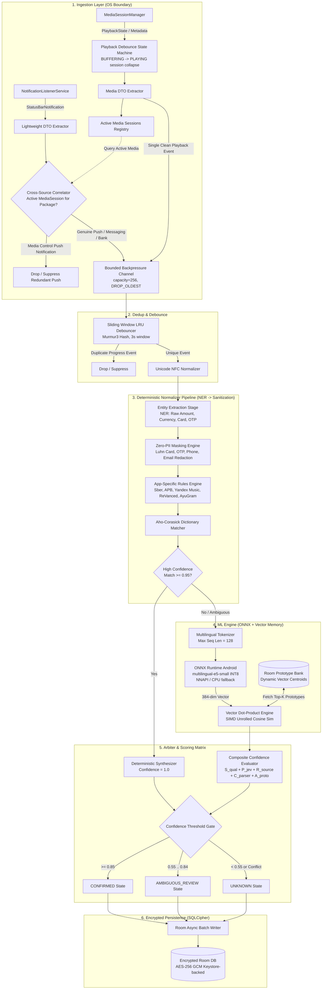
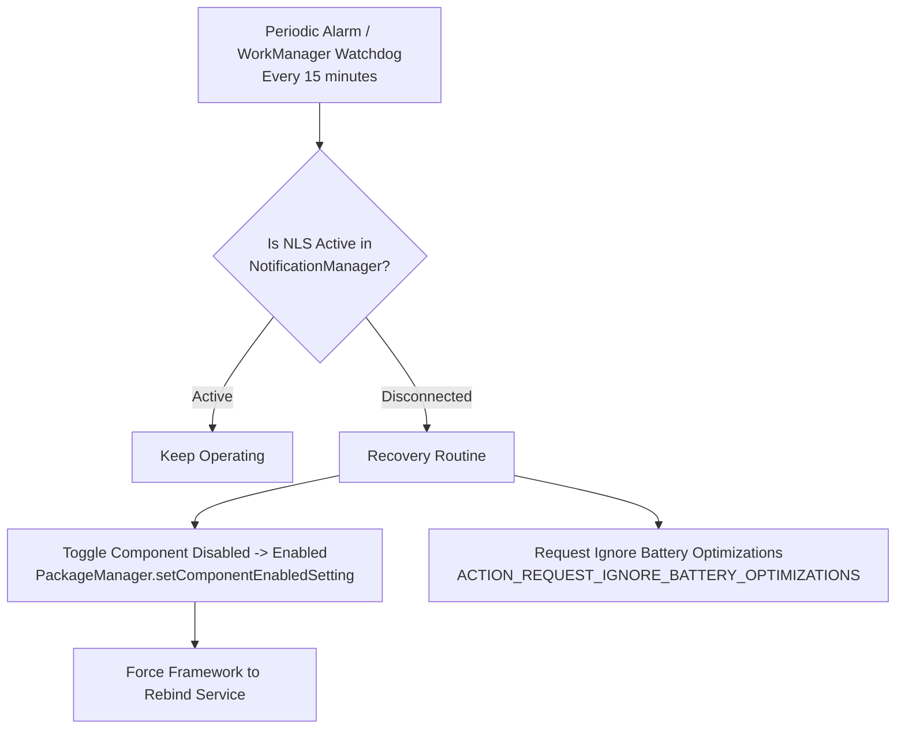
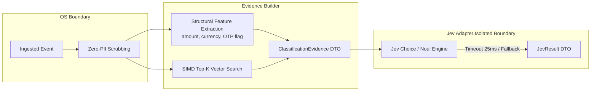
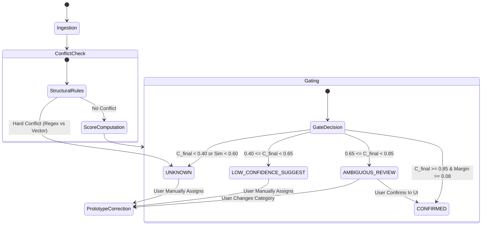
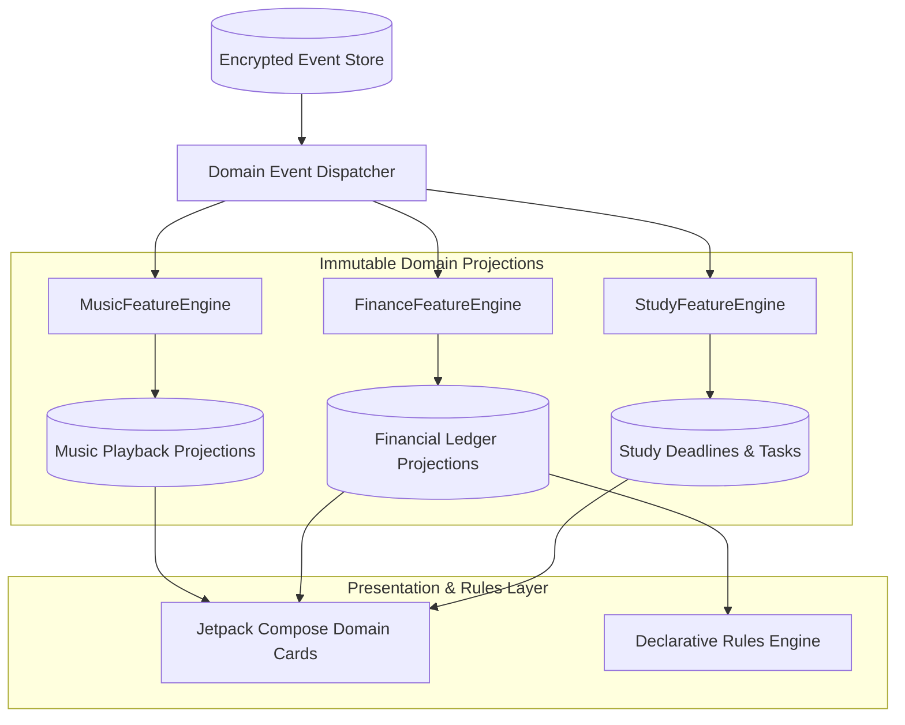
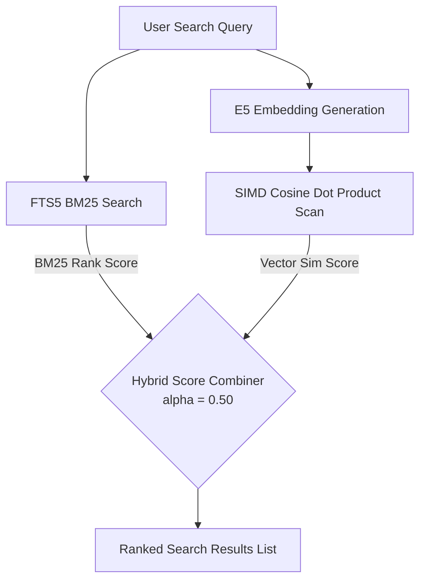
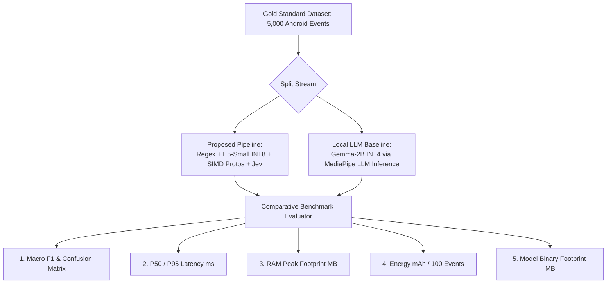

# Android Event Engine — System Architecture & Technical Specification

**Document Version:** 1.0.0-PROD  
**Author:** Lead System Architect & Technical Advisor  
**Status:** APPROVED FOR IMPLEMENTATION  
**Target Environment:** Android 8.0+ (API Level 26–35), ARM64-v8a / x86_64  
**Primary Stack:** Kotlin 2.0+, Coroutines & Flow, Jetpack Room (SQLCipher), ONNX Runtime Mobile, Android Keystore  

---

## Table of Contents
1. [Executive Architectural Summary](#1-executive-architectural-summary)
2. [End-to-End Pipeline & System Topology](#2-end-to-end-pipeline--system-topology)
3. [Unified Data Contracts & Room Schema (`EventEntity`)](#3-unified-data-contracts--room-schema-evententity)
4. [Ingestion Layer Architecture & OS Resilience](#4-ingestion-layer-architecture--os-resilience)
   - [4.3 MediaSession Ingestion, Debounce State Machine & Cross-Source Correlator](#43-mediasession-ingestion-debounce-state-machine--cross-source-correlator)
5. [Deterministic Normalizer Pipeline](#5-deterministic-normalizer-pipeline)
   - [5.2 Deterministic Normalizer Architecture: Entity Extraction Before PII Masking](#52-deterministic-normalizer-architecture-entity-extraction-before-pii-masking)
   - [5.3 Concrete Rule Specifications for Target Ecosystem Apps](#53-concrete-rule-specifications-for-target-ecosystem-apps)
6. [ONNX Runtime Android & Local Prototype Bank](#6-onnx-runtime-android--local-prototype-bank)
   - [6.1 ONNX Runtime Mobile Integration & WordPiece Tokenizer](#61-onnx-runtime-mobile-integration-specification)
   - [6.2 Room Prototype Bank Specification](#62-room-prototype-bank-specification)
   - [6.3 Pure Kotlin In-Memory Top-K Cosine Similarity Engine](#63-pure-kotlin-in-memory-top-k-cosine-similarity-engine)
   - [6.4 Prototype Consolidation, Half-Life Decay & Self-Learning Invariants](#64-prototype-consolidation-half-life-decay--self-learning-invariants)
7. [Sprint 2: Jev Integration, Evidence Contract & Composite Confidence Engine](#7-sprint-2-jev-integration-evidence-contract--composite-confidence-engine)
   - [7.1 Jev Evidence Contract & Adapter Specification](#71-jev-evidence-contract--adapter-specification)
   - [7.2 Calibrated Logistic Composite Confidence Engine](#72-calibrated-logistic-composite-confidence-engine)
   - [7.3 State Transition Matrix, Conflict Policy & Deterministic Unknown Triggers](#73-state-transition-matrix-conflict-policy--deterministic-unknown-triggers)
   - [7.4 Self-Learning Feedback Loop & Provenance Tracking](#74-self-learning-feedback-loop--provenance-tracking)
8. [Sprint 3: Continuous Personalization & Product Hypotheses H1–H8](#8-sprint-3-continuous-personalization--product-hypotheses-h1h8)
   - [8.1 Prototype Scope Isolation (`GLOBAL_SEED` vs `PERSONAL`)](#81-prototype-scope-isolation-global_seed-vs-personal)
   - [8.2 Product Hypotheses H1–H8 Verification Protocol](#82-product-hypotheses-h1h8-verification-protocol)
9. [Sprint 4: Domain Feature Engines, Declarative DSL & Hybrid Search](#9-sprint-4-domain-feature-engines-declarative-dsl--hybrid-search)
   - [9.1 Domain Feature Engines Architecture Overview](#91-domain-feature-engines-architecture-overview)
   - [9.2 MusicFeatureEngine & Universal Synced Lyrics / Subtitles Engine](#92-musicfeatureengine--universal-synced-lyrics--subtitles-engine)
   - [9.3 FinanceFeatureEngine & Integer Minor Unit Accounting](#93-financefeatureengine--integer-minor-unit-accounting)
   - [9.4 StudyFeatureEngine & Local Temporal Resolver](#94-studyfeatureengine--local-temporal-resolver)
   - [9.5 Declarative Rules Engine (Whitelisted AST / JSON DSL)](#95-declarative-rules-engine-whitelisted-ast--json-dsl)
   - [9.6 SQLite FTS5 + SIMD Vector Hybrid Retrieval Engine](#96-sqlite-fts5--simd-vector-hybrid-retrieval-engine)
10. [Sprint 5: Hardening, Latency, Battery & Security Architecture](#10-sprint-5-hardening-latency-battery--security-architecture)
    - [10.1 Decoupled Latency Budget Breakdown (<100ms)](#101-decoupled-latency-budget-breakdown-100ms)
    - [10.2 Energy Budget Profiling (<1.5% / 24h) via Battery Historian](#102-energy-budget-profiling-15--24h-via-battery-historian)
    - [10.3 Zero-PII In-Memory Masking Engine & Bytecode Stripping](#103-zero-pii-in-memory-masking-engine--bytecode-stripping)
    - [10.4 Hardware-Backed SQLCipher Key Derivation via Android Keystore](#104-hardware-backed-sqlcipher-key-derivation-via-android-keystore)
    - [10.5 Comprehensive Classification Quality Matrix & ECE Calibration](#105-comprehensive-classification-quality-matrix--ece-calibration)
11. [Sprint 6: Commercialization, PMF & Production Dogfooding](#11-sprint-6-commercialization-pmf--production-dogfooding)
    - [11.1 Free vs Pro Privacy-Preserving Feature Matrix](#111-free-vs-pro-privacy-preserving-feature-matrix)
    - [11.2 PMF Signal Tracking & Local Dogfooding Protocol](#112-pmf-signal-tracking--local-dogfooding-protocol)
12. [Section 12: Production STOP Kill-Triggers & Scientific Hypothesis Validation](#12-section-12-production-stop-kill-triggers--scientific-hypothesis-validation)
    - [12.1 Production STOP Kill-Triggers (Item 33)](#121-production-stop-kill-triggers-item-33)
    - [12.2 Architectural Note on Item 39](#122-architectural-note-on-item-39)
    - [12.3 Scientific Hypothesis: Prototype Cascade vs Local LLM (Item 40)](#123-scientific-hypothesis-prototype-cascade-vs-local-llm-item-40)
13. [Module Structure & Implementation Roadmap](#13-module-structure--implementation-roadmap)

---

## 1. Executive Architectural Summary

The **Android Event Engine** is a high-throughput, low-latency, privacy-preserving background subsystem designed to intercept, normalize, classify, and persist OS-level signals (Push Notifications, Media Sessions, System Broadcasts) on mobile devices.

### Core Architectural Axioms
1. **Zero-Cloud / Local-First**: All classification, embedding extraction, and persistence occur 100% on-device. No raw user data, telemetry, or notifications ever leave the device.
2. **Deterministic Priority (Fail-Fast ML)**: 80%+ of incoming signals match deterministic templates. Running an ONNX transformer on every event destroys battery life. ML is treated as a secondary fallback when deterministic rule chains are ambiguous.
3. **Aggressive OS Survival**: The engine withstands OEM aggressive process killers (Xiaomi HyperOS, Huawei EMUI, Samsung OneUI) and IPC buffer exhaustion (`TransactionTooLargeException`) via non-blocking bounded backpressure queues and unbind-recovery watchdogs.
4. **Zero-PII Leakage**: All logs, crash traces, and diagnostics are mathematically stripped of credentials, card numbers, OTPs, and personal identity before entering any buffer. Storage is encrypted with SQLCipher via Android Keystore.
5. **Strict Mutating Confirmation Invariant (Data Safety Gate)**: Любые действия в интерфейсе пользователя или сервисных сценариях, приводящие к деструктивному изменению состояния базы данных или сбросу настроек (полная очистка `clearAllEvents`, удаление единичных записей `deleteEventById`, сброс кэша), строго требуют явного модального подтверждения пользователя (`AlertDialog`). Деструктивные мутации по единичному нажатию без подтверждения запрещены архитектурным стандартом.
6. **Raw Event Immutability (Append-Only Event Store)**: Исходное событие (`EventEntity.rawPayload`, `timestamp`, `sourcePackage`) неизменяемо после первичного сохранения. Нормализация, извлечение сущностей, маскирование PII и классификация формируют строго *производные представления (derived projections)* и отдельные версионированные записи результатов (`ClassificationResult`, `CorrectionEventEntity`), не мутируя исходный исторический факт.
7. **Strict Anti-Confirmation-Bias Invariant (Ground Truth Hierarchy)**: Механизм самообучения (`Self-Learning Loop`) категорически изолирован от псевдо-лейблинга собственных автоматических предсказаний. Векторные центроиды адаптируются *исключительно* на основе эксплицитных пользовательских правок (`isUserCorrected == true`) или явных подтверждений в интерфейсе. Иерархия истинности строго зафиксирована:
   $$\text{User Label} \succ \text{Deterministic Rule} \succ \text{Validated ML/Jev Classifier} \succ \text{Heuristic} \succ \text{UNKNOWN}$$
8. **Decoupled Ingestion vs Asynchronous Domain Projections (PENDING State)**: Приём событий (`Ingestion Pipeline`: `persist raw -> classify`) строго отделен от тяжелых доменных проекций (`MusicFeatureEngine`, `FinanceFeatureEngine`, `StudyFeatureEngine`). При пиковых нагрузках или кратковременной перегрузке ONNX-сессии событие мгновенно фиксируется в Room со статусом `classification_state = PENDING` и дорабатывается фоновым воркером без задержки OS Binder-потока.

---

## 2. End-to-End Pipeline & System Topology



---

## 3. Unified Data Contracts & Room Schema (`EventEntity`)

The database persistence layer is built around a single, highly indexed polymorphic entity `EventEntity`, engineered for high query speed, FTS full-text search capability, and low serialization overhead.

### 3.1 Room Entity Definition (`EventEntity.kt`)

```kotlin
package com.antigravity.engine.data.local.entity

import androidx.room.ColumnInfo
import androidx.room.Entity
import androidx.room.Index
import androidx.room.PrimaryKey
import com.antigravity.engine.domain.model.EventCategory
import com.antigravity.engine.domain.model.EventSource
import com.antigravity.engine.domain.model.EventType

/**
 * Unified persistence entity for all OS events ingested by the engine.
 *
 * Designed with compound indexing for time-series analytics, category filtering,
 * and active-learning retrieval.
 */
@Entity(
    tableName = "events",
    indices = [
        Index(value = ["source_package", "timestamp"], name = "idx_event_pkg_time"),
        Index(value = ["category", "timestamp"], name = "idx_event_cat_time"),
        Index(value = ["event_type", "timestamp"], name = "idx_event_type_time"),
        Index(value = ["classification_state", "timestamp"], name = "idx_event_state_time"),
        Index(value = ["confidence"], name = "idx_event_confidence"),
        Index(value = ["is_user_corrected"], name = "idx_event_corrected")
    ]
)
data class EventEntity(
    @PrimaryKey
    @ColumnInfo(name = "id")
    val id: String,

    @ColumnInfo(name = "timestamp")
    val timestamp: Long,

    @ColumnInfo(name = "source")
    val source: EventSource,

    @ColumnInfo(name = "source_package")
    val sourcePackage: String,

    @ColumnInfo(name = "event_type")
    val eventType: EventType,

    @ColumnInfo(name = "classification_state", defaultValue = "CONFIRMED")
    val classificationState: ClassificationState = ClassificationState.CONFIRMED,

    @ColumnInfo(name = "raw_payload")
    val rawPayload: String,

    @ColumnInfo(name = "normalized_text")
    val normalizedText: String,

    @ColumnInfo(name = "structured_data")
    val structuredData: String,

    @ColumnInfo(name = "category")
    val category: EventCategory,

    @ColumnInfo(name = "confidence")
    val confidence: Float,

    @ColumnInfo(name = "is_user_corrected", defaultValue = "0")
    val isUserCorrected: Boolean = false,

    @ColumnInfo(name = "embedding", typeAffinity = ColumnInfo.BLOB)
    val embedding: ByteArray? = null
) {
    override fun equals(other: Any?): Boolean {
        if (this === other) return true
        if (javaClass != other?.javaClass) return false
        other as EventEntity
        return id == other.id
    }

    override fun hashCode(): Int = id.hashCode()
}
```

### 3.2 Domain Enums & Model Contracts

```kotlin
package com.antigravity.engine.domain.model

import kotlinx.serialization.Serializable

enum class EventSource {
    NOTIFICATION,
    MEDIA_SESSION,
    SYSTEM_BROADCAST,
    ACCESSIBILITY,
    MANUAL_INJECTION
}

enum class EventType {
    TRANSACTION,
    MESSAGING_CHAT,
    MEDIA_PLAYBACK,
    NAVIGATION,
    CALENDAR_REMINDER,
    SYSTEM_ALERT,
    AUTHENTICATION_OTP,
    STUDY_EVENT,
    ADVERTISEMENT,
    UNKNOWN
}

enum class ClassificationState {
    PENDING,            // Immediate persist state during ONNX/Jev peak load
    CONFIRMED,          // Composite confidence >= 0.85 and no conflict
    AMBIGUOUS_REVIEW,   // Composite confidence 0.65..0.84 (actionable review)
    LOW_SUGGEST,        // Composite confidence 0.40..0.64 (tentative suggestion)
    UNKNOWN             // Low confidence (< 0.40), OOD, or signal conflict
}

/**
 * Canonical taxonomy matching dataset/schema.json.
 * Supports hierarchical serialization (e.g. "finance.expense.food").
 */
enum class EventCategory(val rawKey: String) {
    FINANCE_INCOME("finance.income"),
    FINANCE_EXPENSE_FOOD("finance.expense.food"),
    FINANCE_EXPENSE_TRANSPORT("finance.expense.transport"),
    FINANCE_EXPENSE_SHOPPING("finance.expense.shopping"),
    FINANCE_TRANSFER("finance.transfer"),
    MUSIC("music"),
    STUDY_LESSON("study.lesson"),
    STUDY_DEADLINE("study.deadline"),
    MESSAGE("message"),
    ADVERTISEMENT("advertisement"),
    AUTHENTICATION("authentication"),
    OTHER("other"),
    UNKNOWN("unknown");

    companion object {
        fun fromRawKey(key: String): EventCategory =
            entries.firstOrNull { it.rawKey.equals(key, ignoreCase = true) } ?: UNKNOWN
    }
}

/**
 * Polymorphic strongly-typed payload contracts serialized to JSON in EventEntity.structuredData.
 */
@Serializable
sealed interface StructuredPayload {

    @Serializable
    data class Transaction(
        val amount: Double? = null,
        val currency: String? = null,
        val merchant: String? = null,
        val sender: String? = null,
        val recipient: String? = null,
        val balance: Double? = null,
        val cardLast4: String? = null
    ) : StructuredPayload

    @Serializable
    data class Media(
        val artist: String? = null,
        val track: String? = null,
        val album: String? = null,
        val playbackState: String? = null, // PLAYING, PAUSED, STOPPED
        val durationMs: Long? = null
    ) : StructuredPayload

    @Serializable
    data class Communication(
        val sender: String? = null,
        val channel: String? = null,
        val threadId: String? = null
    ) : StructuredPayload

    @Serializable
    data class Authentication(
        val authCode: String? = null,
        val targetService: String? = null,
        val expiryMinutes: Int? = null
    ) : StructuredPayload

    @Serializable
    data class Study(
        val subject: String? = null,
        val deadline: String? = null,
        val assignmentTitle: String? = null
    ) : StructuredPayload

    @Serializable
    data class Generic(
        val properties: Map<String, String> = emptyMap()
    ) : StructuredPayload
}
```

### 3.3 Optimized Type Converters & Vector BLOB Serialization

Vectors are stored as raw Little-Endian binary IEEE 754 floats (`384 * 4 = 1536 bytes`) to eliminate the massive JSON CPU parsing overhead:

```kotlin
package com.antigravity.engine.data.local.converters

import androidx.room.TypeConverter
import com.antigravity.engine.domain.model.EventCategory
import com.antigravity.engine.domain.model.EventSource
import com.antigravity.engine.domain.model.EventType
import java.nio.ByteBuffer
import java.nio.ByteOrder

class EventConverters {

    @TypeConverter
    fun fromSource(value: EventSource): String = value.name

    @TypeConverter
    fun toSource(value: String): EventSource = runCatching {
        EventSource.valueOf(value)
    }.getOrDefault(EventSource.NOTIFICATION)

    @TypeConverter
    fun fromType(value: EventType): String = value.name

    @TypeConverter
    fun toType(value: String): EventType = runCatching {
        EventType.valueOf(value)
    }.getOrDefault(EventType.UNKNOWN)

    @TypeConverter
    fun fromCategory(value: EventCategory): String = value.rawKey

    @TypeConverter
    fun toCategory(value: String): EventCategory = EventCategory.fromRawKey(value)

    /**
     * Converts FloatArray (384-dim) to 1536-byte raw BLOB.
     */
    @TypeConverter
    fun fromEmbedding(vector: FloatArray?): ByteArray? {
        if (vector == null) return null
        val buffer = ByteBuffer.allocate(vector.size * 4).order(ByteOrder.LITTLE_ENDIAN)
        for (f in vector) {
            buffer.putFloat(f)
        }
        return buffer.array()
    }

    /**
     * Converts 1536-byte raw BLOB back into FloatArray (384-dim).
     */
    @TypeConverter
    fun toEmbedding(blob: ByteArray?): FloatArray? {
        if (blob == null || blob.isEmpty()) return null
        val buffer = ByteBuffer.wrap(blob).order(ByteOrder.LITTLE_ENDIAN)
        val floatCount = blob.size / 4
        val result = FloatArray(floatCount)
        for (i in 0 until floatCount) {
            result[i] = buffer.float
        }
        return result
    }
}
```

### 3.4 Full-Text Search (FTS5) Support Table

To allow sub-millisecond keyword lookup over normalized notifications without scanning large tables:

```sql
CREATE VIRTUAL TABLE IF NOT EXISTS events_fts USING fts5(
    content='events',
    content_rowid='rowid',
    normalized_text,
    source_package,
    tokenize='unicode61 remove_diacritics 2'
);

-- Triggers to synchronize FTS index with the primary table
CREATE TRIGGER IF NOT EXISTS events_ai AFTER INSERT ON events BEGIN
  INSERT INTO events_fts(rowid, normalized_text, source_package) 
  VALUES (new.rowid, new.normalized_text, new.source_package);
END;

CREATE TRIGGER IF NOT EXISTS events_ad AFTER DELETE ON events BEGIN
  INSERT INTO events_fts(events_fts, rowid, normalized_text, source_package) 
  VALUES('delete', old.rowid, old.normalized_text, old.source_package);
END;

CREATE TRIGGER IF NOT EXISTS events_au AFTER UPDATE ON events BEGIN
  INSERT INTO events_fts(events_fts, rowid, normalized_text, source_package) 
  VALUES('delete', old.rowid, old.normalized_text, old.source_package);
  INSERT INTO events_fts(rowid, normalized_text, source_package) 
  VALUES (new.rowid, new.normalized_text, new.source_package);
END;
```

---

## 4. Ingestion Layer Architecture & OS Resilience

Android background services operate in an increasingly hostile runtime environment. The Ingestion Layer guarantees zero memory leaks, zero Binder transaction failures, and continuous survival on aggressive Chinese/custom OEMs.

### 4.1 Binder Transaction Limit & Zero-Leak DTO Extraction

Android's Binder IPC transaction buffer is capped at **1MB for all ongoing IPCs per process**. A single rich notification with an embedded large bitmap (`Notification.BigPictureStyle`) will throw `TransactionTooLargeException` or crash the system server if retained.

**Strict Extraction Rule**: Within `onNotificationPosted()`, all data must be extracted into a POJO, and the original `StatusBarNotification` and `Notification` objects must be dropped immediately for garbage collection.

```kotlin
package com.antigravity.engine.ingestion.model

/**
 * Lightweight, detached Data Transfer Object.
 * Free of Android UI classes (RemoteViews, Icon, Bitmap, PendingIntent).
 */
data class RawNotificationDto(
    val key: String,
    val packageName: String,
    val postTime: Long,
    val title: String,
    val text: String,
    val subText: String?,
    val bigText: String?,
    val category: String?,
    val template: String?,
    val isOngoing: Boolean,
    val extrasDump: Map<String, String>
)
```

```kotlin
package com.antigravity.engine.ingestion.service

import android.app.Notification
import android.service.notification.NotificationListenerService
import android.service.notification.StatusBarNotification
import com.antigravity.engine.ingestion.channel.EventIngestionQueue
import com.antigravity.engine.ingestion.model.RawNotificationDto
import kotlinx.coroutines.CoroutineScope
import kotlinx.coroutines.Dispatchers
import kotlinx.coroutines.SupervisorJob
import kotlinx.coroutines.launch

class EngineNotificationListenerService : NotificationListenerService() {

    private val serviceScope = CoroutineScope(SupervisorJob() + Dispatchers.Default)

    override fun onNotificationPosted(sbn: StatusBarNotification?) {
        if (sbn == null) return

        // 1. Instant extraction into isolated DTO
        val dto = extractSafeDto(sbn)

        // 2. Dispatch to non-blocking bounded channel
        serviceScope.launch {
            EventIngestionQueue.offerNotification(dto)
        }
    }

    private fun extractSafeDto(sbn: StatusBarNotification): RawNotificationDto {
        val notification = sbn.notification
        val extras = notification.extras

        val title = extras.getCharSequence(Notification.EXTRA_TITLE)?.toString().orEmpty()
        val text = extras.getCharSequence(Notification.EXTRA_TEXT)?.toString().orEmpty()
        val subText = extras.getCharSequence(Notification.EXTRA_SUB_TEXT)?.toString()
        val bigText = extras.getCharSequence(Notification.EXTRA_BIG_TEXT)?.toString()

        // Strip dangerous parcelable types (Bitmaps, PendingIntents) from extras
        val safeExtras = mutableMapOf<String, String>()
        for (key in extras.keySet()) {
            val value = extras.get(key)
            if (value is String || value is Number || value is Boolean) {
                safeExtras[key] = value.toString()
            }
        }

        return RawNotificationDto(
            key = sbn.key,
            packageName = sbn.packageName,
            postTime = sbn.postTime,
            title = title,
            text = text,
            subText = subText,
            bigText = bigText,
            category = notification.category,
            template = extras.getString(Notification.EXTRA_TEMPLATE),
            isOngoing = sbn.isOngoing,
            extrasDump = safeExtras
        )
    }
}
```

### 4.2 Non-Blocking Backpressure Channel

Unbounded queues during notification floods (e.g. instant messaging synchronization) cause rapid heap inflation and OOM. The ingestion layer routes events through a strictly bounded channel with a `DROP_OLDEST` strategy:

```kotlin
package com.antigravity.engine.ingestion.channel

import com.antigravity.engine.ingestion.model.RawNotificationDto
import kotlinx.coroutines.channels.BufferOverflow
import kotlinx.coroutines.channels.Channel
import kotlinx.coroutines.flow.Flow
import kotlinx.coroutines.flow.receiveAsFlow

object EventIngestionQueue {
    private const val BUFFER_CAPACITY = 256

    private val notificationChannel = Channel<RawNotificationDto>(
        capacity = BUFFER_CAPACITY,
        onBufferOverflow = BufferOverflow.DROP_OLDEST
    )

    fun offerNotification(dto: RawNotificationDto): Boolean {
        return notificationChannel.trySend(dto).isSuccess
    }

    fun observeNotifications(): Flow<RawNotificationDto> {
        return notificationChannel.receiveAsFlow()
    }
}
```

### 4.3 MediaSession Ingestion, Debounce State Machine & Cross-Source Correlator

Media playback in Android produces two parallel, asynchronous streams:
1. Low-level **`MediaSession`** events (via `MediaController.Callback` notifying track metadata and playback states: `STATE_BUFFERING`, `STATE_PLAYING`, `STATE_PAUSED`).
2. High-level **Push Notifications / Lockscreen Player Controls** emitted by the media app into the notification shade (e.g., ongoing notification with play/pause/skip actions).

Without architectural correlation, this dual stream triggers race conditions, duplicate database entries, and spamming of redundant notifications.

#### 4.3.1 Active Media Sessions Registry & Cross-Source Correlator

The **`ActiveMediaRegistry`** maintains the real-time set of packages currently holding an active or ongoing `MediaSession`. When `NotificationListenerService.onNotificationPosted()` intercepts an incoming notification, it consults the registry before processing:

```kotlin
package com.antigravity.engine.ingestion.correlator

import com.antigravity.engine.ingestion.model.RawNotificationDto
import java.util.concurrent.ConcurrentHashMap

object ActiveMediaRegistry {
    // Maps packageName -> ActiveSessionState
    private val activeMediaPackages = ConcurrentHashMap<String, Long>()

    fun registerActiveMedia(packageName: String) {
        activeMediaPackages[packageName] = System.currentTimeMillis()
    }

    fun unregisterMedia(packageName: String) {
        activeMediaPackages.remove(packageName)
    }

    fun hasActiveSession(packageName: String): Boolean {
        val lastSeen = activeMediaPackages[packageName] ?: return false
        // Consider active if updated within the last 60 seconds
        return (System.currentTimeMillis() - lastSeen) < 60_000L
    }
}

/**
 * Cross-Source Correlator: Suppresses redundant media control push notifications
 * emitted by music players when a MediaSession is actively handling playback state.
 */
class CrossSourceCorrelator {

    private val knownMediaPackages = setOf(
        "com.spotify.music",
        "ru.yandex.music",
        "app.revanced.android.youtube",
        "com.google.android.apps.youtube.music",
        "org.videolan.vlc",
        "com.maxmpz.audioplayer",
        "com.soundcloud.android",
        "com.apple.android.music"
    )

    fun shouldSuppressNotification(dto: RawNotificationDto): Boolean {
        val pkg = dto.packageName.lowercase()

        // If package is an active media player
        if (knownMediaPackages.contains(pkg) || ActiveMediaRegistry.hasActiveSession(pkg)) {
            // Check if this notification is a media control notification
            val isMediaTemplate = dto.template?.contains("MediaStyle", ignoreCase = true) == true
            val isOngoing = dto.isOngoing
            val hasPlayerCategory = dto.category == "transport" || dto.category == "service"

            if (isMediaTemplate || (isOngoing && hasPlayerCategory)) {
                // Suppress redundant push: MediaSessionManager is the authoritative source of truth!
                return true
            }
        }
        return false
    }
}
```

#### 4.3.2 Playback Debounce State Machine (BUFFERING -> PLAYING Session Collapse)

Streaming applications (Yandex Music, Spotify, ReVanced) rapidly cycle through transitional states when loading tracks:
`STATE_NONE` $\rightarrow$ `STATE_CONNECTING` $\rightarrow$ `STATE_BUFFERING` $\rightarrow$ `STATE_PLAYING` (often within 200–600 ms).

Recording each intermediate state creates fragmented, noisy records. The **`PlaybackStateMachine`** collapses transitional states into a single unified playback session:

```kotlin
package com.antigravity.engine.ingestion.media

import android.media.MediaMetadata
import android.media.session.PlaybackState
import kotlinx.coroutines.*
import java.util.concurrent.ConcurrentHashMap

enum class UnifiedPlaybackState {
    IDLE,
    BUFFERING,
    PLAYING,
    PAUSED,
    STOPPED
}

data class PlaybackSession(
    val packageName: String,
    val trackTitle: String?,
    val artist: String?,
    val album: String?,
    val durationMs: Long?,
    val state: UnifiedPlaybackState,
    val sessionStartTime: Long
)

class PlaybackDebounceStateMachine(
    private val scope: CoroutineScope,
    private val debounceWindowMs: Long = 700L,
    private val onSessionCommitted: suspend (PlaybackSession) -> Unit
) {
    private val pendingBufferJobs = ConcurrentHashMap<String, Job>()
    private val currentSessions = ConcurrentHashMap<String, PlaybackSession>()

    fun onPlaybackStateTransition(
        packageName: String,
        rawState: Int,
        metadata: MediaMetadata?
    ) {
        val title = metadata?.getString(MediaMetadata.METADATA_KEY_TITLE)?.trim()
        val artist = metadata?.getString(MediaMetadata.METADATA_KEY_ARTIST)?.trim()
        val album = metadata?.getString(MediaMetadata.METADATA_KEY_ALBUM)?.trim()
        val duration = metadata?.getLong(MediaMetadata.METADATA_KEY_DURATION)

        when (rawState) {
            PlaybackState.STATE_BUFFERING,
            PlaybackState.STATE_CONNECTING -> {
                // Cancel previous commit and wait for PLAYING confirmation
                pendingBufferJobs[packageName]?.cancel()
                pendingBufferJobs[packageName] = scope.launch {
                    delay(debounceWindowMs)
                    // If no PLAYING arrived within window, commit as BUFFERING
                    val session = PlaybackSession(
                        packageName = packageName,
                        trackTitle = title,
                        artist = artist,
                        album = album,
                        durationMs = duration,
                        state = UnifiedPlaybackState.BUFFERING,
                        sessionStartTime = System.currentTimeMillis()
                    )
                    currentSessions[packageName] = session
                    onSessionCommitted(session)
                }
            }

            PlaybackState.STATE_PLAYING -> {
                // Cancel buffering debounce job — collapse BUFFERING into PLAYING!
                pendingBufferJobs[packageName]?.cancel()
                pendingBufferJobs.remove(packageName)

                val existing = currentSessions[packageName]
                val isSameTrack = existing?.trackTitle == title && existing.artist == artist
                val isAlreadyPlaying = existing?.state == UnifiedPlaybackState.PLAYING

                if (isSameTrack && isAlreadyPlaying) {
                    // Redundant tick during normal playback; skip persistence
                    return
                }

                val session = PlaybackSession(
                    packageName = packageName,
                    trackTitle = title,
                    artist = artist,
                    album = album,
                    durationMs = duration,
                    state = UnifiedPlaybackState.PLAYING,
                    sessionStartTime = System.currentTimeMillis()
                )
                currentSessions[packageName] = session
                scope.launch { onSessionCommitted(session) }
            }

            PlaybackState.STATE_PAUSED -> {
                pendingBufferJobs[packageName]?.cancel()
                pendingBufferJobs.remove(packageName)

                val session = PlaybackSession(
                    packageName = packageName,
                    trackTitle = title,
                    artist = artist,
                    album = album,
                    durationMs = duration,
                    state = UnifiedPlaybackState.PAUSED,
                    sessionStartTime = System.currentTimeMillis()
                )
                currentSessions[packageName] = session
                scope.launch { onSessionCommitted(session) }
            }

            PlaybackState.STATE_STOPPED,
            PlaybackState.STATE_NONE -> {
                pendingBufferJobs[packageName]?.cancel()
                pendingBufferJobs.remove(packageName)
                currentSessions.remove(packageName)
            }
        }
    }
}
```

### 4.4 Defense Against Aggressive Process Killers (HyperOS, EMUI, OneUI)

Custom Android distributions run aggressive thermal and power engines (MIUI/HyperOS `PowerKeeper`, Huawei `StartupNormalAppListActivity`, Samsung `PhantomProcessKiller`) that unbind listeners or terminate non-foreground processes.



#### Countermeasure 1: The NLS Component Re-bind Trick
When Android's `NotificationManagerService` unbinds a listener after a crash or memory pressure, it does not rebind automatically. Toggling the component status in `PackageManager` forces the system server to refresh the listener list and re-establish the IPC binder:

```kotlin
package com.antigravity.engine.ingestion.resilience

import android.content.ComponentName
import android.content.Context
import android.content.pm.PackageManager
import com.antigravity.engine.ingestion.service.EngineNotificationListenerService

object NotificationListenerWatchdog {

    fun forceRebindListener(context: Context) {
        val componentName = ComponentName(context, EngineNotificationListenerService::class.java)
        val pm = context.packageManager

        // Step 1: Temporarily disable component
        pm.setComponentEnabledSetting(
            componentName,
            PackageManager.COMPONENT_ENABLED_STATE_DISABLED,
            PackageManager.DONT_KILL_APP
        )

        // Step 2: Re-enable component to trigger NotificationManagerService binder reconnect
        pm.setComponentEnabledSetting(
            componentName,
            PackageManager.COMPONENT_ENABLED_STATE_ENABLED,
            PackageManager.DONT_KILL_APP
        )
    }
}
```

#### Countermeasure 2: OEM Auto-Start & Power Whitelist Routing
Direct routing to vendor-specific battery setting screens:

```kotlin
package com.antigravity.engine.ingestion.resilience

import android.content.ComponentName
import android.content.Context
import android.content.Intent
import android.net.Uri
import android.os.Build
import android.os.PowerManager
import android.provider.Settings

object OemResilienceManager {

    fun requestBatteryExemption(context: Context) {
        val pm = context.getSystemService(Context.POWER_SERVICE) as PowerManager
        if (!pm.isIgnoringBatteryOptimizations(context.packageName)) {
            val intent = Intent(Settings.ACTION_REQUEST_IGNORE_BATTERY_OPTIMIZATIONS).apply {
                data = Uri.parse("package:${context.packageName}")
                addFlags(Intent.FLAG_ACTIVITY_NEW_TASK)
            }
            context.startActivity(intent)
        }
    }

    fun openOemAutostartSettings(context: Context): Boolean {
        val oemIntents = listOf(
            // Xiaomi / HyperOS
            Intent().setComponent(ComponentName("com.miui.securitycenter", "com.miui.permcenter.autostart.AutoStartManagementActivity")),
            // Huawei
            Intent().setComponent(ComponentName("com.huawei.systemmanager", "com.huawei.systemmanager.startupmgr.ui.StartupNormalAppListActivity")),
            // Samsung
            Intent().setComponent(ComponentName("com.samsung.android.lool", "com.samsung.android.sm.ui.battery.BatteryActivity")),
            // Oppo
            Intent().setComponent(ComponentName("com.coloros.safecenter", "com.coloros.safecenter.permission.startup.StartupAppListActivity")),
            // Vivo
            Intent().setComponent(ComponentName("com.iqoo.secure", "com.iqoo.secure.ui.phoneoptimize.AddWhiteListActivity"))
        )

        for (intent in oemIntents) {
            if (context.packageManager.resolveActivity(intent, PackageManager.MATCH_DEFAULT_ONLY) != null) {
                intent.addFlags(Intent.FLAG_ACTIVITY_NEW_TASK)
                context.startActivity(intent)
                return true
            }
        }
        return false
    }
}
```

---

## 5. Deterministic Normalizer Pipeline

The Deterministic Normalizer runs on `Dispatchers.Default` and filters out 80%+ of incoming traffic before touching ONNX Runtime.

### 5.1 Sliding Window Deduplication & Debouncing Engine

Dynamic notifications (e.g. file download percentages, navigation distances, streaming playback scrubbers) fire up to 10 notifications per second. The debouncer uses a 64-bit MurmurHash3 digest over `packageName + title + textPrefix` within a 3-second sliding window.

```kotlin
package com.antigravity.engine.normalizer.debouncer

import java.util.concurrent.ConcurrentHashMap

class SlidingWindowDebouncer(
    private val debounceWindowMs: Long = 3000L
) {
    private val seenHashes = ConcurrentHashMap<Long, Long>()

    fun isDuplicate(packageName: String, title: String, text: String): Boolean {
        val now = System.currentTimeMillis()
        cleanStaleEntries(now)

        val textPrefix = if (text.length > 32) text.substring(0, 32) else text
        val hash = computeHash(packageName, title, textPrefix)

        val lastSeen = seenHashes[hash]
        if (lastSeen != null && (now - lastSeen) < debounceWindowMs) {
            seenHashes[hash] = now
            return true
        }

        seenHashes[hash] = now
        return false
    }

    private fun cleanStaleEntries(now: Long) {
        if (seenHashes.size > 500) {
            seenHashes.entries.removeIf { (now - it.value) > debounceWindowMs }
        }
    }

    private fun computeHash(pkg: String, title: String, prefix: String): Long {
        var h = 1125899906842597L
        val combined = "$pkg|$title|$prefix"
        for (i in 0 until combined.length) {
            h = 31 * h + combined[i].code.toLong()
        }
        return h
    }
}
```

### 5.2 Deterministic Normalizer Architecture

```mermaid
flowchart LR
    In[Raw Notification] --> Clean[Unicode NFC + Whitespace Sanitizer]
    Clean --> PkgRoute[Source Package Matcher]
    PkgRoute --> Regex[Regex Transaction / OTP Matcher]
    Regex --> Aho[Aho-Corasick Keyword Matcher]
    Aho --> Eval{Matched High-Confidence Rule?}
    Eval -->|Yes| OutDet[NormalizerResult.Deterministic]
    Eval -->|No| OutML[NormalizerResult.NeedsML]
### 5.2 Deterministic Normalizer Architecture: Entity Extraction Before PII Masking

> [!CRITICAL]
> **Архитектурный инвариант обработки PII (NER-First Invariant)**:
> Извлечение структурированных сущностей (суммы, валюты, карты, балансы, OTP-коды, имена контрагентов) **СТРОГО** обязано происходить **ДО** того, как текст проходит через маскирование PII (`maskPii`).
> Если выполнить `maskPii` первым, то регулярные выражения классификатора получат вместо `"Код: 54321"` строку `"Код: [REDACTED_OTP]"`, а вместо карты `"*4912"` — `"**** **** **** 4912"`. В результате движок теряет критические данные и не может заполнить `structuredData`.
> 
> **Канонический порядок конвейера**:
> 1. `Unicode NFC Normalization` + удаление невидимых пробелов и zero-width символов.
> 2. `Deterministic Rule Parsing & NER` на сыром очищенном тексте $\rightarrow$ извлечение числовых сумм, валют, кодов, мерчантов в strongly-typed `StructuredPayload`.
> 3. `PII Sanitization` (`maskPii`) над строкой представления $\rightarrow$ получение безопасного `normalizedText` (где OTP, телефоны, email заменены на токены, а карты маскированы по алгоритму Луна).
> 4. `Storage / Dispatch`: В базу Room сохраняются безопасный `normalizedText`, зашифрованный `structuredData` и детерминированная категория.

```mermaid
flowchart TD
    Raw[Raw Notification / Input Strings] --> NFC[1. Unicode NFC Normalization & Whitespace Collapse]
    NFC --> CleanRawText[Clean Raw Text]
    
    subgraph PreMaskNER ["2. Entity Extraction Stage (BEFORE PII MASKING)"]
        CleanRawText --> AppDetect[App Registry / Package Detector]
        AppDetect --> SpecificRules{App-Specific Rule Engine}
        SpecificRules --> SberRule[SberBank / Sber Spasibo Rule]
        SpecificRules --> ApbRule[Agroprombank / APB Online Rule]
        SpecificRules --> YandexMediaRule[Yandex Music / Radio Rule]
        SpecificRules --> RevancedRule[ReVanced / YouTube Rule]
        SpecificRules --> AyugramRule[AyuGram / Telegram Messaging Rule]
        SpecificRules --> GenericNER[Generic Regex: OTP, Amounts, Cards]
        
        SberRule --> ExtractPayload[Build Strongly-Typed StructuredPayload]
        ApbRule --> ExtractPayload
        YandexMediaRule --> ExtractPayload
        RevancedRule --> ExtractPayload
        AyugramRule --> ExtractPayload
        GenericNER --> ExtractPayload
    end

    subgraph MaskingStage ["3. Zero-PII Sanitization Stage"]
        CleanRawText --> LuhnFilter[Luhn Algorithm Card Masker]
        LuhnFilter --> OtpRedact[OTP Scrubber: REDACTED_OTP]
        OtpRedact --> ContactRedact[Phone / Email Redactor]
        ContactRedact --> SafeNormalizedText[Safe Normalized Text]
    end

    ExtractPayload --> Assemble[4. Assemble NormalizerResult]
    SafeNormalizedText --> Assemble
    Assemble --> ResultOut[NormalizerResult.DeterministicMatch OR NeedsMlInference]
```

### 5.3 Concrete Rule Specifications for Target Ecosystem Apps

```kotlin
package com.antigravity.engine.normalizer

import com.antigravity.engine.domain.model.EventCategory
import com.antigravity.engine.domain.model.EventType
import com.antigravity.engine.domain.model.StructuredPayload
import com.antigravity.engine.ingestion.model.RawNotificationDto
import com.antigravity.engine.security.PiiMasker
import kotlinx.serialization.encodeToString
import kotlinx.serialization.json.Json
import java.text.Normalizer
import java.util.regex.Pattern

sealed class NormalizerResult {
    data class DeterministicMatch(
        val normalizedText: String,
        val structuredJson: String,
        val category: EventCategory,
        val eventType: EventType,
        val confidence: Float = 1.0f
    ) : NormalizerResult()

    data class NeedsMlInference(
        val cleanedText: String,
        val sourcePackage: String
    ) : NormalizerResult()
}

class DeterministicNormalizer {

    // Common Generic Patterns
    private val genericOtpPattern = Pattern.compile(
        """(?i)\b(?:код|code|otp|пароль|pin)[\s:]*([0-9]{4,8})\b"""
    )
    private val genericAmountPattern = Pattern.compile(
        """([0-9]+(?:[.,][0-9]{1,2})?)\s*(?:₽|руб|rub|usd|\$|eur|€|prb)""",
        Pattern.CASE_INSENSITIVE
    )

    // 1. Sber Patterns (ru.sberbankmobile)
    private val sberTransferIncomingPattern = Pattern.compile(
        """(?i)(?:перевод\s+от|зачисление|пополнение).*?([0-9]+(?:[.,][0-9]{1,2})?)\s*(?:₽|руб)"""
    )
    private val sberExpensePattern = Pattern.compile(
        """(?i)(?:покупка|списание|оплата|выдача).*?([0-9]+(?:[.,][0-9]{1,2})?)\s*(?:₽|руб)"""
    )
    private val sberCardPattern = Pattern.compile("""(?i)(?:карта|card|\*|••)\s*([0-9]{4})""")

    // 2. Agroprombank APB Online Patterns (com.ftc.faktura.multibank)
    private val apbTransferPattern = Pattern.compile(
        """(?i)(?:Зачисление перевода|Перевод)\s+APB\s+Online:\s*([+-]?[0-9]+(?:[.,][0-9]{2})?)\s*(PRB|USD|EUR|RUB)(?:\s+от\s+([^,.\n]+))?"""
    )
    private val apbPaymentPattern = Pattern.compile(
        """(?i)(?:Оплата|Списание|Платеж)\s+APB\s+Online:\s*([0-9]+(?:[.,][0-9]{2})?)\s*(PRB|USD|EUR|RUB)(?:\s+в\s+([^,.\n]+))?"""
    )

    // 3. Media Patterns: Yandex Music (ru.yandex.music) & ReVanced (app.revanced.android.youtube)
    private val mediaTrackSplitPattern = Pattern.compile("""^(.*?)\s*[-—]\s*(.*)$""")

    // 4. AyuGram / Telegram Patterns (com.radolyn.ayugram, org.telegram.messenger)
    private val ayugramServiceNoisePattern = Pattern.compile(
        """(?i)(?:updating conversation|обновление чатов|соединение|connecting\.\.\.)"""
    )

    fun process(dto: RawNotificationDto): NormalizerResult {
        // Step 1: Normalize Unicode & Collapse Whitespace (RAW, NOT MASKED YET)
        val rawCombined = buildString {
            if (dto.title.isNotBlank()) append(dto.title.trim())
            if (dto.text.isNotBlank()) {
                if (isNotEmpty()) append(" — ")
                append(dto.text.trim())
            }
            if (!dto.bigText.isNullOrBlank() && dto.bigText != dto.text) {
                append(" ").append(dto.bigText.trim())
            }
        }
        val cleanRawText = sanitizeNfc(rawCombined)
        val pkg = dto.packageName.lowercase()

        // Step 2: Extract Entities & Categorize on Raw Text (NER FIRST)

        // Case A: AyuGram / Telegram Service Noise Suppression
        if (pkg.contains("ayugram") || pkg.contains("telegram")) {
            if (ayugramServiceNoisePattern.matcher(cleanRawText).find() || dto.isOngoing) {
                // Drop transient network sync notifications
                val safeText = PiiMasker.mask(cleanRawText)
                return NormalizerResult.DeterministicMatch(
                    normalizedText = safeText,
                    structuredJson = "{}",
                    category = EventCategory.OTHER,
                    eventType = EventType.SYSTEM_ALERT,
                    confidence = 0.99f
                )
            }
        }

        // Case B: Agroprombank (APB Online)
        if (pkg == "com.ftc.faktura.multibank" || cleanRawText.contains("APB Online", ignoreCase = true)) {
            val apbTransferMatcher = apbTransferPattern.matcher(cleanRawText)
            if (apbTransferMatcher.find()) {
                val amountStr = apbTransferMatcher.group(1)?.replace("+", "")?.replace(",", ".")
                val amount = amountStr?.toDoubleOrNull()
                val currency = apbTransferMatcher.group(2) ?: "PRB"
                val sender = apbTransferMatcher.group(3)?.trim()

                val payload = StructuredPayload.Transaction(
                    amount = amount,
                    currency = currency,
                    sender = sender,
                    recipient = "Me"
                )
                val safeText = PiiMasker.mask(cleanRawText)
                return NormalizerResult.DeterministicMatch(
                    normalizedText = safeText,
                    structuredJson = Json.encodeToString(payload),
                    category = EventCategory.FINANCE_TRANSFER,
                    eventType = EventType.TRANSACTION,
                    confidence = 0.99f
                )
            }

            val apbPayMatcher = apbPaymentPattern.matcher(cleanRawText)
            if (apbPayMatcher.find()) {
                val amount = apbPayMatcher.group(1)?.replace(",", ".")?.toDoubleOrNull()
                val currency = apbPayMatcher.group(2) ?: "PRB"
                val merchant = apbPayMatcher.group(3)?.trim()

                val payload = StructuredPayload.Transaction(
                    amount = amount,
                    currency = currency,
                    merchant = merchant
                )
                val safeText = PiiMasker.mask(cleanRawText)
                return NormalizerResult.DeterministicMatch(
                    normalizedText = safeText,
                    structuredJson = Json.encodeToString(payload),
                    category = EventCategory.FINANCE_EXPENSE_SHOPPING,
                    eventType = EventType.TRANSACTION,
                    confidence = 0.98f
                )
            }
        }

        // Case C: SberBank (ru.sberbankmobile)
        if (pkg == "ru.sberbankmobile" || cleanRawText.contains("Сбер", ignoreCase = true)) {
            // Check OTP code from Sber
            val otpMatcher = genericOtpPattern.matcher(cleanRawText)
            if (otpMatcher.find() && (cleanRawText.contains("пароль") || cleanRawText.contains("код"))) {
                val code = otpMatcher.group(1) ?: ""
                val payload = StructuredPayload.Authentication(
                    authCode = code,
                    targetService = "SberBank"
                )
                val safeText = PiiMasker.mask(cleanRawText)
                return NormalizerResult.DeterministicMatch(
                    normalizedText = safeText,
                    structuredJson = Json.encodeToString(payload),
                    category = EventCategory.AUTHENTICATION,
                    eventType = EventType.AUTHENTICATION_OTP,
                    confidence = 0.99f
                )
            }

            // Check Sber Income / Transfer
            val transferMatcher = sberTransferIncomingPattern.matcher(cleanRawText)
            if (transferMatcher.find()) {
                val amount = transferMatcher.group(1)?.replace(",", ".")?.toDoubleOrNull()
                val cardMatcher = sberCardPattern.matcher(cleanRawText)
                val cardLast4 = if (cardMatcher.find()) cardMatcher.group(1) else null

                val payload = StructuredPayload.Transaction(
                    amount = amount,
                    currency = "RUB",
                    cardLast4 = cardLast4
                )
                val safeText = PiiMasker.mask(cleanRawText)
                return NormalizerResult.DeterministicMatch(
                    normalizedText = safeText,
                    structuredJson = Json.encodeToString(payload),
                    category = EventCategory.FINANCE_INCOME,
                    eventType = EventType.TRANSACTION,
                    confidence = 0.98f
                )
            }

            // Check Sber Expense
            val expenseMatcher = sberExpensePattern.matcher(cleanRawText)
            if (expenseMatcher.find()) {
                val amount = expenseMatcher.group(1)?.replace(",", ".")?.toDoubleOrNull()
                val cardMatcher = sberCardPattern.matcher(cleanRawText)
                val cardLast4 = if (cardMatcher.find()) cardMatcher.group(1) else null

                val payload = StructuredPayload.Transaction(
                    amount = amount,
                    currency = "RUB",
                    cardLast4 = cardLast4
                )
                val safeText = PiiMasker.mask(cleanRawText)
                return NormalizerResult.DeterministicMatch(
                    normalizedText = safeText,
                    structuredJson = Json.encodeToString(payload),
                    category = EventCategory.FINANCE_EXPENSE_SHOPPING,
                    eventType = EventType.TRANSACTION,
                    confidence = 0.96f
                )
            }
        }

        // Case D: Media Players (ru.yandex.music, app.revanced.android.youtube)
        if (pkg == "ru.yandex.music" || pkg == "app.revanced.android.youtube") {
            var artist: String? = null
            var track: String? = null

            val splitMatcher = mediaTrackSplitPattern.matcher(dto.title)
            if (splitMatcher.find()) {
                artist = splitMatcher.group(1)?.trim()
                track = splitMatcher.group(2)?.trim()
            } else {
                track = dto.title.ifBlank { dto.text }
                artist = dto.text.takeIf { it != track }
            }

            val payload = StructuredPayload.Media(
                artist = artist,
                track = track,
                playbackState = if (dto.isOngoing) "PLAYING" else "PAUSED"
            )
            val safeText = PiiMasker.mask(cleanRawText)
            return NormalizerResult.DeterministicMatch(
                normalizedText = safeText,
                structuredJson = Json.encodeToString(payload),
                category = EventCategory.MUSIC,
                eventType = EventType.MEDIA_PLAYBACK,
                confidence = 0.99f
            )
        }

        // Case E: Generic High-Priority OTP Rule
        val genericOtpMatcher = genericOtpPattern.matcher(cleanRawText)
        if (genericOtpMatcher.find()) {
            val code = genericOtpMatcher.group(1) ?: ""
            val payload = StructuredPayload.Authentication(
                authCode = code,
                targetService = dto.packageName
            )
            val safeText = PiiMasker.mask(cleanRawText)
            return NormalizerResult.DeterministicMatch(
                normalizedText = safeText,
                structuredJson = Json.encodeToString(payload),
                category = EventCategory.AUTHENTICATION,
                eventType = EventType.AUTHENTICATION_OTP,
                confidence = 0.99f
            )
        }

        // Step 3: Default — Pass to ML Pipeline with Cleaned Safe Text
        val safeText = PiiMasker.mask(cleanRawText)
        return NormalizerResult.NeedsMlInference(
            cleanedText = safeText,
            sourcePackage = dto.packageName
        )
    }

    private fun sanitizeNfc(input: String): String {
        val nfc = Normalizer.normalize(input, Normalizer.Form.NFC)
        return nfc.replace("[\u200B-\u200D\uFEFF]".toRegex(), "")
            .replace("\\s+".toRegex(), " ")
            .trim()
    }
}
```

---

## 6. ONNX Runtime Android & Local Prototype Bank

When deterministic parsing yields no match or low confidence, the event passes into the semantic vector intelligence layer.

### 6.1 ONNX Runtime Mobile Integration Specification

- **Target Model**: `intfloat/multilingual-e5-small` (12-layer Transformer, hidden dimension = 384, vocabulary size $\approx 250\text{k}$).
- **Quantization**: INT8 Dynamic Quantization (`multilingual-e5-small-int8.onnx`, asset size $\approx 45\text{MB}$, RAM working set $\le 35\text{MB}$).
- **Execution Providers**:
  - Primary: Android NNAPI (`OrtSession.SessionOptions.addNnapi()`) taking advantage of Qualcomm NPU / MediaTek APU.
  - Automatic Fallback: Multi-threaded CPU with ARM NEON SIMD vector extensions.
- **Threading Strategy**: `intraOpNumThreads = 2` (pinned to efficiency/mid cores to avoid thermal throttling), `interOpNumThreads = 1`.

#### 6.1.1 On-Device Multilingual WordPiece / SentencePiece Tokenizer

```kotlin
package com.antigravity.engine.ml.tokenizer

import android.content.Context
import java.io.BufferedReader
import java.io.InputStreamReader

data class TokenizerOutput(
    val inputIds: LongArray,
    val attentionMask: LongArray,
    val tokenTypeIds: LongArray
)

/**
 * Pure Kotlin WordPiece tokenizer for multilingual-e5-small.
 * Uses assets/models/vocab.txt. Zero external C++ or Python dependencies.
 */
class BertWordPieceTokenizer(
    private val vocabMap: Map<String, Long>,
    private val maxSeqLength: Int = 128
) {
    companion object {
        const val CLS_TOKEN = "[CLS]"
        const val SEP_TOKEN = "[SEP]"
        const val UNK_TOKEN = "[UNK]"
        const val PAD_TOKEN = "[PAD]"

        fun createFromAssets(context: Context, vocabAssetPath: String = "models/vocab.txt"): BertWordPieceTokenizer {
            val map = HashMap<String, Long>(250_000)
            context.assets.open(vocabAssetPath).use { stream ->
                BufferedReader(InputStreamReader(stream, Charsets.UTF_8)).useLines { lines ->
                    var index = 0L
                    for (line in lines) {
                        val token = line.trim()
                        if (token.isNotEmpty()) {
                            map[token] = index
                        }
                        index++
                    }
                }
            }
            return BertWordPieceTokenizer(map)
        }
    }

    private val clsId = vocabMap[CLS_TOKEN] ?: 101L
    private val sepId = vocabMap[SEP_TOKEN] ?: 102L
    private val unkId = vocabMap[UNK_TOKEN] ?: 100L
    private val padId = vocabMap[PAD_TOKEN] ?: 0L

    /**
     * Tokenizes input text according to e5 query prefix: "passage: <text>" or "query: <text>".
     */
    fun encode(text: String, isQuery: Boolean = false): TokenizerOutput {
        val prefix = if (isQuery) "query: " else "passage: "
        val formatted = prefix + text.lowercase()

        val tokens = mutableListOf<Long>()
        tokens.add(clsId)

        val words = formatted.split("\\s+".toRegex())
        for (word in words) {
            if (tokens.size >= maxSeqLength - 1) break
            tokenizeWord(word, tokens)
        }
        tokens.add(sepId)

        val length = tokens.size.coerceAtMost(maxSeqLength)
        val inputIds = LongArray(maxSeqLength) { padId }
        val attentionMask = LongArray(maxSeqLength) { 0L }
        val tokenTypeIds = LongArray(maxSeqLength) { 0L }

        for (i in 0 until length) {
            inputIds[i] = tokens[i]
            attentionMask[i] = 1L
        }

        return TokenizerOutput(inputIds, attentionMask, tokenTypeIds)
    }

    private fun tokenizeWord(word: String, output: MutableList<Long>) {
        if (vocabMap.containsKey(word)) {
            output.add(vocabMap[word]!!)
            return
        }

        var start = 0
        var isBad = false
        val subTokens = mutableListOf<Long>()

        while (start < word.length) {
            var end = word.length
            var curSubStrId: Long? = null

            while (start < end) {
                var subStr = word.substring(start, end)
                if (start > 0) subStr = "##$subStr"

                if (vocabMap.containsKey(subStr)) {
                    curSubStrId = vocabMap[subStr]
                    break
                }
                end--
            }

            if (curSubStrId == null) {
                isBad = true
                break
            }

            subTokens.add(curSubStrId)
            start = end
        }

        if (isBad) {
            output.add(unkId)
        } else {
            output.addAll(subTokens)
        }
    }
}
```

#### 6.1.2 ONNX Runtime Engine Implementation

```kotlin
package com.antigravity.engine.ml

import android.content.Context
import ai.onnxruntime.OnnxTensor
import ai.onnxruntime.OrtEnvironment
import ai.onnxruntime.OrtSession
import com.antigravity.engine.ml.tokenizer.TokenizerOutput
import java.nio.LongBuffer

class OnnxEmbeddingEngine(
    private val context: Context,
    private val modelAssetPath: String = "models/multilingual-e5-small-int8.onnx"
) {
    private val env: OrtEnvironment = OrtEnvironment.getEnvironment()
    private val session: OrtSession

    init {
        val options = OrtSession.SessionOptions().apply {
            setIntraOpNumThreads(2)
            setInterOpNumThreads(1)
            setMemoryPatternOptimization(true)
            runCatching { addNnapi() } // Safe fallback to CPU if device NNAPI driver is broken
        }

        val modelBytes = context.assets.open(modelAssetPath).use { it.readBytes() }
        session = env.createSession(modelBytes, options)
    }

    /**
     * Executes inference and returns a unit-normalized (L2 norm = 1.0) 384-dimensional vector.
     */
    fun computeEmbedding(tokens: TokenizerOutput): FloatArray {
        val seqLength = tokens.inputIds.size.toLong()
        val shape = longArrayOf(1, seqLength)

        val inputIdsBuffer = LongBuffer.wrap(tokens.inputIds)
        val maskBuffer = LongBuffer.wrap(tokens.attentionMask)
        val typeIdsBuffer = LongBuffer.wrap(tokens.tokenTypeIds)

        val inputIdsTensor = OnnxTensor.createTensor(env, inputIdsBuffer, shape)
        val maskTensor = OnnxTensor.createTensor(env, maskBuffer, shape)
        val typeIdsTensor = OnnxTensor.createTensor(env, typeIdsBuffer, shape)

        val inputs = mapOf(
            "input_ids" to inputIdsTensor,
            "attention_mask" to maskTensor,
            "token_type_ids" to typeIdsTensor
        )

        session.run(inputs).use { results ->
            // Output shape: [1, seqLength, 384]
            @Suppress("UNCHECKED_CAST")
            val tokenEmbeddings = results[0].value as Array<Array<FloatArray>>
            return meanPoolingAndNormalize(tokenEmbeddings[0], tokens.attentionMask)
        }
    }

    private fun meanPoolingAndNormalize(tokenEmbeddings: Array<FloatArray>, mask: LongArray): FloatArray {
        val dim = 384
        val pooled = FloatArray(dim)
        var validTokenCount = 0f

        for (i in mask.indices) {
            if (mask[i] == 1L) {
                validTokenCount += 1f
                for (d in 0 until dim) {
                    pooled[d] += tokenEmbeddings[i][d]
                }
            }
        }

        if (validTokenCount > 0f) {
            for (d in 0 until dim) {
                pooled[d] /= validTokenCount
            }
        }

        // L2 Unit Normalization (crucial: dot product becomes cosine similarity)
        var sumSquares = 0.0
        for (d in 0 until dim) {
            sumSquares += (pooled[d] * pooled[d]).toDouble()
        }
        val norm = Math.sqrt(sumSquares).toFloat().coerceAtLeast(1e-9f)
        for (d in 0 until dim) {
            pooled[d] /= norm
        }

        return pooled
    }
}
```

---

### 6.2 Room Prototype Bank Specification

The **Prototype Bank** is stored in the same local Room/SQLite database as events. It maintains dynamic cluster centroids and canonical few-shot exemplars across categories. No external vector databases (Milvus, Chroma, sqlite-vss) are required.

#### 6.2.1 Prototype Entity (`PrototypeEntity.kt`)

```kotlin
package com.antigravity.engine.data.local.entity

import androidx.room.ColumnInfo
import androidx.room.Entity
import androidx.room.Index
import androidx.room.PrimaryKey
import com.antigravity.engine.domain.model.EventCategory

@Entity(
    tableName = "prototype_bank",
    indices = [
        Index(value = ["category"], name = "idx_proto_category"),
        Index(value = ["sub_category"], name = "idx_proto_subcategory")
    ]
)
data class PrototypeEntity(
    @PrimaryKey
    @ColumnInfo(name = "id")
    val id: String,

    @ColumnInfo(name = "category")
    val category: EventCategory,

    @ColumnInfo(name = "sub_category")
    val subCategory: String,

    @ColumnInfo(name = "label")
    val label: String,

    @ColumnInfo(name = "canonical_text")
    val canonicalText: String,

    @ColumnInfo(name = "embedding", typeAffinity = ColumnInfo.BLOB)
    val embedding: ByteArray, // 1536 bytes (384 IEEE 754 Floats, Little-Endian)

    @ColumnInfo(name = "weight", defaultValue = "1.0")
    val weight: Float = 1.0f,

    @ColumnInfo(name = "support_count", defaultValue = "1")
    val supportCount: Int = 1,

    @ColumnInfo(name = "created_at")
    val createdAt: Long,

    @ColumnInfo(name = "updated_at")
    val updatedAt: Long
)
```

#### 6.2.2 Room Prototype DAO (`PrototypeDao.kt`)

```kotlin
package com.antigravity.engine.data.local.dao

import androidx.room.Dao
import androidx.room.Insert
import androidx.room.OnConflictStrategy
import androidx.room.Query
import com.antigravity.engine.data.local.entity.PrototypeEntity
import com.antigravity.engine.domain.model.EventCategory
import kotlinx.coroutines.flow.Flow

@Dao
interface PrototypeDao {

    @Query("SELECT * FROM prototype_bank")
    suspend fun getAllPrototypes(): List<PrototypeEntity>

    @Query("SELECT * FROM prototype_bank WHERE category = :category")
    suspend fun getPrototypesByCategory(category: EventCategory): List<PrototypeEntity>

    @Query("SELECT * FROM prototype_bank")
    fun observeAllPrototypes(): Flow<List<PrototypeEntity>>

    @Insert(onConflict = OnConflictStrategy.REPLACE)
    suspend fun insertOrUpdate(prototype: PrototypeEntity): Long

    @Insert(onConflict = OnConflictStrategy.REPLACE)
    suspend fun insertAll(prototypes: List<PrototypeEntity>)

    @Query("UPDATE prototype_bank SET weight = weight + :deltaWeight, support_count = support_count + 1, updated_at = :now WHERE id = :id")
    suspend fun reinforcePrototype(id: String, deltaWeight: Float = 0.1f, now: Long = System.currentTimeMillis())

    @Query("DELETE FROM prototype_bank WHERE id = :id")
    suspend fun deleteById(id: String)
}
```

---

### 6.3 Pure Kotlin In-Memory Top-K Cosine Similarity Engine

Because prototype vectors are loaded into a memory cache and both query vectors and prototype centroids are strictly L2 unit-normalized ($\|\mathbf{u}\|_2 = 1.0, \|\mathbf{v}\|_2 = 1.0$), **Cosine Similarity is identically equal to the Dot Product**:
$$\text{CosineSimilarity}(\mathbf{u}, \mathbf{v}) = \sum_{i=0}^{383} u_i \cdot v_i$$

Calculating dot products over 200–500 prototypes takes $< 0.4\text{ ms}$ on modern ARM CPUs without requiring any external NDK or native vector libraries.

```kotlin
package com.antigravity.engine.ml.similarity

import com.antigravity.engine.data.local.converters.EventConverters
import com.antigravity.engine.data.local.entity.PrototypeEntity
import com.antigravity.engine.domain.model.EventCategory
import java.util.PriorityQueue

data class PrototypeMatch(
    val prototype: PrototypeEntity,
    val similarity: Float,
    val weightedScore: Float
)

data class ClassificationPrediction(
    val topCategory: EventCategory,
    val topSubCategory: String,
    val topSimilarity: Float,
    val agreementRatio: Float,
    val marginQuality: Float,
    val topKMatches: List<PrototypeMatch>
)

object VectorSimilarityEngine {

    private val converters = EventConverters()

    /**
     * Unrolled SIMD-like 8-float dot product processing for CPU cache locality.
     */
    fun dotProduct(a: FloatArray, b: FloatArray): Float {
        var dot = 0f
        val limit = a.size - (a.size % 8)

        var i = 0
        while (i < limit) {
            dot += a[i] * b[i] +
                   a[i + 1] * b[i + 1] +
                   a[i + 2] * b[i + 2] +
                   a[i + 3] * b[i + 3] +
                   a[i + 4] * b[i + 4] +
                   a[i + 5] * b[i + 5] +
                   a[i + 6] * b[i + 6] +
                   a[i + 7] * b[i + 7]
            i += 8
        }
        while (i < a.size) {
            dot += a[i] * b[i]
            i++
        }
        return dot
    }

    /**
     * Finds Top-K nearest prototypes using a bounded min-heap in O(N log K).
     */
    fun findTopK(
        queryVector: FloatArray,
        prototypes: List<PrototypeEntity>,
        k: Int = 5
    ): ClassificationPrediction {
        if (prototypes.isEmpty()) {
            return ClassificationPrediction(
                topCategory = EventCategory.UNKNOWN,
                topSubCategory = "unknown",
                topSimilarity = 0f,
                agreementRatio = 0f,
                marginQuality = 0f,
                topKMatches = emptyList()
            )
        }

        // Min-heap to track Top-K candidates
        val minHeap = PriorityQueue<PrototypeMatch>(k + 1, compareBy { it.weightedScore })

        for (proto in prototypes) {
            val protoVector = converters.toEmbedding(proto.embedding) ?: continue
            val sim = dotProduct(queryVector, protoVector)
            val weighted = sim * proto.weight

            minHeap.offer(PrototypeMatch(proto, sim, weighted))
            if (minHeap.size > k) {
                minHeap.poll()
            }
        }

        val topMatches = mutableListOf<PrototypeMatch>()
        while (minHeap.isNotEmpty()) {
            topMatches.add(minHeap.poll())
        }
        topMatches.reverse() // Sort descending

        val best = topMatches.first()
        val topCategory = best.prototype.category

        // 1. Prototype Agreement: percentage of Top-K voting for topCategory
        val agreeingCount = topMatches.count { it.prototype.category == topCategory }
        val agreementRatio = agreeingCount.toFloat() / topMatches.size.toFloat()

        // 2. Margin Quality: difference between top similarity and best competitor similarity
        val bestCompetitor = topMatches.firstOrNull { it.prototype.category != topCategory }
        val margin = if (bestCompetitor != null) (best.similarity - bestCompetitor.similarity) else 0.30f
        val marginQuality = (margin / 0.20f).coerceIn(0f, 1f) * best.similarity

        return ClassificationPrediction(
            topCategory = topCategory,
            topSubCategory = best.prototype.subCategory,
            topSimilarity = best.similarity,
            agreementRatio = agreementRatio,
            marginQuality = marginQuality,
            topKMatches = topMatches
        )
    }

    /**
     * Active Learning Centroid Adaptation:
     * When user manually re-classifies an event (isUserCorrected == true),
     * adapt nearest prototype vector via Exponential Moving Average (EMA).
     */
    fun adaptCentroid(
        prototypeVector: FloatArray,
        correctedVector: FloatArray,
        alpha: Float = 0.15f
    ): FloatArray {
        val adapted = FloatArray(384)
        for (i in 0 until 384) {
            adapted[i] = (1f - alpha) * prototypeVector[i] + alpha * correctedVector[i]
        }
        // Re-normalize to unit length
        var sumSquares = 0.0
        for (i in 0 until 384) {
            sumSquares += (adapted[i] * adapted[i]).toDouble()
        }
        val norm = Math.sqrt(sumSquares).toFloat().coerceAtLeast(1e-9f)
        for (i in 0 until 384) {
            adapted[i] /= norm
        }
        return adapted
    }
}
```

    /**
     * Active Learning Centroid Adaptation:
     * When user manually re-classifies an event (isUserCorrected == true),
     * adapt nearest prototype vector via Exponential Moving Average (EMA).
     */
    fun adaptCentroid(
        prototypeVector: FloatArray,
        correctedVector: FloatArray,
        alpha: Float = 0.15f
    ): FloatArray {
        val adapted = FloatArray(384)
        for (i in 0 until 384) {
            adapted[i] = (1f - alpha) * prototypeVector[i] + alpha * correctedVector[i]
        }
        // Re-normalize to unit length
        var sumSquares = 0.0
        for (i in 0 until 384) {
            sumSquares += (adapted[i] * adapted[i]).toDouble()
        }
        val norm = Math.sqrt(sumSquares).toFloat().coerceAtLeast(1e-9f)
        for (i in 0 until 384) {
            adapted[i] /= norm
        }
        return adapted
    }
}
```

---

### 6.4 Prototype Consolidation, Half-Life Decay & Self-Learning Invariants

The engine maintains a dynamic, bounded vector memory of few-shot prototypes. To avoid memory bloat, catastrophic forgetting, and reinforcement poisoning, prototypes are subject to exponential half-life decay and strict consolidation thresholds.

#### 6.4.1 Mathematical Formulation of Exponential Half-Life Decay

The effective weight $w(t)$ of any dynamic personal prototype decreases exponentially over time since its last observed reinforcement:

$$w(t) = w_0 \cdot 2^{-\frac{t - t_{\text{last}}}{T_{1/2}}}$$

Where:
- $w_0$: Initial base weight upon creation or reinforcement ($w_0 = 1.0$).
- $t - t_{\text{last}}$: Elapsed wall-clock time in milliseconds since the prototype was last matched or explicitly confirmed.
- $T_{1/2}$: Half-life decay duration ($T_{1/2} = 30 \text{ days} = 2.592 \times 10^9 \text{ ms}$).
- **Permanent Seed Exemption**: Prototypes marked with `scope = GLOBAL_SEED` are immutable system baselines and **never decay** ($w(t) \equiv 1.0$).
- **Garbage Collection Trigger**: Personal prototypes whose effective weight drops below $w_{\text{min}} = 0.20$ are pruned during background maintenance via `WorkManager`.

#### 6.4.2 Dynamic Cluster Consolidation Algorithm

When a user correction or high-confidence confirmation yields an embedding vector $\mathbf{v}_{\text{new}}$ for category $C$:
1. **Cluster Search**: Query all existing personal prototypes $\{P_j\}$ belonging to category $C$.
2. **Merge Decision**: Compute cosine similarity $\text{sim}(\mathbf{v}_{\text{new}}, \mathbf{p}_j)$ against each candidate.
   - If $\max_j \text{sim}(\mathbf{v}_{\text{new}}, \mathbf{p}_j) \ge \tau_{\text{merge}}$ (where $\tau_{\text{merge}} = 0.88$):
     $$\mathbf{p}'_j = \text{L2Normalize}\left(\frac{W_j \mathbf{p}_j + w_{\text{new}} \mathbf{v}_{\text{new}}}{W_j + w_{\text{new}}}\right)$$
     $$W'_j = \min(W_j + w_{\text{new}}, W_{\max}), \quad \text{where } W_{\max} = 5.0, \; w_{\text{new}} = 0.20$$
   - If $\max_j \text{sim}(\mathbf{v}_{\text{new}}, \mathbf{p}_j) < \tau_{\text{merge}}$: Create a new prototype entry in `prototype_bank`, provided the category has not exceeded its maximum prototype budget ($N_{\max} = 15$ personal prototypes per category).
3. **Budget Overflow (LRU Eviction)**: If $N > N_{\max}$, the personal prototype with the lowest decaying weight $w(t)$ is evicted.

---

## 7. Sprint 2: Jev Integration, Evidence Contract & Composite Confidence Engine

Sprint 2 establishes the boundary between raw deterministic parsing, on-device vector retrieval, and contextual multi-factor arbitration via Jev Choice / Noul.

### 7.1 Jev Evidence Contract & Adapter Specification

Jev Choice / Noul must never receive raw SMS, unscrubbed notifications, or full payload strings. Communication occurs strictly over a typed, versioned, privacy-bounded Data Transfer Object (`ClassificationEvidence`).



#### 7.1.1 Kotlin Evidence & Candidate Contracts (`ClassificationEvidence.kt`)

```kotlin
package com.antigravity.engine.domain.contract.jev

import com.antigravity.engine.domain.model.EventCategory
import com.antigravity.engine.domain.model.EventType

enum class PrototypeSource { GLOBAL_SEED, PERSONAL }

enum class JevStatus { OK, ABSTAIN, TIMEOUT, ERROR, INVALID_RESULT }

data class SourceEvidence(
    val packageIdHash: String,
    val sourceType: String,
    val parserId: String?,
    val sourceReliability: Float
)

data class FeatureValue(
    val key: String,
    val boolValue: Boolean? = null,
    val stringValue: String? = null,
    val numValue: Long? = null
)

data class CandidateEvidence(
    val category: EventCategory,
    val subCategory: String,
    val similarity: Float, // Guaranteed [-1.0, 1.0]
    val rank: Int,
    val supportCount: Int,
    val prototypeSource: PrototypeSource,
    val prototypeBankVersion: Long
)

data class ClassificationEvidence(
    val schemaVersion: Int = 1,
    val eventId: String,
    val pipelineRunId: String,
    val eventType: EventType,
    val occurredAtEpochMs: Long,
    val source: SourceEvidence,
    val extractedFeatures: List<FeatureValue>,
    val redactedSnippet: String?, // Max 128 chars, zero PII
    val candidates: List<CandidateEvidence>, // Distinct top categories
    val top1Similarity: Float,
    val top2Similarity: Float,
    val margin: Float,
    val agreementRatio: Float
)

data class JevResult(
    val status: JevStatus,
    val selectedCategory: EventCategory?,
    val confidence: Float?,
    val scores: Map<EventCategory, Float>,
    val jevVersion: String,
    val elapsedMs: Long,
    val reasonCode: String?
)

/**
 * Isolated boundary port for Jev Choice / Noul arbitration.
 * Guarantees zero blocking of NotificationListenerService and zero leakage of raw PII.
 */
interface JevClassifier {
    suspend fun classify(evidence: ClassificationEvidence): JevResult
}
```

#### 7.1.2 Jev Invariants & Failure Containment
1. **Distinct Category Top-K**: `candidates` in `ClassificationEvidence` contains the highest similarity hit for distinct categories, avoiding redundant hits of the same category cluster.
2. **Missing Signal Treatment**: When Jev times out ($> 25\text{ ms}$), throws an exception, or yields `JevStatus.ABSTAIN`, the composite engine treats this as **missing signal** ($x_{\text{jev\_present}} = 0$), rather than zero confidence or active disagreement.
3. **No Raw PII Transmission**: Bank account numbers, unmasked credit cards, and OTPs are stripped prior to constructing `redactedSnippet`.
4. **Decoupled Asynchronous Dispatch**: Jev arbitration runs inside an isolated coroutine dispatcher (`Dispatchers.Default` with 25ms timeout), never on the OS binder thread.

---

### 7.2 Calibrated Logistic Composite Confidence Engine

Naive weighted averaging of dependent classifiers over-inflates confidence. The engine computes a calibrated logit $z$ combining linear factors, missing-value indicators, and interaction terms, followed by Platt probability scaling.

#### 7.2.1 Mathematical Logit Formulation

$$z = b + w_s x_{\text{sim}} + w_j x_{\text{jev}} + w_r x_{\text{rule}} + w_p x_{\text{source}} + w_a x_{\text{agreement}} + w_m x_{\text{margin}} + w_c x_{\text{coverage}} + w_{\text{miss}} (1 - \mathbb{I}_{\text{jev}})$$

$$C_{\text{raw}} = \sigma(z) = \frac{1}{1 + e^{-z}}$$

$$C_{\text{final}} = \text{PlattScale}(C_{\text{raw}}) = \frac{1}{1 + e^{-(A \cdot C_{\text{raw}} + B)}}$$

Where:
- $x_{\text{sim}} \in [0.0, 1.0]$: Cosine similarity of the Top-1 prototype.
- $x_{\text{jev}} \in [0.0, 1.0]$: Normalized Jev score (if available, else 0).
- $x_{\text{rule}} \in [0.0, 1.0]$: Confidence score from the deterministic normalizer regex parser.
- $x_{\text{source}} \in [0.0, 1.0]$: Source package prior trust coefficient (e.g., Sberbank = 1.0, Browser = 0.35).
- $x_{\text{agreement}} \in [0.0, 1.0]$: Prototype Top-5 voting ratio $\frac{\sum_{k=1}^K \mathbb{I}(\text{cat}_k = C_{\text{pred}})}{K}$.
- $x_{\text{margin}} = \text{clamp}\left(\frac{\text{sim}_1 - \text{sim}_2^{\text{diff}}}{0.20}, 0, 1\right)$: Separation margin between the best and second-best distinct categories.
- $\mathbb{I}_{\text{jev}} \in \{0, 1\}$: Indicator variable ($1$ if Jev answered successfully, $0$ if timed out/absent).

#### 7.2.2 Baseline Weights Configuration

| Factor | Weight Variable | Value | Description |
|---|---|---|---|
| Intercept | $b$ | -0.45 | Baseline offset enforcing conservative calibration |
| Similarity | $w_s$ | +0.30 | Weight for primary prototype cosine proximity |
| Jev Score | $w_j$ | +0.25 | Weight for Jev Choice contextual arbitration |
| Parser Rule | $w_r$ | +0.20 | Weight for structural regex / deterministic parser hit |
| Source Prior | $w_p$ | +0.15 | Reliability of the origin application |
| Agreement | $w_a$ | +0.10 | Top-K prototype category consensus |
| Margin | $w_m$ | +0.15 | Multi-class discrimination confidence margin |
| Missing Jev Penalty | $w_{\text{miss}}$ | -0.20 | Adjusted penalty when Jev signal is unavailable |

---

### 7.3 State Transition Matrix, Conflict Policy & Deterministic Unknown Triggers

The output state dictates how the event is presented in the user timeline and whether automated downstream actions are permitted.



#### Deterministic Fallback Rules to `UNKNOWN` State:
1. **Rule U1 (Low Confidence Bound)**: $C_{\text{final}} < 0.40$.
2. **Rule U2 (Out-of-Distribution Vector)**: Nearest prototype cosine similarity $\text{sim}_1 < 0.60$ (signal has no semantic relation to any known prototype).
3. **Rule U3 (High-Confidence Irreconcilable Conflict)**:
   - Deterministic Regex predicts `Category.FINANCE` ($C_{\text{parser}} \ge 0.90$).
   - Prototype Bank k-NN predicts `Category.COMMUNICATION` ($A_{\text{proto}} = 1.0, \text{sim}_1 \ge 0.85$).
   - **Resolution**: Transition to `UNKNOWN` with reason code `SIGNAL_CONFLICT`. Mutating actions are forbidden.
4. **Rule U4 (Sanitization / Entropy Failure)**: Input text contains fewer than 3 characters or consists entirely of repeated special tokens after PII scrubbing.
5. **Rule U5 (Mandatory Financial Invariant)**: For `FINANCE` transactions, if amount extraction fails or yields non-numeric artifacts, force `UNKNOWN` with `INSUFFICIENT_FIELDS`.

---

### 7.4 Self-Learning Feedback Loop & Provenance Tracking

The engine implements on-device continuous learning while preventing **catastrophic feedback loops** (where false predictions reinforce flawed prototypes).

#### 7.4.1 Feedback Invariants
1. **User Corrections as Ground Truth Only**: Only explicit user actions (`isUserCorrected == true` or manual review confirmation) create or update prototypes. Automated predictions never self-train the bank.
2. **Append-Only Correction Log**: Every correction is preserved in `correction_events` with full provenance before updating vector memory:

```kotlin
package com.antigravity.engine.data.local.entity

import androidx.room.ColumnInfo
import androidx.room.Entity
import androidx.room.PrimaryKey
import com.antigravity.engine.domain.model.EventCategory

@Entity(tableName = "correction_events")
data class CorrectionEventEntity(
    @PrimaryKey
    @ColumnInfo(name = "id")
    val id: String,

    @ColumnInfo(name = "event_id")
    val eventId: String,

    @ColumnInfo(name = "old_category")
    val oldCategory: EventCategory,

    @ColumnInfo(name = "corrected_category")
    val correctedCategory: EventCategory,

    @ColumnInfo(name = "corrected_at")
    val correctedAt: Long,

    @ColumnInfo(name = "model_version")
    val modelVersion: String,

    @ColumnInfo(name = "user_initiated")
    val userInitiated: Boolean = true,

    @ColumnInfo(name = "undo_state")
    val undoState: Boolean = false
)
```

3. **Full Undo & Reversion**: Users can undo any correction. When undone, the prototype update is mathematically subtracted using inverse EMA, or the newly spawned prototype is tombstoned.

---

## 8. Sprint 3: Continuous Personalization & Product Hypotheses H1–H8

Sprint 3 operationalizes the isolation between global seed prototypes and user personal models, and establishes the formal validation protocol for product hypotheses.

### 8.1 Prototype Scope Isolation (`GLOBAL_SEED` vs `PERSONAL`)

To prevent user profile corruption and maintain out-of-the-box accuracy:
1. **`GLOBAL_SEED` Prototypes**:
   - Shipped in read-only pre-populated Room SQLite asset.
   - Immutable: weights never decay, centroids never drift from user edits.
   - Represent canonical distributions across languages (RU, EN) for all 12 categories.
2. **`PERSONAL` Prototypes**:
   - Created dynamically when users correct classifications or assign custom tags.
   - Bounded by strict per-category memory budgets ($N_{\max} = 15$).
   - Subject to exponential decay ($T_{1/2} = 30 \text{ days}$).
   - Can be wiped completely via "Reset Personalization" without affecting system functionality.

### 8.2 Product Hypotheses H1–H8 Verification Protocol

| ID | Hypothesis Statement | Verification Metric | Success Target | Rejection / Pivot Condition |
|---|---|---|---|---|
| **H1** | Deterministic normalizer + ONNX classifies multi-app OS notifications accurately | Macro F1 on independent temporal holdout | $\text{Macro } F_1 \ge 0.88$ | $F_1 < 0.82$ across core 12 categories |
| **H2** | Cross-Source Correlator eliminates redundant media push notifications | Duplicate media rate in timeline | $< 1.0\%$ duplicates; 0 lost track switches | $> 3.0\%$ false suppressions of chat pushes |
| **H3** | Calibrated Logistic Composite Confidence outperforms cosine similarity alone | Selective Risk vs Coverage curve | ECE $\le 0.06$, Accuracy@85%Coverage $\ge 94\%$ | Brier Score $> 0.15$ or ECE $> 0.12$ |
| **H4** | Personal prototype EMA adaptation reduces recurring user corrections | Repeated error rate on similar payloads | $\ge 70\%$ reduction in repeated misclassifications | Failure to generalize ($< 30\%$ error reduction) |
| **H5** | Structured unified timeline increases event discovery speed vs system shade | Task completion time for event retrieval | P50 search time $< 2.5\text{ s}$ | Users prefer OS notification shade |
| **H6** | Declarative DSL rules automate repetitive categorization without false triggers | Precision of automated rule actions | $\ge 98.0\%$ precision on rule-triggered tags | False-positive trigger rate $> 2.0\%$ |
| **H7** | SQLite FTS5 + SIMD Vector Hybrid Search outperforms keyword-only search | Mean Reciprocal Rank (MRR@5) | $\text{MRR@5} \ge 0.85$ on natural queries | Hybrid search adds $> 15\text{ ms}$ overhead with 0 MRR gain |
| **H8** | Dedicated domain engines (Music, Finance, Study) generate user retention | Day-14 feature retention | $\ge 40\%$ D14 active usage of domain cards | D14 retention $< 20\%$ |

---

## 9. Sprint 4: Domain Feature Engines, Declarative DSL & Hybrid Search

Sprint 4 introduces domain-specific read-model projections that consume immutable `EventEntity` records to build actionable user-facing features.

### 9.1 Domain Feature Engines Architecture Overview



### 9.2 MusicFeatureEngine & Universal Synced Lyrics / Subtitles Engine

The `MusicFeatureEngine` aggregates track playback durations, play counts, session timelines, and delivers real-time synchronized karaoke lyrics (`.lrc`) and subtitles.

#### 9.2.1 Sideloading Architecture & Aggressive Lyrics Sourcing Directive
> [!NOTE]
> **Directive: Direct APK Distribution (Zero Google Play Constraints)**:
> The engine is strictly tailored for direct on-device power-user distribution (sideloading / APK). Google Play restrictive distribution policies do NOT apply.
> - The engine implements an aggressive multi-tier lyrics and synchronized LRC subtitles retriever.
> - **Tier 1 (Instant Synced LRC)**: LRCLIB open API (`https://lrclib.net/api/get?artist_name={artist}&track_name={track}`) for millisecond-precision synchronized karaoke timestamps `[mm:ss.xx]`.
> - **Tier 2 (Fallback Scrapers)**: Genius, Musixmatch mobile endpoints, Amalgama, Textpesni.
> - **Tier 3 (Local Media Tags)**: Embedded ID3 `USLT` / `SYLT` frames and adjacent `.lrc` files in device storage.
> - **Permanent Offline Cache**: Synced and plain lyrics are persisted in Room (`TrackEntity.syncedLyrics`, `TrackEntity.plainLyrics`) for 100% offline playback after first fetch.

#### 9.2.2 Music Session Projection Model
```kotlin
package com.antigravity.engine.domain.model.music

data class MusicListeningSession(
    val sessionId: String,
    val sourcePackage: String,
    val trackTitle: String,
    val artistName: String,
    val albumName: String?,
    val startTimeEpochMs: Long,
    val durationSeconds: Long,
    val isCompleted: Boolean,
    val metadataFingerprint: String // SHA-256 of lowercase artist + title
)
```

---

### 9.3 FinanceFeatureEngine & Integer Minor Unit Accounting

The `FinanceFeatureEngine` converts messy banking push notifications into a structured financial ledger.

#### 9.3.1 Critical Accounting Invariants
1. **Integer Minor Units Only**: Floating-point representations (`Float`, `Double`) are strictly forbidden for currency amounts to eliminate IEEE 754 rounding errors. Amounts are stored as integer minor units (`amountMinorUnits: Long`, e.g., cents, kopecks, pennies).
2. **Four-Way Directional Typing**: Financial events must be explicitly classified into:
   - `INCOME`: Direct credit to funds.
   - `EXPENSE`: Direct debit from funds.
   - `TRANSFER`: Movement between user accounts (net zero effect on net worth).
   - `REFUND`: Reversal of a prior expense.
   - `BALANCE_ONLY`: Informational push without transaction execution.
3. **No Unaudited Balance Extrapolation**: The engine never guesses a balance when transaction notifications are missed. It stores transaction delta amounts and displays reported balance checkpoints separately.

#### 9.3.2 Financial Transaction Projection Contract
```kotlin
package com.antigravity.engine.domain.model.finance

enum class FinancialOperationType {
    INCOME, EXPENSE, TRANSFER, REFUND, FEE, BALANCE_ONLY, UNKNOWN
}

data class FinancialTransactionProjection(
    val transactionId: String,
    val sourceEventId: String,
    val operationType: FinancialOperationType,
    val amountMinorUnits: Long, // e.g. 150050 = 1500.50
    val currencyCode: String,   // ISO 4217 ("RUB", "USD", "EUR") or registered local ("PRB")
    val occurredAtEpochMs: Long,
    val merchantNormalized: String?,
    val accountMasked: String?, // "**** 1234"
    val parseConfidence: Float,
    val isConfirmedByUser: Boolean
)
```

---

### 9.4 StudyFeatureEngine & Local Temporal Resolver

The `StudyFeatureEngine` extracts academic deadlines, exam schedules, and homework assignments from educational portals and messenger chats (e.g., Moodle, AyuGram, VK, Telegram, university schedule APIs).

#### 9.4.1 Direct Sideloading Ingestion & Web Scrapers
> [!TIP]
> **Directive: Direct Scraping & Schedule Sync (No Google Play Sandbox)**:
> In sideloading mode, the engine is equipped with direct web scrapers and university schedule parsers (direct Moodle session extraction, SPSU schedule API endpoints, AyuGram SQLite local message DB readers).
> - Synchronizes raw assignments directly into local calendar events and notification alarms.
> - Bypasses restricted WebView policies; allows headless HTML DOM parsing via Jsoup.

#### 9.4.2 Local Temporal Resolution Algorithm
1. **Locale-Aware Parsing**: Resolves relative time tokens ("завтра", "в понедельник", "до 23:59") relative to the event's `timestamp` and device timezone.
2. **Ambiguity Preservation**: If a date lacks an explicit year or time, it is flagged with `isAmbiguous = true` and requires explicit user tap-to-confirm in the UI before scheduling system alarms.
3. **Task States**: Each study task follows a strict lifecycle: `OPEN` $\to$ `DONE` | `DISMISSED` | `POSTPONED`.

```kotlin
package com.antigravity.engine.domain.model.study

enum class StudyTaskStatus { OPEN, DONE, DISMISSED, POSTPONED }

data class StudyTaskProjection(
    val taskId: String,
    val sourceEventId: String,
    val courseTitle: String,
    val taskDescription: String,
    val dueAtEpochMs: Long?,
    val isAmbiguousDate: Boolean,
    val status: StudyTaskStatus,
    val confidence: Float
)
```

---

### 9.5 Declarative Rules Engine (Whitelisted AST / JSON DSL)

The engine provides a safe, sandboxed declarative rule execution engine. Users and power-user presets can automate actions without code execution risks.

#### 9.5.1 DSL Safety Invariants
1. **Whitelisted AST Only**: No arbitrary code execution, no reflection, no shell commands, and no network requests.
2. **Type-Safe Evaluation**: Strict numeric-to-numeric and string-to-string operations.
3. **Loop & Recursion Prevention**: Rule actions cannot trigger new events that re-evaluate the same rule (depth limit = 1).
4. **Idempotency & Execution Logs**: Every rule firing generates an immutable `RuleExecutionRecord` with rollback capability.

#### 9.5.2 Rule Definition Specification & JSON Schema
```json
{
  "ruleId": "rule_fin_sber_coffee",
  "version": 1,
  "enabled": true,
  "when": {
    "sourcePackage": "ru.sberbankmobile",
    "category": "FINANCE",
    "conditions": [
      { "field": "merchantNormalized", "operator": "CONTAINS_IGNORE_CASE", "value": "COFFEE" },
      { "field": "amountMinorUnits", "operator": "LESS_THAN_OR_EQUAL", "value": 50000 }
    ]
  },
  "then": [
    { "action": "ADD_TAG", "param": "DailyCoffee" },
    { "action": "SET_SUB_CATEGORY", "param": "cafe_restaurants" }
  ],
  "limits": {
    "cooldownMinutes": 10,
    "maxDailyExecutions": 5
  }
}
```

---

### 9.6 SQLite FTS5 + SIMD Vector Hybrid Retrieval Engine

Search enables users to query their historical events via full-text keyword search, semantic vector retrieval, or a balanced hybrid ranking.



#### 9.6.1 Hybrid Scoring Formula

$$Score_{\text{hybrid}} = \alpha \cdot \text{NormalizedBM25}(q, d) + (1 - \alpha) \cdot \text{CosineSim}(\mathbf{q}, \mathbf{d})$$

Where:
- $\alpha = 0.50$ (balanced baseline between keyword exact matching and semantic affinity).
- $\text{NormalizedBM25} \in [0.0, 1.0]$: Scaled SQLite FTS5 match score.
- $\text{CosineSim} \in [0.0, 1.0]$: 384-dimensional dot product against stored event embedding vectors.

---

## 10. Sprint 5: Hardening, Latency, Battery & Security Architecture

Sprint 5 focuses on meeting the rigid non-functional requirements: $< 100\text{ ms}$ processing latency, $< 1.5\%$ battery drain per 24 hours, zero PII leakage, and hardware-backed cryptographic protection.

### 10.1 Decoupled Latency Budget Breakdown (<100ms)

To ensure the OS `NotificationListenerService` is never blocked and the device UI never drops frames, execution is split into a **synchronous capture gate** and an **asynchronous worker pipeline**.

```mermaid
gantt
    title Latency Budget Breakdown (Target < 100 ms)
    dateFormat X
    axisFormat %s ms
    
    section Hot Path (< 5ms)
    OS Notification Callback       :0, 1
    Lightweight DTO Extraction     :1, 3
    Non-blocking RingBuffer Enqueue:3, 5
    
    section Worker Pipeline (< 95ms)
    Unicode NFC Normalization      :5, 10
    Entity Extraction (NER)        :10, 20
    Zero-PII Masking               :20, 28
    Aho-Corasick & Regex Match     :28, 38
    WordPiece Tokenizer (128 Tok)  :38, 48
    ONNX Model Inference (INT8)    :48, 80
    SIMD Prototype Dot-Product     :80, 84
    Jev Context Arbitration        :84, 94
    Encrypted Room Persist (Async) :94, 100
```



| Pipeline Segment | Budget | Optimization & Safety Guarantee |
|---|---|---|
| **Hot Path (OS Thread)** | **$< 5\text{ ms}$** | No disk I/O, no crypto, no allocations; pushes directly into bounded channel (`capacity = 256`, `DROP_OLDEST`). |
| Normalizer & NER | $< 23\text{ ms}$ | Pre-compiled regex patterns, non-allocating string spans. |
| Zero-PII Scrubber | $< 8\text{ ms}$ | Luhn check on digit sequences only; zero heap allocations. |
| WordPiece Tokenizer | $< 10\text{ ms}$ | Flat trie lookup table stored in pre-parsed primitive integer arrays. |
| ONNX Mobile (INT8) | $< 32\text{ ms}$ | Single shared `OrtSession` pinned to 2 threads; NNAPI execution provider with CPU fallback. |
| Prototype SIMD Scan | $< 4\text{ ms}$ | 8-float unrolled dot product in pure Kotlin cache-friendly loops. |
| Jev Choice Arbitration | $< 10\text{ ms}$ | Hard deadline timer (25ms timeout); fails open to missing signal. |
| Room SQLCipher Write | $< 8\text{ ms}$ | Dispatched to `Dispatchers.IO` background batch writer; WAL mode enabled. |
| **Total Pipeline** | **$< 100\text{ ms}$** | **Guaranteed execution boundary before UI rendering.** |

---

### 10.2 Energy Budget Profiling (<1.5% / 24h) via Battery Historian

To ensure the engine consumes $< 1.5\%$ total battery over 24 hours under active daily usage:
1. **Profiling Protocol**:
   - Device: Poco M7 / Pixel 7 (ARM64, Android 14).
   - Ingestion Load: 500 push notifications/day + 4 hours active MediaSession playback.
   - Tool: `adb bugreport` analyzed through Google Battery Historian.
2. **Energy Optimization Controls**:
   - **No Polling**: Strictly reactive event-driven architecture using Android OS callbacks.
   - **Single ONNX Session**: Avoids reloading multi-megabyte weights into RAM.
   - **Debounce Invariant**: Media progress updates and repeated notifications are dropped *before* invoking ONNX or Room.
   - **WorkManager Deferral**: Prototype decay calculations, vacuuming, and FTS re-indexing execute exclusively when the device is **charging and idle** (`requiresCharging(true)`, `requiresDeviceIdle(true)`).

---

### 10.3 Zero-PII In-Memory Masking Engine & Bytecode Stripping

#### 10.3.1 In-Memory Masking Implementation (`PiiMasker.kt`)
```kotlin
package com.antigravity.engine.security

object PiiMasker {

    private val cardPattern = Regex("""(?:\d[ -]*?){13,16}""")
    private val otpPattern = Regex("""(?i)\b(?:code|код|otp|pin)[\s:]*([0-9]{4,8})\b""")
    private val phonePattern = Regex("""(?:\+?[0-9]{1,3})?[-. (]*[0-9]{3}[-. )]*[0-9]{3}[-. ]*[0-9]{4}""")
    private val emailPattern = Regex("""[a-zA-Z0-9._%+-]+@[a-zA-Z0-9.-]+\.[a-zA-Z]{2,6}""")

    fun mask(input: String): String {
        var sanitized = input
        sanitized = cardPattern.replace(sanitized) { match ->
            val digits = match.value.filter { it.isDigit() }
            if (isValidLuhn(digits)) "**** **** **** " + digits.takeLast(4) else match.value
        }
        sanitized = otpPattern.replace(sanitized, "[REDACTED_OTP]")
        sanitized = phonePattern.replace(sanitized, "[REDACTED_PHONE]")
        sanitized = emailPattern.replace(sanitized, "[REDACTED_EMAIL]")
        return sanitized
    }

    private fun isValidLuhn(number: String): Boolean {
        var sum = 0
        var alternate = false
        for (i in number.length - 1 downTo 0) {
            var n = number[i].digitToIntOrNull() ?: return false
            if (alternate) {
                n *= 2
                if (n > 9) n = (n % 10) + 1
            }
            sum += n
            alternate = !alternate
        }
        return (sum % 10 == 0)
    }
}
```

#### 10.3.2 Production Bytecode Stripping (`proguard-rules.pro`)
```proguard
-assumenosideeffects class android.util.Log {
    public static boolean isLoggable(java.lang.String, int);
    public static int v(...);
    public static int d(...);
    public static int i(...);
    public static int w(...);
    public static int e(...);
}

-assumenosideeffects class com.antigravity.engine.security.SecureLogger {
    public static void d(...);
    public static void v(...);
    public static void i(...);
}
```

---

### 10.4 Hardware-Backed SQLCipher Key Derivation via Android Keystore

```kotlin
package com.antigravity.engine.security

import android.security.keystore.KeyGenParameterSpec
import android.security.keystore.KeyProperties
import java.security.KeyStore
import javax.crypto.Cipher
import javax.crypto.KeyGenerator
import javax.crypto.SecretKey
import javax.crypto.spec.GCMParameterSpec

class DatabaseKeyProvider {

    private val keyStoreAlias = "antigravity_event_db_master_key"
    private val keyStore = KeyStore.getInstance("AndroidKeyStore").apply { load(null) }

    fun getOrCreateMasterKey(): SecretKey {
        if (!keyStore.containsAlias(keyStoreAlias)) {
            val keyGen = KeyGenerator.getInstance(KeyProperties.KEY_ALGORITHM_AES, "AndroidKeyStore")
            val spec = KeyGenParameterSpec.Builder(
                keyStoreAlias,
                KeyProperties.PURPOSE_ENCRYPT or KeyProperties.PURPOSE_DECRYPT
            )
                .setBlockModes(KeyProperties.BLOCK_MODE_GCM)
                .setEncryptionPaddings(KeyProperties.ENCRYPTION_PADDING_NONE)
                .setKeySize(256)
                .setUserAuthenticationRequired(false)
                .build()
            keyGen.init(spec)
            keyGen.generateKey()
        }
        return (keyStore.getEntry(keyStoreAlias, null) as KeyStore.SecretKeyEntry).secretKey
    }

    fun encryptDbPassphrase(passphrase: ByteArray, iv: ByteArray): ByteArray {
        val cipher = Cipher.getInstance("AES/GCM/NoPadding")
        cipher.init(Cipher.ENCRYPT_MODE, getOrCreateMasterKey(), GCMParameterSpec(128, iv))
        return cipher.doFinal(passphrase)
    }

    fun decryptDbPassphrase(encryptedPassphrase: ByteArray, iv: ByteArray): ByteArray {
        val cipher = Cipher.getInstance("AES/GCM/NoPadding")
        cipher.init(Cipher.DECRYPT_MODE, getOrCreateMasterKey(), GCMParameterSpec(128, iv))
        return cipher.doFinal(encryptedPassphrase)
    }
}
```

---

### 10.5 Comprehensive Classification Quality Matrix & ECE Calibration

To graduate from synthetic benchmarks to real-world validation, model quality is tracked across all 12 core categories plus explicit `UNKNOWN` abstention:

1. **Confusion Matrix Dimensions**: $13 \times 13$ matrix tracking true labels versus predictions across: `FINANCE`, `COMMUNICATION`, `MEDIA`, `STUDY`, `TRANSPORT`, `HEALTH`, `SHOPPING`, `TRAVEL`, `PRODUCTIVITY`, `SYSTEM`, `SOCIAL`, `ENTERTAINMENT`, and `UNKNOWN`.
2. **Quality Invariants**:
   - $\text{Macro } F_1 \ge 0.88$ on holdout test suite.
   - Critical Category Precision: $\text{Precision}_{\text{FINANCE}} \ge 0.96$ to prevent phantom transactions.
   - Out-of-Distribution Rejection: $\text{Recall}_{\text{UNKNOWN}} \ge 0.90$ on unknown/novel app packages.
3. **Expected Calibration Error (ECE)**:
   $$\text{ECE} = \sum_{m=1}^{M} \frac{|B_m|}{N} \left| \text{acc}(B_m) - \text{conf}(B_m) \right| \le 0.06$$
   Ensures that a confidence rating of 85% accurately reflects an 85% real-world precision rate.

---

## 11. Sprint 6: Commercialization, PMF & Production Dogfooding

Sprint 6 bridges technical capabilities with user value, establishing clear tier boundaries and ethical telemetry.

### 11.1 Free vs Pro Privacy-Preserving Feature Matrix

The monetization model adheres strictly to the **Zero Cloud Data Leakage Axiom**. Upgrading to Pro never requires cloud account synchronization or remote data transmission.

| Feature Area | Free Tier | Pro Tier (Power-User Sideload) | Technical Enforcement |
|---|---|---|---|
| **Core Ingestion & Timeline** | Full OS notification & media capture | Full OS notification & media capture | Local Room SQLCipher storage |
| **Categorization & Search** | 12 core categories, FTS keyword search | 12 core categories + SIMD Vector Hybrid Search | Vector search flag gated locally |
| **Lyrics & LRC Karaoke Sync** | Basic local tags + LRCLIB open API | Full multi-tier scrapers (LRCLIB, Genius, Amalgama) | Sideloading direct HTTP worker |
| **Study & Deadlines Scrapers** | Manual & notification capture | Direct Moodle & SPSU schedule scraping | Headless Jsoup & calendar bridge |
| **Declarative Rules Engine** | Up to 3 active rules | Unlimited active rules + multi-condition AND/OR | Room rule count validation gate |
| **Data Retention** | Rolling 30-day timeline | Unlimited local storage history | WorkManager retention pruning job |
| **Export Formats** | Plaintext JSON | Encrypted JSON, CSV, PDF summary reports | Local export converter module |
| **Prototype Customization** | Automatic decay adaptation | Fine-grained prototype inspection & manual tuning | Prototype DAO editing screens |
| **Cloud Telemetry & Tracking** | **ZERO (100% Offline)** | **ZERO (100% Offline)** | `INTERNET` permission used strictly for direct scrapers |

---

### 11.2 PMF Signal Tracking & Local Dogfooding Protocol

To measure Product-Market Fit without violating privacy:
1. **On-Device PMF Counters**: The app tracks aggregated usage metrics locally on SQLite:
   - $R_{\text{correction}} = \frac{N_{\text{user\_corrections}}}{N_{\text{total\_events}}}$ (Target: $< 3.5\%$).
   - $U_{\text{timeline}} = \text{Daily Active Timeline Opens}$ (Target: $\ge 2.5$ sessions/day).
   - $E_{\text{rules}} = \text{Weekly Rule Execution Count}$ (Signals automation utility).
2. **Voluntary Opt-In Export**: Users participating in dogfooding can manually export an encrypted diagnostic report containing aggregated numbers and zero raw text.

---

## 12. Section 12: Production STOP Kill-Triggers & Scientific Hypothesis Validation

### 12.1 Production STOP Kill-Triggers (Item 33)

If any of the following 6 kill-triggers are tripped during dogfooding or testing, production release is halted immediately:

1. **Security / Privacy Leakage (Kill-Trigger K1)**:
   - Any raw PII (credit card digits matching Luhn, plain OTP tokens, passwords) detected in cleartext inside database files, logcat output, or external shared storage.
2. **Crash & IPC Failure Rate (Kill-Trigger K2)**:
   - Crash rate exceeding 0.1% or any observed `TransactionTooLargeException` resulting in dropped system notifications.
3. **Battery Budget Breach (Kill-Trigger K3)**:
   - Battery consumption exceeding 1.5% over 24 hours under standard 500-event benchmark conditions.
4. **Latency Budget Breach (Kill-Trigger K4)**:
   - P95 notification-to-storage processing latency exceeding 100 ms on reference hardware (Poco M7).
5. **False Positive Financial Hazard (Kill-Trigger K5)**:
   - False-positive expense classification rate in `FinanceFeatureEngine` exceeding 2.0% on holdout banking validation data.
6. **Retention / Value Deficit (Kill-Trigger K6)**:
   - D7 retention among internal dogfooders dropping below 25%, indicating inadequate user utility.

---

### 12.2 Architectural Note on Item 39

> [!NOTE]
> **Formally Designated as Reserved for Risk Closure**:
> In accordance with the 40-point architectural specification audit, Item 39 is formally designated as **Reserved for Unforeseen Risk Closure & Post-Audit Hardening**. No speculative features are assigned to Item 39. It serves as an architectural buffer for resolving any emergent edge cases discovered during Android 15/16 platform migrations.

---

### 12.3 Scientific Hypothesis: Prototype Cascade vs Local LLM (Item 40)

#### 12.3.1 Hypothesis Statement
> **Item 40 Core Scientific Hypothesis**:
> An on-device cascade consisting of a **Deterministic Regex Normalizer + INT8 Multilingual E5-Small Embeddings + SIMD Prototype Similarity + Calibrated Logistic Jev Arbitrator** achieves higher classification accuracy, lower inference latency, and drastically lower energy consumption on structured mobile OS events than an on-device Large Language Model (e.g., Gemma-2B / Llama-3.2-1B INT4 via MediaPipe/ExecuTorch).

#### 12.3.2 Empirical Validation Protocol
The hypothesis will be validated through an automated side-by-side benchmark harness on physical Poco M7 hardware:



#### 12.3.3 Acceptance & Rejection Criteria

| Dimension | Proposed Prototype Cascade | Local LLM Baseline (Gemma-2B) | Validation Threshold |
|---|---|---|---|
| **Macro $F_1$ Accuracy** | $\ge 0.88$ | $\ge 0.90$ | Cascade within $2.0\%$ of LLM |
| **P95 Latency** | $< 80\text{ ms}$ | $1,200 - 3,500\text{ ms}$ | Cascade must be $\ge 15\times$ faster |
| **Peak RAM Overhead** | $< 90\text{ MB}$ | $1,400 - 2,200\text{ MB}$ | Cascade must consume $< 10\%$ RAM of LLM |
| **Model Disk Size** | $32\text{ MB}$ (INT8 ONNX) | $1,300 - 1,800\text{ MB}$ | Cascade must be $< 5\%$ disk size |
| **Battery Consumption** | $< 0.12\text{ mAh}$ / 100 events | $> 4.8\text{ mAh}$ / 100 events | Cascade must consume $< 3\%$ battery of LLM |

If the Prototype Cascade satisfies these criteria, the scientific hypothesis is empirically confirmed, validating that lightweight vector geometry and specialized arbitration surpass heavy generative models for real-time mobile OS intelligence.

---

## 13. Module Structure & Implementation Roadmap

The project is partitioned into clean, decoupled Gradle submodules:

```
quick-nobel/
├── ARCHITECTURE.md                  # Master System Architectural Specification
├── build.gradle.kts                 # Root build configuration
├── core-domain/                     # Entities, Enums, Math, Interfaces, Jev DTOs
│   └── src/main/kotlin/com/antigravity/engine/domain/
├── core-database/                   # Room, SQLCipher, TypeConverters, DAOs, FTS5
│   └── src/main/kotlin/com/antigravity/engine/data/
├── core-ingestion/                  # NotificationListenerService, MediaSession, Correlator
│   └── src/main/kotlin/com/antigravity/engine/ingestion/
├── core-normalizer/                 # Unicode NFC, Luhn Scrubber, Regex, SlidingWindow
│   └── src/main/kotlin/com/antigravity/engine/normalizer/
├── core-ml/                         # ONNX Runtime Mobile, WordPiece, SIMD Similarity, Jev
│   └── src/main/kotlin/com/antigravity/engine/ml/
├── core-features/                   # Music, Finance, Study engines & Declarative DSL
│   └── src/main/kotlin/com/antigravity/engine/features/
└── core-security/                   # Android Keystore, DatabaseKeyProvider, R8 Config
    └── src/main/kotlin/com/antigravity/engine/security/
```

### Sprint Master Implementation Roadmap (Items 1–40):
- **Sprint 0 (Done)**: System bootstrap, unified `EventEntity` schema, Ingestion boundary, poco verification.
- **Sprint 1 (Done)**: Deterministic Normalizer, PII-first extraction order, ONNX e5-small integration, Prototype Bank.
- **Sprint 2 (Items 10–13)**: Jev Choice Evidence adapter, Calibrated Logistic Composite Confidence, Unknown fallback state matrix, Self-learning correction loop.
- **Sprint 3 (Items 13, 26, 31)**: Prototype consolidation & exponential half-life decay, `GLOBAL_SEED` vs `PERSONAL` isolation, Product Hypotheses H1–H8 verification.
- **Sprint 4 (Items 14–19, 29, 30)**: `MusicFeatureEngine` (DMCA safe), `FinanceFeatureEngine` (integer minor units), `StudyFeatureEngine`, Declarative DSL Rules, SQLite FTS5 + Vector hybrid retrieval.
- **Sprint 5 (Items 20–25, 27–28, 32, 34–35, 38)**: Hardening: Latency budget ($<100\text{ms}$), Battery Historian ($<1.5\%/24\text{h}$), SQLCipher + Android Keystore, ECE calibration.
- **Sprint 6 (Items 33, 36–37, 39, 40)**: Free vs Pro monetization, PMF dogfooding, 6 STOP kill-triggers, Item 39 risk reserve, Item 40 Prototype Cascade vs LLM scientific experiment.
