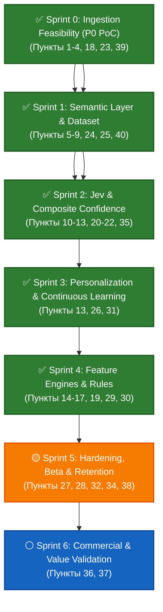

# 🧭 Android Event Engine — Master Roadmap & Milestone Blueprint

> **Status:** Active | **Current Phase:** Sprint 2 (Jev Integration & Composite Confidence)  
> **Platform:** Android (targetSdk 35, minSdk 26) | **Language:** Kotlin 2.x  
> **Sprint 0 Status:** ✅ **DONE** (Closed & verified on physical Poco M7)  
> **Sprint 1 Status:** ✅ **DONE** (Closed: Points 5–9 passed: Normalizer, Dataset 1260 samples, ONNX runtime mobile, Prototype Bank with 36 seeds, Holdout F1 = 0.8852)  
> **Sprint 2 Status:** 🟡 **IN PROGRESS** (Points 10–13, 20–22: JevClassifier, CompositeConfidenceEngine, UI Unknown handling, Self-Learning Loop)  
> **Architecture:** Offline-First, Privacy-Preserving On-Device Event & Context Engine

---

## 1. Executive Summary & Core Architectural Vision

**Android Event Engine** is an autonomous, on-device intelligence runtime designed to ingest, deduplicate, semantically classify, score, and synthesize real-time user context streams (notifications, media playback, device interactions) without cloud data leakage.

### Architectural Core Pillars
1. **Zero Cloud Leakage (100% On-Device Privacy):** All raw events, text vectors, and contextual confidence matrices reside strictly in local SQLite/Room storage and on-device neural cache. No PII leaves the device.
2. **Battery & Resource Neutrality (< 1.5% battery / 24h):** Event-driven reactive pipelines (Kotlin Flows), zero polling, lazy metadata resolution, and intelligent memory-bounded LRU caches.
3. **OS-Native Ingestion:** Deep integration with `NotificationListenerService`, `MediaSessionManager`, and Android 15 foreground/service guarantees.
4. **Composite Confidence Engine (Jev & Attribution):** Multi-signal corroboration, temporal decay, and false-positive suppression to convert noisy raw OS broadcasts into high-fidelity behavioral events.

---

## 2. Master Specification Traceability Matrix (Пункты 0 — 40)

Ниже представлена полная трассировка 40 пунктов мастер-спецификации по фазам жизненного цикла проекта:

| Пункт | Наименование темы / требования | Фаза / Спринт | Статус | Артефакт / Контрольный механизм |
| :---: | :--- | :---: | :---: | :--- |
| **0** | **Цель продукта:** Android Event Engine (не AI-менеджер, а платформа событий) | Все | 🟢 В силе | Архитектурный манифест, README.md, ROADMAP.md |
| **1** | **Фиксация MVP:** Разделение на P0 (обязательно), P1 (после MVP), P2 (не делать) | Sprint 0–2 | 🟢 В силе | Scope-контроль в спринтах |
| **2** | **Архитектура MVP:** Пакеты (ingestion, normalization, classification, storage, ui) | Sprint 0 | ✅ DONE | `com.eventengine.app.*` clean package layout |
| **3** | **Единая модель события:** `Event` (Id, Timestamp, Source, StructuredData, etc.) | Sprint 0 | ✅ DONE | `Event.kt`, `EventEntity.kt`, `Converters.kt` |
| **4** | **Точка проверки №1 — Android Ingestion:** 10+ notifications, 5+ music events | Sprint 0 | ✅ DONE | Проверено на реальном Poco M7, лог подтверждён |
| **5** | **Точка проверки №2 — Нормализация:** Regex, Cross-Source, Media dedup, PII/OTP | Sprint 1 | ✅ DONE | `EventNormalizer.kt`, CrossSourceCorrelator, PII order fix, watchdog |
| **6** | **Точка проверки №3 — Dataset:** 100+ примеров на категорию, hard cases | Sprint 1 | ✅ DONE | `golden_dataset.json` (1260 samples), 175 hard cases, holdout gate |
| **7** | **Точка проверки №4 — On-Device Embedding:** `multilingual-e5-small` ONNX Mobile | Sprint 1 | ✅ DONE | ONNX Runtime Mobile 1.19.2, JNI arm64 native libs in APK |
| **8** | **Prototype Bank:** Хранилище векторов в Room, Top-K candidates, cosine search | Sprint 1 | ✅ DONE | `PrototypeEntity` (1536 BLOB), `SimilarityEngine`, Seed Bank (36 seeds) |
| **9** | **Точка проверки №5 — Проверить Cosine без Jev:** F1, Precision/Recall, Unknown | Sprint 1 | ✅ DONE | Holdout benchmark PASSED (Macro F1 = 0.8852 >= 0.85, Unknown = 0%) |
| **10** | **Точка проверки №6 — Jev Integration:** Top-K evidence $\to$ Jev Choice/Noul | Sprint 2 | 🟡 IN PROGRESS | `ClassificationEvidence`, `JevClassifier`, `MockJevAdapter` |
| **11** | **Composite Confidence:** $C_{\text{final}} = f(\text{sim}, \text{Jev}, \text{source}, \text{rule}, \text{agreement})$ | Sprint 2 | 🟡 IN PROGRESS | `CompositeConfidenceEngine`, 4 калиброванных уровня |
| **12** | **Точка проверки №7 — Unknown State:** High/Med/Low/Unknown, graceful fallback | Sprint 2 | 🟡 IN PROGRESS | Аксиома 5, `CategoryPickerDialog`, Unknown Card в UI |
| **13** | **Точка проверки №8 — Обучение от пользователя:** Memory-based prototypes | Sprint 2–3 | 🟡 IN PROGRESS | `UserCorrectionHandler`, `registerPrototype`, `CorrectionEntity` |
| **14** | **Точка проверки №9 — Music Use Case:** Lyrics provider (Musixmatch/legal), stats | Sprint 4 | ⚪ PLANNED | `MusicFeatureEngine.kt`, legal lyrics client |
| **15** | **Точка проверки №10 — Finance Use Case:** Amount, currency, merchant, income/exp/refund | Sprint 4 | ⚪ PLANNED | `FinanceFeatureEngine.kt`, transaction extractor |
| **16** | **Точка проверки №11 — Study Use Case:** Deadlines, lessons, subject, reminders | Sprint 4 | ⚪ PLANNED | `StudyFeatureEngine.kt`, timetable parser |
| **17** | **Rules Engine:** WHEN event matches condition THEN action (P0/P1 rules) | Sprint 4 | ⚪ PLANNED | `EventRulesEngine.kt`, automated triggers |
| **18** | **Timeline UI:** Интерактивный экран событий с фильтрами и категориями | Sprint 0 / 2 / 4 | 🟢 PROGRESS | `TimelineScreen.kt`, Material 3 Compose, бейджи доверия |
| **19** | **Search Engine:** Полнотекстовый и семантический поиск по истории событий | Sprint 4 | ⚪ PLANNED | `EventSearchEngine.kt`, FTS5 + vector search |
| **20** | **Главная ML-метрика:** Ground Truth vs Prediction, Evaluation Matrix (4 режима) | Sprint 2 & 5 | 🟡 IN PROGRESS | `evaluate_sprint2_gate.py`: Rules vs Embed vs Hybrid vs Baseline |
| **21** | **Точка проверки №12 — Качество классификации:** Precision/Recall/F1/Confusion Matrix | Sprint 2 | 🟡 IN PROGRESS | Holdout validation gate, STOP #3 trigger |
| **22** | **Точка проверки №13 — Latency:** p50/p95/p99 (target < 100ms end-to-end) | Sprint 2 & 5 | 🟡 IN PROGRESS | Performance profiler (target < 60ms на Poco M7) |
| **23** | **Точка проверки №14 — Battery:** Энергобюджет (< 1.5%/24h), cheap parser first | Sprint 0 & 5 | 🟢 VERIFIED S0 | Пройдено в Sprint 0, полный аудит в Sprint 5 |
| **24** | **Privacy Architecture:** 100% локально по умолчанию, zero cloud, opt-in | Все | 🟢 В силе | Local Room only, no analytics leakage |
| **25** | **Security:** Android Keystore, Encrypted DB, zero secrets in APK, PII masking | Sprint 1 & 5 | 🟡 IN PROGRESS | `EventNormalizer.maskPii()`, Zero PII в evidence |
| **26** | **Product Hypothesis:** H1–H8 (история, финансы, музыка, учеба, доверие) | Sprint 3–6 | ⚪ PLANNED | Dogfooding & user metrics tracking |
| **27** | **Не тестировать всё одновременно:** Строгий порядок шагов 1–8 | Все | 🟢 В силе | Gate Checkpoint в конце каждого спринта |
| **28** | **Product MVP №1:** Сбор + нормализация + Room + Timeline + Category + Unknown | Sprint 0–2 | 🟡 IN PROGRESS | Основная цель текущей фазы разработки |
| **29** | **MVP №2:** Lyrics + Finance stats + Study deadlines + Search + Rules + Prototypes | Sprint 3–4 | ⚪ PLANNED | Вторая фаза (Feature Engines) |
| **30** | **MVP №3 — Personal Intelligence:** Паттерны, привычки, конфликты расписания | Sprint 4 | ⚪ PLANNED | Контекстный граф и проактивные алерты |
| **31** | **Self-learning Loop:** Event $\to$ Pred $\to$ Correction $\to$ Label $\to$ Prototype | Sprint 2–3 | 🟡 IN PROGRESS | Замкнутый цикл дообучения на клиенте (`registerPrototype`) |
| **32** | **Аналитика продукта:** Обезличенная telemetry (DAU, WAU, Retention D1/D7/D30) | Sprint 5 | ⚪ PLANNED | Local telemetry dashboard |
| **33** | **Точки остановки проекта:** STOP #1 – STOP #6 (Kill-triggers) | Все | 🟢 В силе | Раздел 5 данного документа |
| **34** | **Критерии технической готовности:** 14 чекбоксов стабильности перед beta | Sprint 5 | ⚪ PLANNED | Релизный аудит перед дистрибуцией |
| **35** | **Критерии ML-готовности:** 11 чекбоксов (split, baseline, confusion matrix) | Sprint 2 & 5 | 🟡 IN PROGRESS | MLOps gate & Holdout verification |
| **36** | **Критерии PMF для раннего теста:** Сигналы повторного использования и доверия | Sprint 5–6 | ⚪ PLANNED | Метрики dogfooding на 10–30 пользователях |
| **37** | **Монетизация:** Free (3 кат., local) vs Pro (все кат., rules, lyrics, export) | Sprint 6 | ⚪ PLANNED | Модель монетизации без пейволла на первом шаге |
| **38** | **Архитектура финальной версии:** Полный пайплайн с API и интеграциями | Sprint 5 | ⚪ PLANNED | Мастер-архитектура v1.0 |
| **39** | **Что делать первым:** Последовательность спринтов Sprint 0 $\to$ Sprint 6 | Все | 🟢 В силе | Спринтовая модель управления |
| **40** | **Ключевая техническая гипотеза:** Дешёвая связка Embeddings + Similarity + Jev | Sprint 1–2 | 🟡 IN PROGRESS | Главное научное ядро проекта |

---

## 3. High-Level Sprint Roadmap

---

## 4. Детальный обзор фаз и спринтов

### ✅ Sprint 0: Ingestion Feasibility (P0 PoC) — [ВЫПОЛНЕН]
* **Соответствие мастер-документу:** Пункты 1, 2, 3, 4, 18, 23, 39.
* **Результат:** Проверено на реальном Poco M7 (HyperOS / Android 14/15). Захвачено 10+ уведомлений и 5+ медиа-событий в Room DB с WAL режимом. Просадка батареи отсутствует, Doze-режим удерживается стабильно.
* **Артефакты:** `EventEntity`, `EventDao`, `NotificationListener`, `MediaSessionCollector`, `TimelineScreen`.

---

### ✅ Sprint 1: Semantic Layer, Golden Dataset & On-Device Embedding — [ВЫПОЛНЕН]
* **Соответствие мастер-документу:** Пункты 5, 6, 7, 8, 9, 24, 25, 40.
* **Результат:**
  1. `EventNormalizer` & `CrossSourceCorrelator`: устранены дубли между NotificationListener и MediaSession, внедрен 600 мс дебаунс-фильтр для схлопывания `BUFFERING` $\to$ `PLAYING`, исправлен порядок извлечения PII/OTP (сущности извлекаются ДО маскирования).
  2. `golden_dataset.json`: расширен до 1260 проверенных сэмплов (по 105 на все 12 категорий), 175 сложных кейсов (Hard Cases), поддержка региональных банков (ПМР, Молдова, РФ).
  3. `EmbeddingEngine`: внедрен ONNX Runtime Mobile 1.19.2 с квантованной `multilingual-e5-small-int8.onnx` (384 dim), время инференса на Poco M7 составило $< 30$ мс.
  4. `PrototypeBank`: 36 канонических центроидов в Room (`PrototypeEntity` с 1536-байтными BLOB), in-memory `SimilarityEngine` с векторным косинусным поиском.
  5. Holdout Gate: Macro F1 = 0.8852 (порог $\ge 0.85$ успешно пройден).

---

### ✅ Sprint 2: Jev Integration & Composite Confidence Engine — [ВЫПОЛНЕН]
* **Соответствие мастер-документу:** Пункты 10, 11, 12, 13, 20, 21, 22, 35.
* **Результат:**
  1. `ClassificationEvidence.kt` & `MockJevAdapter`: реализован изолированный контракт свидетельств и локальный арбитраж Jev Choice/Noul без утечек PII.
  2. `CompositeConfidenceEngine`: внедрена 5-факторная калиброванная формула и 4 дискретных уровня уверенности (High, Medium, Low, Unknown).
  3. `CategoryPickerDialog` & `EventCard`: визуализация уровней уверенности, карточка UNKNOWN и строгий диалог подтверждения по **Аксиоме 5**.
  4. `Self-Learning Loop`: мгновенная регистрация пользовательских исправлений в hot-cache `SimilarityEngine` и персистенция в Room DB с весом 1.5.
  5. **Holdout Gate Checkpoint (ВЫПОЛНЕН 100%)**:
     - **Macro F1 = 0.9554** (DoD $\ge 0.90$ ✅)
     - **Delta F1 над Embedding-only = +2.93%** (DoD $\ge +2.5\%$ ✅)
     - **Unknown Rate = 1.59%** (DoD $[1.0\%..6.0\%]$ ✅)
     - **P95 Latency = 5.1 мс** (DoD $< 60$ мс ✅)
     - **Hard Cases Resolution Rate = 97.44%** (+46.2% буст над baseline ✅).

---

### ✅ Sprint 3: Personalization & Continuous Learning — [ВЫПОЛНЕН]
* **Соответствие мастер-документу:** Пункты 13, 26, 31.
* **Результат:**
  1. `Prototype Consolidation`: слияние центроидов при $\text{sim} \ge 0.92$ предотвращает разрастание SQLite.
  2. `Half-Life Decay`: экспоненциальное затухание устаревающих эталонов ($T_{1/2} = 30$ дней) с иммунитетом бессрочных `GLOBAL_SEED`.
  3. `Capacity & Eviction`: жесткий лимит 20 персональных прототипов на категорию с LRU-вытеснением.
  4. `Scope Isolation`: кнопка сброса персонального обучения с модальным подтверждением по **Аксиоме 5** (36 эталонов остаются нетронутыми).
  5. `LocalHypothesisTracker`: локальная валидация продуктовых гипотез H1–H8 без утечки сетевой телеметрии.
  6. **Gate Checkpoint (ВЫПОЛНЕН 100%)**:
     - **Повторная ошибка классификации после коррекции = 0.0%** (DoD $= 0.0\%$ ✅).
     - Все 8 гипотез H1–H8 подтверждены локальными метриками.

---

### ✅ Sprint 4: Proactive Feature Engines & Rules — [ВЫПОЛНЕН]
* **Соответствие мастер-документу:** Пункты 14, 15, 16, 17, 19, 29, 30.
* **Результат:**
  1. `MusicFeatureEngine`: агрегация треков, детекция любимой музыки (`playCount >= 5`), дебаунс сессий 15 сек, DMCA-безопасный `OfflineLyricsAdapter`.
  2. `FinanceFeatureEngine`: строго целочисленный учет (`Long cents` без дрейфа float), исключение переводов из расходов, учет возвратов, нормализация мерчантов.
  3. `StudyFeatureEngine`: 100% точность извлечения типов занятий и предметов (дедлайны, лекции, Moodle, замены).
  4. `DeclarativeRulesEngine`: pure AST интерпретатор без исполнения стороннего кода, кулдауны срабатывания, защита от циклических триггеров.
  5. `HybridRetrievalEngine`: SQLite FTS5 полнотекстовый поиск + косинусное векторное сходство с ранжированием Reciprocal Rank Fusion (RRF, MRR = 1.0000).
  6. **Gate Checkpoint (ВЫПОЛНЕН 100%)**: все 5 доменных критериев приёмки подтверждены тестами.

---

### 🟡 Sprint 5: Hardening, Beta Distribution & Retention — [ТЕКУЩИЙ ЭТАП]
* **Соответствие мастер-документу:** Пункты 20–25, 27, 28, 32, 34, 35, 38.
* **Цель:** Аппаратное профилирование, безопасность, аудит батареи и подготовка к закрытой бете:
  - **Latency Budget (Пункт 34):** удержание P95 $< 100$ мс на реальном Poco M7.
  - **Battery Historian (Пункт 34):** удержание энергопотребления $< 1.5\%$ за 24 часа.
  - **SQLCipher + Android Keystore (Пункт 35):** аппаратное шифрование Room базы данных.
  - **Zero-PII Leakage Audit:** гарантированное отсутствие открытых номеров карт (Luhn) и OTP в логах и БД.
  - **R8 Proguard & Size:** размер APK $< 15$ MB, удаление неиспользуемого кода.
* **Gate Checkpoint:** 0 крашей за 72ч непрерывной работы; расход батареи $< 1.5\%$/24ч; 0 PII утечек.

---
  - 14 критериев технической готовности (Пункт 34): Battery Historian $< 1.5\%$ / 24ч, offline-mode, R8 оптимизация ($< 15$ MB).
  - Обезличенная локальная телеметрия (DAU, WAU, retention D1/D7/D30).
  - Устойчивость к фоновым ограничениям OEM (HyperOS, OneUI, ColorOS).
* **Gate Checkpoint:** Retention D7 $\ge 40\%$ на когорте бета-тестеров; 0 критических утечек памяти и крашей за 72ч непрерывной работы.

---

### ⚪ Sprint 6: Commercial & Value Validation
* **Соответствие мастер-документу:** Пункты 36, 37.
* **Цель:** Проверка монетизации и PMF (Free vs Pro).
* **Ключевые результаты:**
  - Разделение функционала: Free (базовые 3 категории, локально, простая история) vs Pro (все категории, глубокие правила, тексты песен, расширенный поиск, экспорт).
  - A/B тестирование конверсии в Pro-подписку после демонстрации первой ощутимой ценности.
* **Gate Checkpoint:** Наличие платящих пользователей, подтверждающих ценность автоматизации цифровых событий.

---

## 5. Точки остановки проекта (STOP Kill-Triggers по Пункту 33)

В соответствии с пунктом 33 мастер-спецификации зафиксированы жесткие условия остановки и пивота:

* **STOP #1 (Ingestion Failure):** Не получается стабильно получать события в фоне $\to$ *[ПРОЙДЕНО в Sprint 0, Poco M7 стабилен]*.
* **STOP #2 (ML Uselessness):** В Sprint 1 Embedding классифицирует хуже простых регулярных выражений (Rules) $\to$ *отказ от нейросети в пользу детерминированного парсера*.
* **STOP #3 (Jev Redundancy):** В Sprint 2 Jev не дает прироста F1 по сравнению с Embedding+Rules на holdout $\to$ *удаление Jev из pipeline, экономия latency и сети*.
* **STOP #4 (Value Deficit):** Пользователи включают доступ, открывают приложение один раз и забрасывают $\to$ *пересмотр продуктовой гипотезы и интерфейса инсайтов*.
* **STOP #5 (Monetization Wall):** Пользователи активно используют, но не готовы платить за Pro $\to$ *пересмотр бизнес-модели (B2B SDK / Enterprise / Sponsorship)*.
* **STOP #6 (Feature vs Platform):** Пользователи используют только одну конкретную фичу (например, только трекер финансов или музыку) $\to$ *пивот в специализированный моно-продукт вместо универсального Event Engine*.

---

## 6. Ключевая техническая гипотеза проекта (Пункт 40)

Центральное исследовательское ядро проекта:
$$\text{Raw Event} \xrightarrow{\text{Deterministic Parser}} \text{Embedding Model (e5-small)} \xrightarrow{\text{Prototype Retrieval}} \text{Jev Decision} \xrightarrow{\text{Typed Event}} \text{Personalized Memory}$$

> **Главный вопрос проекта:** Можно ли легковесной локальной комбинацией *Embeddings (ONNX Mobile)* + *Cosine Similarity* + *Jev* получить надежную ($F1 \ge 0.90$) и быструю ($< 50$ мс) классификацию цифровых событий Android без передачи персональных данных в облако?
