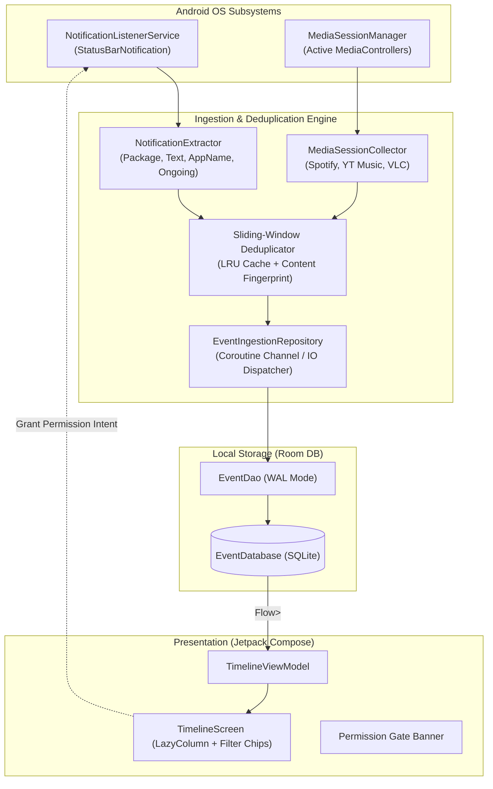

# 📋 Sprint 0 Task Decomposition — Android Ingestion Proof of Concept (P0)

> **Sprint Goal:** Validate reliable, low-power on-device ingestion and deduplication of Android OS notifications and media sessions under targetSdk 35 (Android 15), persisting into Room and displaying in a reactive Compose Timeline.  
> **Target Device Tier:** Android 8.0+ (API 26+) up to Android 15 (API 35).  
> **Status:** Ready for Implementation (Handoff to Coder).

---

## 1. Sprint 0 Overview & Architecture Topology



---

## 2. Detailed Task Breakdown

---

### Task 0.1: Project Scaffolding & Build System Configuration
* **Type:** Architecture / Infrastructure
* **Priority:** P0 (Blocker)
* **Estimated Effort:** 0.5 Day
* **Assigned Role:** Android Lead / Coder

#### Technical Description
Initialize the multi-package Android project with modern Gradle Kotlin DSL (`build.gradle.kts`), Gradle Version Catalog (`gradle/libs.versions.toml`), Android 15 compatibility (`targetSdk 35`, `compileSdk 35`, `minSdk 26`), Jetpack Compose BOM, Room DB with KSP, and Kotlin Coroutines/Flow.

#### Deliverables & Scope
1. `settings.gradle.kts` with dependency resolution management.
2. `gradle/libs.versions.toml` declaring:
   - Android Gradle Plugin `8.7+`, Kotlin `2.0+`
   - Compose BOM `2024.09+` (Material3, Foundation, UI, Tooling)
   - AndroidX Core KTX, Lifecycle Runtime Compose
   - Room KSP `2.6.1+` (room-runtime, room-ktx, room-compiler)
   - Kotlin Coroutines Core & Android `1.8+`
   - Timber (logging)
3. `app/build.gradle.kts` configured with `applicationId "com.eventengine.android"`, Java 17 compatibility, and Compose compiler plugin.
4. Clean package directory tree:
   ```
   com.eventengine.android/
   ├── core/
   │   ├── database/       # Room Database, TypeConverters
   │   └── model/          # Domain models & EventSource enums
   ├── data/
   │   ├── local/          # Room Entities & DAOs
   │   └── repository/     # EventIngestionRepository & Deduplication
   ├── features/
   │   ├── ingestion/
   │   │   ├── notification/  # NotificationListenerService
   │   │   └── media/         # MediaSessionCollector
   │   └── timeline/          # Compose UI & ViewModel
   └── EventEngineApp.kt      # Application class (Timber init)
   ```

#### Acceptance Criteria (Gherkin)
```gherkin
Scenario: Successful Project Compilation
  Given the project is configured with targetSdk 35 and Kotlin DSL
  When `./gradlew assembleDebug` is executed
  Then the build finishes with status 0
  And APK `app-debug.apk` is generated without dependency resolution conflicts
```

---

### Task 0.2: Domain Models & Room Entity Architecture
* **Type:** Data & Storage Engine
* **Priority:** P0
* **Estimated Effort:** 0.5 Day
* **Assigned Role:** Core Coder

#### Technical Description
Design the unified immutable `Event` domain model and its corresponding Room Entity `EventEntity` capable of capturing notification events, media playback changes, and extensible metadata with indexed query performance.

#### Data Schema Specification
* **Table:** `events`
* **Columns:**
  - `id`: `Long` (Primary Key, autogenerate = true)
  - `source`: `String` (`NOTIFICATION`, `MEDIA_SESSION`, `SYSTEM`) — Indexed
  - `packageName`: `String` — Indexed
  - `appName`: `String` (human-readable label, e.g. "Telegram")
  - `title`: `String?` (notification title or song title)
  - `text`: `String?` (notification message body or subtitle)
  - `subText`: `String?`
  - `category`: `String?` (OS category e.g. `CATEGORY_MESSAGE`, `CATEGORY_TRANSPORT`)
  - `timestamp`: `Long` (Epoch timestamp millis) — Indexed (DESC)
  - `notificationId`: `Int?`
  - `notificationKey`: `String?` (StatusBarNotification key)
  - `isOngoing`: `Boolean` (true for sticky music players, download progress, GPS)
  - `mediaArtist`: `String?`
  - `mediaAlbum`: `String?`
  - `mediaPlaybackState`: `String?` (`PLAYING`, `PAUSED`, `STOPPED`, `BUFFERING`)
  - `mediaDurationMs`: `Long?`
  - `contentFingerprint`: `String` (SHA-256 hash for deduplication) — Indexed
  - `rawExtrasJson`: `String?` (Extensible JSON dump of bundle extras)

#### Room DAO Operations (`EventDao`)
- `fun observeAllEvents(limit: Int = 200): Flow<List<EventEntity>>`
- `fun observeEventsBySource(source: String): Flow<List<EventEntity>>`
- `suspend fun insertEvent(event: EventEntity): Long`
- `suspend fun getRecentByFingerprint(fingerprint: String, sinceTimestamp: Long): EventEntity?`
- `suspend fun clearAllEvents()`
- `suspend fun getEventCount(): Int`

#### Acceptance Criteria (Gherkin)
```gherkin
Scenario: Persisting and observing events in Room
  Given an initialized in-memory Room database
  When an `EventEntity` with source "NOTIFICATION" and package "org.telegram.messenger" is inserted
  Then `observeAllEvents()` emits a list containing the inserted event
  And querying `getRecentByFingerprint` returns the entity within 5ms
```

---

### Task 0.3: NotificationListenerService Implementation
* **Type:** OS Ingestion Service
* **Priority:** P0
* **Estimated Effort:** 1.0 Day
* **Assigned Role:** Android System Coder

#### Technical Description
Implement `EventNotificationListenerService` subclassing Android's native `NotificationListenerService`. Safely extract notification payload data, resolve human-friendly application labels with an in-memory caching layer (avoiding expensive IPC calls on every event), and bridge events asynchronously to the ingestion repository.

#### Implementation Requirements
1. **Manifest Declaration:**
   ```xml
   <service
       android:name=".features.ingestion.notification.EventNotificationListenerService"
       android:label="@string/notification_listener_service_name"
       android:permission="android.permission.BIND_NOTIFICATION_LISTENER_SERVICE"
       android:exported="true">
       <intent-filter>
           <action android:name="android.service.notification.NotificationListenerService" />
       </intent-filter>
   </service>
   ```
2. **Payload Extraction Pipeline (`onNotificationPosted(sbn: StatusBarNotification)`):**
   - Check `sbn != null && sbn.notification != null`.
   - Resolve `appName` using `PackageManager.getApplicationLabel()` backed by `ConcurrentHashMap<String, String>` cache.
   - Extract extras: `Notification.EXTRA_TITLE`, `Notification.EXTRA_TEXT`, `Notification.EXTRA_SUB_TEXT`, `Notification.EXTRA_BIG_TEXT`.
   - Extract category (`sbn.notification.category`), flags (`FLAG_ONGOING_EVENT`).
   - Extract unique `sbn.key` and `sbn.id`.
3. **Android 13/14/15 Permission Navigation Utility:**
   - Detect if notification listener permission is granted via `NotificationManagerCompat.getEnabledListenerPackages()`.
   - Deep-link intent helper to `Settings.ACTION_NOTIFICATION_LISTENER_SETTINGS` (or Android 13+ restricted settings dialog prompt).
4. **Lifecycle Robustness:**
   - Handle `onListenerConnected()` and `onListenerDisconnected()`.
   - Dispatch events on background coroutine scope (`Dispatchers.Default` / `Dispatchers.IO`) without blocking system binder thread.

#### Acceptance Criteria (Gherkin)
```gherkin
Scenario: Capturing a real-time incoming notification
  Given the user has enabled Notification Access in Android Settings
  When a notification is posted by "com.google.android.gm" with title "Meeting Tomorrow"
  Then `onNotificationPosted` intercepts the `StatusBarNotification`
  And extracts package "com.google.android.gm", appName "Gmail", title "Meeting Tomorrow"
  And forwards the event to the Ingestion Repository without blocking the binder thread
```

---

### Task 0.4: MediaSessionCollector Implementation
* **Type:** OS Ingestion Service
* **Priority:** P0
* **Estimated Effort:** 1.0 Day
* **Assigned Role:** Media / OS Coder

#### Technical Description
Implement `MediaSessionCollector` leveraging Android's `MediaSessionManager` to track real-time media playback transitions (Play, Pause, Stop, Track change) and metadata (Track Name, Artist, Album, Duration) across active players (Spotify, YouTube Music, VLC, Podcasts).

#### Implementation Requirements
1. **Session Listener Registration:**
   - Obtain `MediaSessionManager` via `context.getSystemService(Context.MEDIA_SESSION_SERVICE)`.
   - Call `addOnActiveSessionsChangedListener(listener, notificationListenerComponentName)`.
   *Note: Using the ComponentName of the active NotificationListenerService authorizes access to all active system media sessions without requiring special audio routing privileges.*
2. **MediaController Callback Subscription:**
   - For every active `MediaController`, register a `MediaController.Callback`:
     - `onPlaybackStateChanged(state: PlaybackState?)`: maps integer state (`STATE_PLAYING`, `STATE_PAUSED`, etc.) to domain enum.
     - `onMetadataChanged(metadata: MediaMetadata?)`: extracts `METADATA_KEY_TITLE`, `METADATA_KEY_ARTIST`, `METADATA_KEY_ALBUM`, `METADATA_KEY_DURATION`.
3. **State Normalization & Flutter Debounce:**
   - Filter redundant intermediate states (e.g. `STATE_BUFFERING` $\to$ `STATE_PLAYING` within 200ms).
   - Only emit when there is a meaningful state transition (new track title or state change from Paused $\leftrightarrow$ Playing).
4. **Resource Hygiene:**
   - Unregister callbacks cleanly when controllers are destroyed or session list changes.

#### Acceptance Criteria (Gherkin)
```gherkin
Scenario: Capturing music playback transition
  Given Spotify or YouTube Music is active on the device
  When the user taps Play on track "Starboy" by "The Weeknd"
  Then `MediaSessionCollector` intercepts the playback state `PLAYING`
  And extracts title "Starboy", artist "The Weeknd"
  And dispatches a `MEDIA_SESSION` event to the Ingestion Repository
```

---

### Task 0.5: Ingestion Repository & Event Deduplication Engine
* **Type:** Core Domain / Ingestion Logic
* **Priority:** P0
* **Estimated Effort:** 0.5 Day
* **Assigned Role:** Core Coder

#### Technical Description
Implement `EventIngestionRepository` with an intelligent sliding-window deduplication filter. Prevent database flooding caused by high-frequency notification mutations (e.g. messaging apps updating unread counts, download progress ticks, ongoing music notification seek-bar updates).

#### Deduplication & Throttling Rules
1. **Content Fingerprint Calculation:**
   $$\text{Fingerprint} = \text{SHA256}(\text{packageName} + \text{"|"} + \text{notificationKey} + \text{"|"} + \text{title} + \text{"|"} + \text{text} + \text{"|"} + \text{isOngoing})$$
2. **Sliding-Window Time Filter ($\Delta t = 3000\text{ms}$):**
   - If an event with an identical fingerprint was recorded within the last $3000\text{ms}$, drop it immediately (Duplicate rejection).
3. **Ongoing Notification Throttle:**
   - If `isOngoing == true` (e.g., download manager, navigation banner):
     - Throttle updates to at most once per 10 seconds unless `title` or major state fundamentally changes.
4. **Asynchronous Buffer Pipeline:**
   - Use Kotlin Coroutines `Channel<EventEntity>(capacity = Channel.BUFFERED)` with a dedicated worker writing to Room via `Dispatchers.IO` to ensure 0ms main-thread blockage and zero missed events under burst load.

#### Acceptance Criteria (Gherkin)
```gherkin
Scenario: Deduplicating rapid notification updates
  Given a messaging app posts 5 notification updates for the same message within 1.5 seconds
  When the events pass through `EventIngestionRepository`
  Then exactly 1 event is persisted in the Room database
  And 4 duplicate events are dropped and logged at debug level
```

---

### Task 0.6: Minimal Compose Timeline UI & Permission Flow
* **Type:** Presentation / Jetpack Compose
* **Priority:** P1
* **Estimated Effort:** 0.5 Day
* **Assigned Role:** Android UI Coder

#### Technical Description
Build a clean, high-contrast Jetpack Compose debug dashboard (`TimelineScreen`) that provides real-time visibility into the ingested event stream, visual indicators for OS permissions, and interactive filtering.

#### UI Features & Components
1. **Permission Gate Banner:**
   - Real-time check: Is Notification Access granted?
   - If missing: High-visibility warning card with "Grant Notification Access" button directing user directly to `Settings.ACTION_NOTIFICATION_LISTENER_SETTINGS`.
2. **Header Bar & Controls:**
   - Total event counter badge (e.g., "Total Events: 42").
   - "Clear Database" button with confirmation prompt.
3. **Source & Category Filter Chips (Horizontal Scroll):**
   - Filter chips: `[All]`, `[Notifications]`, `[Media]`, `[Ongoing]`.
4. **Event Feed (`LazyColumn`):**
   - Renders `EventCard`:
     - App icon / initial badge + App Name + Formatted Timestamp (`HH:mm:ss.SSS`).
     - Event Source Badge (`NOTIFICATION` in Teal, `MEDIA` in Purple).
     - Title (bold) + Body text (max 2 lines with expand toggle).
     - Media details (if source is Media: Track title, Artist, Album, Playback state icon).
     - Fingerprint snippet and ongoing badge.
5. **Lifecycle Awareness:**
   - Flow collection using `collectAsStateWithLifecycle()` to stop DB observation when the app goes into background.

#### Acceptance Criteria (Gherkin)
```gherkin
Scenario: Observing real-time events in the UI
  Given the app is launched and Notification Access is granted
  When an external notification is posted to the phone
  Then the Compose Timeline updates reactively without manual refresh
  And the top item displays the new event with matching title and timestamp
```

---

## 3. Sprint 0 Definition of Done (DoD) Checklist

To complete Sprint 0 and declare the PoC successful, the following criteria must ALL be met:

- [ ] **Code Complete:** Tasks 0.1 through 0.6 implemented, merged, and adhering to Kotlin style guidelines.
- [ ] **Compilation & Build:** `./gradlew assembleDebug` and `./gradlew testDebugUnitTest` succeed with 0 errors.
- [ ] **Target SDK Compliance:** Fully tested on Android 14/15 (`targetSdk 35`) without security exception crashes.
- [ ] **Permission Flow Verified:** Clean onboarding to `NotificationListenerSettings` verified on a physical device.
- [ ] **Capture Quota (Functional PoC):**
  - Successfully captured $\ge 10$ real-world notifications from different apps (e.g. Telegram, WhatsApp, Gmail, SMS, System).
  - Successfully captured $\ge 5$ media session state transitions (e.g. Spotify play/pause/track change).
- [ ] **Deduplication Verified:** Rapidly editing or appending messages in chat apps does not create duplicate database rows within 3 seconds.
- [ ] **Persistence Verified:** Events survive app process death and cold restart (Room WAL persistence).
- [ ] **UI Performance:** Compose Timeline scrolls smoothly (60+ FPS) with 200+ events loaded.

---

## 4. Sprint 0 Kill-Trigger (Non-Negotiable Failure Criteria)

> ⚠️ **CRITICAL GO / NO-GO CRITERIA**  
> If ANY of the following conditions occur during Sprint 0 evaluation on physical test devices, work is immediately **HALTED** and escalated for architectural pivot:

1. **Battery Drain Threshold:** Standby battery consumption attributed to `com.eventengine.android` exceeds **$2.0\%$ per hour** over a 4-hour background test run with the screen off.
2. **OS Listener Revocation (Doze Killing):** Android OS systematically unbinds or permanently silences `NotificationListenerService` during Deep Doze without automatic reconnect upon device wake.
3. **Security / Binder Blockage:** Notification or MediaSession IPC calls block the Android main thread, causing ANRs (Application Not Responding) or dropped system frames.
4. **OEM Permission Lock:** On popular target OEM versions (OneUI / MIUI / Pixel), Android 15 Restricted Settings permanently prevent enabling Notification Listener for side-loaded debug builds without viable user workaround.

---

## 5. Handoff Instructions for the Coder

1. **Sequential Execution Order:**
   - `Task 0.1` (Scaffolding & dependencies) $\to$
   - `Task 0.2` (Room entity & DAO) $\to$
   - `Task 0.3` (Notification Listener Service) $\to$
   - `Task 0.4` (Media Session Collector) $\to$
   - `Task 0.5` (Deduplication & Repository) $\to$
   - `Task 0.6` (Compose Timeline UI).
2. **Zero Assumptions on System Threads:** Always offload Room operations and heavy metadata parsing to `Dispatchers.IO`.
3. **Logging Discipline:** Use Timber with structured tags (`[Ingestion:Notification]`, `[Ingestion:Media]`, `[Dedup]`).
4. **Documentation Sync:** As each task is completed, update the task checkbox in this file.
