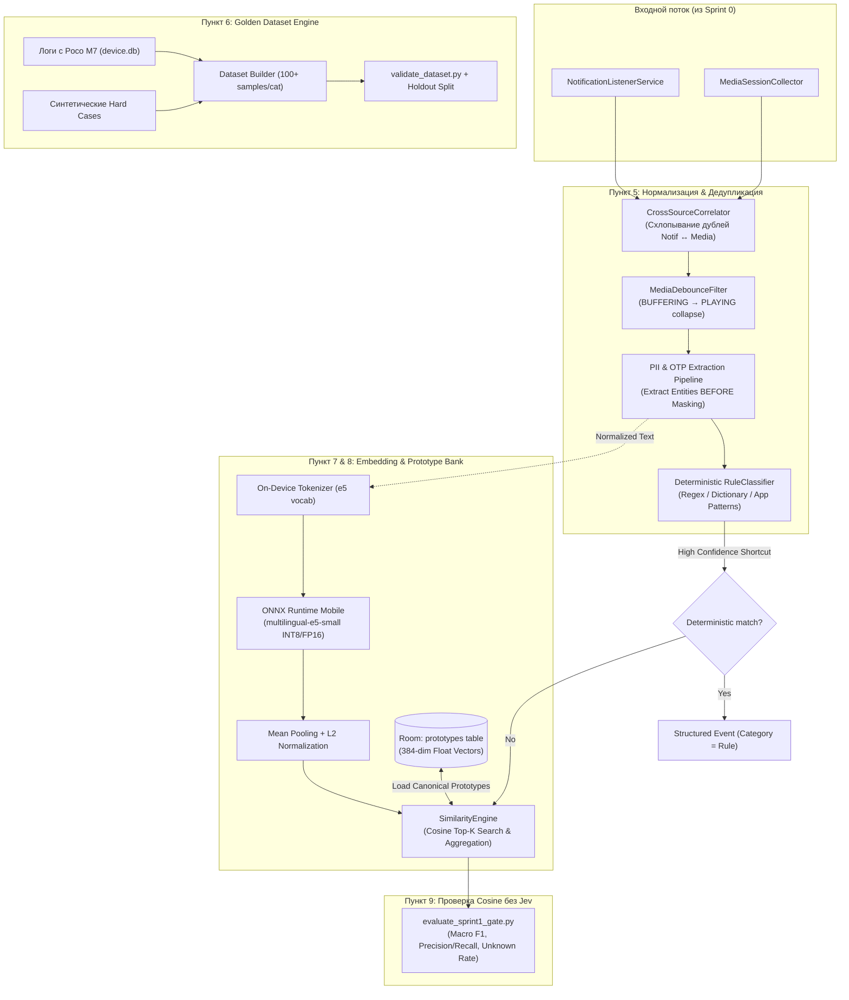

# 📋 Sprint 1 Task Decomposition — Semantic Layer, Golden Dataset & On-Device Embedding

> **Sprint Focus:** Пункты 5, 6, 7, 8 и 9 мастер-спецификации.  
> **Sprint Goal:** Создать локальный семантический слой классификации Android Event Engine без внешних API: детерминированная нормализация, устранение дребезга/дублей медиа, расширенный датасет (100+ на категорию), локальный инференс `multilingual-e5-small` через ONNX Runtime Mobile и банк прототипов в Room с векторным Top-K поиском.  
> **Target Hardware:** Poco M7 (Snapdragon / HyperOS Android 14/15) + стандартный эмулятор API 35.  
> **Status:** Ready for Implementation (Handoff to Coder, QA & DevOps).

---

## 1. Архитектурная топология Sprint 1



---

## 2. Детальная декомпозиция задач

---

### Task 1.1: Нормализация, Cross-Source Correlator & Устранение дублей медиа (Пункт 5)
* **Тип:** Core Normalization & Ingestion Logic
* **Приоритет:** P0 (Blocker)
* **Трудоёмкость:** 1.0 Day
* **Исполнитель:** Coder (Android Core)

#### Техническое описание
Реализовать единый конвейер очистки, извлечения сущностей и кросс-источниковой дедупликации, устраняющий паразитные события от плееров и исправляющий порядок обработки конфиденциальных данных (OTP/PII).

#### Требования к реализации
1. **Cross-Source Correlator (`CrossSourceCorrelator.kt`):**
   - Проблема: Музыкальные плееры (Spotify, YouTube Music, Яндекс Музыка, VLC) одновременно публикуют системное уведомление в `NotificationListener` и шлют обновления в `MediaSessionManager`.
   - Решение: Если пакет приложения совпадает с известным медиа-плеером или содержит флаги медиа-уведомления (`MediaStyle`), событие уведомления подавляется, а приоритет отдается структурированным данным `MediaSessionCollector`.
2. **Схлопывание дребезга Media Playback (`MediaSessionCollector.kt`):**
   - Проблема: При переключении трека или старте воспроизведения плеер отправляет последовательность `BUFFERING` $\to$ `PLAYING` в интервале 100–800 мс, засоряя историю двумя событиями.
   - Решение: Ввести скользящее окно ожидания (debounce 600 мс) для статуса `BUFFERING`. Если в течение 600 мс поступает статус `PLAYING` для того же пакета и трека, промежуточное состояние `BUFFERING` аннулируется и не записывается в Room DB.
3. **Исправление порядка обработки PII и OTP (`EventNormalizer.kt`):**
   - Проблема: Если маскирование PII запускается до парсинга, то регулярные выражения заменяют код подтверждения на `[REDACTED_OTP]`, делая невозможным извлечение `auth_code` в `StructuredData`.
   - Новый строгий порядок:
     $$\text{Raw String} \xrightarrow{\text{Unicode NFC + Whitespace Trim}} \xrightarrow{\text{Extract Entities (auth\_code, amount, merchant)}} \xrightarrow{\text{Mask PII (cards, phones, emails, OTP)}} \xrightarrow{\text{Sanitized NormalizedText}}$$
   - Результат: В `EventEntity.structuredData` сохраняется структурированный объект (например, `{"auth_code": "8492"}` или `{"amount": 532.0, "currency": "RUB"}`), а в `EventEntity.normalizedText` и логах текст гарантированно обезличен (`"Код подтверждения: [REDACTED_OTP]"`).
4. **Расширение детерминированных правил (`RuleClassifier.kt`):**
   - Поддержка жестких финансовых паттернов: списание, пополнение, оплата картой, перевод, возврат (Refund не равен Income!).
   - Извлечение расписания пар и дедлайнов для `study.lesson` и `study.deadline`.

#### Критерии приёмки (Gherkin)
```gherkin
Scenario: Cross-Source Correlator suppresses duplicate music notification
  Given Spotify is playing "Starboy" by "The Weeknd"
  When Spotify simultaneously emits a Status Notification and a MediaSession state change
  Then the CrossSourceCorrelator records only 1 event with source "MEDIA_SESSION"
  And drops the redundant notification event

Scenario: Debounce collapses BUFFERING into PLAYING
  Given a media player starts playback
  When MediaSession emits STATE_BUFFERING at t=0ms and STATE_PLAYING at t=350ms
  Then exactly 1 event with mediaPlaybackState "PLAYING" is stored in the database
  And no isolated "BUFFERING" event remains in history

Scenario: Correct OTP extraction before PII masking
  Given an SMS notification "Ваш одноразовый пароль для входа: 4819"
  When the event passes through EventNormalizer
  Then structuredData contains {"auth_code": "4819"}
  And normalizedText equals "Ваш одноразовый пароль для входа: [REDACTED_OTP]"
  And no raw digits 4819 appear in normalizedText
```

---

### Task 1.2: Golden Dataset Engine & Расширение до 100+ на категорию (Пункт 6)
* **Тип:** Data Engineering / QA
* **Приоритет:** P0
* **Трудоёмкость:** 1.0 Day
* **Исполнитель:** QA / MLOps

#### Техническое описание
Сформировать репрезентативный, валидированный по JSON-схеме датасет объемом $\ge 100$ примеров на каждую из целевых категорий, обогащенный реальными обезличенными логами с Poco M7 и синтетическими граничными случаями (Hard Cases).

#### Требования к реализации
1. **Целевые категории (минимум 100 примеров на категорию, итого $\ge 1200$ примеров):**
   - `finance.income` (зарплата, переводы от клиентов, кэшбэк, проценты)
   - `finance.expense.food` (кафе, супермаркеты, доставка еды)
   - `finance.expense.transport` (такси, метро, АЗС, каршеринг)
   - `finance.expense.shopping` (маркетплейсы, одежда, электроника)
   - `finance.transfer` (переводы родственникам, между своими счетами)
   - `music` (стриминг, аудиоплееры, подкасты)
   - `study.lesson` (лекции, семинары, аудитории, замена пар)
   - `study.deadline` (дедлайны сдачи лаб, курсовых, тестов)
   - `message` (личные сообщения Telegram, WhatsApp, SMS)
   - `advertisement` (маркетинг банков, промокоды, рассылки)
   - `authentication` (2FA-коды, подтверждение входа, push-подтверждения)
   - `other` (системные уведомления, погода, обновления)
2. **Обязательные граничные случаи (Hard Cases с флагом `is_hard_case: true`):**
   - `"Сбер: Перевод 1000"` (`finance.transfer`) vs `"Сбер: Пополнение 1000"` (`finance.income`)
   - `"Оплата 1000"` (`finance.expense.*`) vs `"Возврат 1000"` (`finance.income` или отдельный subtype `refund`) vs `"Списание 1000"`
   - `"Завтра пара"` (`study.lesson`) vs `"Завтра пара отменяется"` (`study.lesson` / `system`) vs `"Завтра замена пары"`
   - `"Не забудь сдать лабу"` (`study.deadline`)
   - `"Код подтверждения 8492"` (`authentication`) vs `"Заказ №8492 готов"` (`other` / `shopping`)
3. **Импорт логов с Poco M7:**
   - Извлечь реальные события из `build_tmp/event_engine_device.db`.
   - Прогнать через нормализатор PII, проставить ground truth разметку `category` и `intent`.
4. **Инструменты валидации и разбиения:**
   - Обновить `dataset/validate_dataset.py`: строгая проверка схемы `dataset/schema.json` и контроль квоты $\ge 100$ записей на категорию.
   - Скрипт `dataset/split_dataset.py`: стратифицированное разбиение на `train.json` (80%) и `holdout_eval.json` (20%) с фиксацией `random_seed=42`. Утечка данных между train и holdout строго исключена.

#### Критерии приёмки (Gherkin)
```gherkin
Scenario: Golden Dataset schema and volume validation
  Given the updated `dataset/golden_dataset.json`
  When `python dataset/validate_dataset.py` is executed
  Then the validation exits with code 0
  And every target category has at least 100 verified samples
  And all hard cases have valid `is_hard_case: true` and non-null `hard_case_reason`

Scenario: Stratified Train/Holdout split without leakage
  When `python dataset/split_dataset.py` is executed
  Then `train.json` contains 80% of samples and `holdout_eval.json` contains 20%
  And no sample ID in `holdout_eval.json` exists in `train.json`
```

---

### Task 1.3: On-Device Embedding Engine via ONNX Runtime Mobile (Пункт 7)
* **Тип:** On-Device ML Architecture
* **Приоритет:** P0
* **Трудоёмкость:** 1.5 Days
* **Исполнитель:** Coder (Android / ML)

#### Техническое описание
Интегрировать модель `multilingual-e5-small` в Android-приложение через официальный ONNX Runtime Mobile (`onnxruntime-android`), реализовать локальный токенизатор и конвейер векторизации текста в 384-мерное $L_2$-нормализованное пространство с жестким контролем задержки и памяти.

#### Требования к реализации
1. **Gradle зависимости и сборка (`libs.versions.toml`, `app/build.gradle.kts`):**
   - Добавить: `com.microsoft.onnxruntime:onnxruntime-android:1.19.0`
   - Настроить размещение артефакта модели: `app/src/main/assets/models/multilingual-e5-small-int8.onnx` (квантованная INT8 версия, размер $\approx 35\text{ MB}$) или загрузчик при первом старте.
2. **On-Device Tokenizer (`E5Tokenizer.kt`):**
   - Реализовать или адаптировать легковесный токенизатор WordPiece/SentencePiece, совместимый со словарем `multilingual-e5-small` (`vocab.txt` / 250k токенов).
   - Поддержка префикса: согласно спецификации e5 добавлять префикс `"passage: "` для текстов и прототипов.
   - Ограничение длины последовательности: `max_length = 64` (достаточно для 99% уведомлений, минимизирует задержку вычислений).
3. **Движок инференса (`EmbeddingEngine.kt`):**
   - Инициализация `OrtEnvironment` и `OrtSession` в режиме синглтона.
   - Подготовка тензоров: `input_ids`, `attention_mask` (тип `LongBuffer`).
   - Mean Pooling: усреднение выходных эмбеддингов по токенам с учетом `attention_mask`:
     $$\vec{e}_{\text{raw}} = \frac{\sum_{i=1}^{L} m_i \cdot \vec{h}_i}{\sum_{i=1}^{L} m_i}$$
   - Нормализация вектора по норме $L_2$:
     $$\vec{e} = \frac{\vec{e}_{\text{raw}}}{\|\vec{e}_{\text{raw}}\|_2}$$
   - Размерность выхода: ровно 384 числа с плавающей точкой (`FloatArray(384)`).
4. **Управление нативными ресурсами (Zero Memory Leak):**
   - Явное освобождение тензоров `OnnxTensor` и `OrtValue` через `use { ... }` или блок `finally`.
   - Запуск только на выделенном пуле корутин `Dispatchers.Default` с ограничением параллелизма.
5. **Производительность:**
   - Инференс одного события на процессоре Poco M7: p50 $\le 25\text{ мс}$, p95 $\le 40\text{ мс}$.

#### Критерии приёмки (Gherkin)
```gherkin
Scenario: Successful on-device embedding generation
  Given the EmbeddingEngine is initialized on an Android device
  When text "Покупка в магазине Пятёрочка" is processed by `EmbeddingEngine.embed("passage: Покупка в магазине Пятёрочка")`
  Then an embedding of exactly 384 dimensions is returned
  And the L2 norm of the returned vector is 1.0 (with tolerance ±0.0001)
  And the inference time on Poco M7 does not exceed 40ms

Scenario: No memory leak after 100 sequential inferences
  Given the EmbeddingEngine is active
  When 100 notification texts are embedded consecutively
  Then the native heap memory of the app increases by less than 5MB
  And all OnnxValue handles are cleanly released
```

---

### Task 1.4: Prototype Bank & Vector Storage in Room (Пункт 8)
* **Тип:** Local Vector Storage & Retrieval
* **Приоритет:** P0
* **Трудоёмкость:** 1.0 Day
* **Исполнитель:** Coder (Android Core)

#### Техническое описание
Создать легковесное локальное векторное хранилище (Prototype Bank) на базе Room DB для хранения канонических и пользовательских прототипов с поддержкой быстрого косинусного поиска Top-$K$ кандидатов без необходимости использования внешних векторных БД (Qdrant не требуется на объемах $< 10\,000$ векторов).

#### Требования к реализации
1. **Room Entity `PrototypeEntity.kt`:**
   - `id`: `Long` (PK, autogenerate = true)
   - `category`: `String` (индексировано)
   - `subcategory`: `String?`
   - `rawText`: `String`
   - `normalizedText`: `String`
   - `embedding`: `ByteArray` (сериализованный `FloatArray` из 384 float32 чисел = $384 \times 4 = 1536$ байт)
   - `source`: `String` (`CANONICAL`, `USER_CORRECTION`)
   - `isUserCustom`: `Boolean` (default `false`)
   - `createdAt`: `Long`
2. **Room DAO `PrototypeDao.kt`:**
   - `suspend fun insertAll(prototypes: List<PrototypeEntity>)`
   - `suspend fun getAllPrototypes(): List<PrototypeEntity>`
   - `suspend fun getPrototypesByCategory(category: String): List<PrototypeEntity>`
   - `suspend fun countPrototypes(): Int`
3. **Предустановка канонических прототипов (Database Seeding):**
   - При первом запуске базы сидировать банк 10–15 эталонными прототипами на каждую категорию, предварительно векторизованными из обучающей выборки `train.json`.
4. **Движок поиска сходства (`SimilarityEngine.kt`):**
   - Кэширование векторов прототипов в памяти (`ConcurrentHashMap` / `List<PrototypeMemoryEntry>`) для исключения накладных расходов SQLite при частых запросах.
   - Быстрый расчет косинусного сходства (для $L_2$-нормализованных векторов косинус равен скалярному произведению):
     $$\text{CosineSimilarity}(\vec{u}, \vec{v}) = \sum_{i=0}^{383} u_i \cdot v_i$$
   - Выборка Top-$K$ ($K=5$) наиболее похожих прототипов.
   - Агрегация уверенности по категориям:
     $$\text{Score}(C) = \sum_{p \in \text{TopK}, \text{cat}(p) = C} \text{CosineSimilarity}(\vec{e}, \vec{p})$$
   - Определение предварительного вердикта: победившая категория, максимальное сходство и степень согласия прототипов (`prototype_agreement`).

#### Критерии приёмки (Gherkin)
```gherkin
Scenario: Top-K prototype retrieval for incoming expense
  Given the Prototype Bank contains canonical prototypes for all categories
  When an event with text "Оплата покупки 650 рублей ВкусВилл" is queried via `SimilarityEngine.findTopK(vector, k = 5)`
  Then at least 4 of the Top-5 retrieved prototypes belong to category "finance.expense.food"
  And the top candidate similarity is greater than 0.85
  And the calculation takes less than 2ms for 200 in-memory prototypes
```

---

### Task 1.5: Offline & On-Device Evaluation Harness (Пункт 9)
* **Тип:** Evaluation / Benchmarking
* **Приоритет:** P1
* **Трудоёмкость:** 1.0 Day
* **Исполнитель:** QA / MLOps

#### Техническое описание
Разработать автоматизированный стенд оценки качества классификации на holdout-выборке без привлечения Jev/LLM для проверки ключевых гипотез пункта 9 мастер-спецификации.

#### Требования к реализации
1. **Сравнительный анализ представлений текста (Эксперимент 1):**
   - Запустить оценку качества для трех вариантов входа:
     1. `Raw Text` (исходный текст уведомления без обработки).
     2. `Normalized Text` (текст после Unicode NFC, очистки пробелов и PII-маскирования).
     3. `Normalized Text + Source Metadata` (текст с добавлением имени пакета/приложения, например `"Telegram: Завтра замена пары"`).
   - Зафиксировать лучший вариант по метрике Macro F1.
2. **Расчет метрик классификации:**
   - Accuracy, Macro F1, Precision и Recall по каждой из 12 категорий.
   - Построение Confusion Matrix (в текстовом и JSON формате).
   - Калибровка порога отсечения `Unknown` ($\theta_{\text{unknown}} \in [0.65, 0.85]$): фиксация доли событий, отнесенных к `Unknown`.
3. **Скрипт запуска (`scripts/evaluate_sprint1_gate.py`):**
   - Загружает `holdout_eval.json`, прогоняет через `multilingual-e5-small` + Prototype Bank, сравнивает с ground truth.
   - Формирует отчет `build_tmp/sprint1_eval_report.json` и сводную таблицу в консоль.

#### Критерии приёмки (Gherkin)
```gherkin
Scenario: Evaluation gate execution and reporting
  Given `holdout_eval.json` with 200+ samples
  When `python scripts/evaluate_sprint1_gate.py` is executed
  Then the script produces `build_tmp/sprint1_eval_report.json`
  And outputs Macro F1, Per-Category Precision/Recall, and Confusion Matrix
  And validates that Macro F1 >= 0.85
```

---

## 3. Definition of Done (DoD) по ролям

### 👨‍💻 1. Definition of Done для Кодера (Android Lead / Core Dev)
- [ ] **Архитектурная чистота:** Код написан на Kotlin 2.x, разделен по слоям (`normalization`, `classification`, `storage`), 0 warnings компилятора.
- [ ] **Реализация компонентов:** Завершены и слиты `CrossSourceCorrelator`, `MediaDebounceFilter`, обновленный `EventNormalizer`, `EmbeddingEngine` (ONNX) и `SimilarityEngine`.
- [ ] **Тестовое покрытие Unit-тестами:** Покрытие бизнес-логики нормализатора, токенизатора и векторного сходства $\ge 85\%$. Все тесты в `./gradlew testDebugUnitTest` зеленые.
- [ ] **Управление нативными ресурсами:** ONNX-сессии и тензоры закрываются без утечек памяти. Проверено в Android Studio Memory Profiler.
- [ ] **Инференс-бюджет:** Время выполнения `EmbeddingEngine.embed()` на реальном Poco M7 составляет $\le 30\text{ мс}$ в p50 и $\le 45\text{ мс}$ в p95.

### 🕵️ 2. Definition of Done для QA (Quality Assurance)
- [ ] **Объем и качество датасета:** В `dataset/golden_dataset.json` содержится не менее 100 проверенных и аннотированных примеров на каждую из 12 категорий (всего $\ge 1200$ записей).
- [ ] **Верификация Hard Cases:** Все граничные кейсы ("Сбер: Перевод" vs "Пополнение", "Оплата" vs "Возврат", "Завтра пара" vs "Отмена") покрыты тестами и валидируются.
- [ ] **Кросс-источниковая дедупликация:** На физическом устройстве проверено: воспроизведение трека в Spotify/VLC не создает дублирующих записей в Timeline.
- [ ] **Zero-PII верификация:** Ни один номер телефона, банковская карта, email или OTP-код не попадает в `normalizedText` и системный Logcat в открытом виде.
- [ ] **Holdout Gate:** Macro F1 на отложенной выборке (`holdout_eval.json`) составляет $\ge 0.85$.

### ⚙️ 3. Definition of Done для DevOps / MLOps
- [ ] **Валидация данных в пайплайне:** Скрипты `dataset/validate_dataset.py` и `dataset/split_dataset.py` исполняются без ошибок и интегрированы в скрипты проверки.
- [ ] **Управление моделью:** Квантованный артефакт `multilingual-e5-small-int8.onnx` корректно упаковывается в APK через Gradle assets без раздувания репозитория.
- [ ] **Контроль размера бинарника:** Общий размер релизного APK с моделью и нативными библиотеками ONNX Runtime Mobile не превышает $45\text{ MB}$.
- [ ] **Автоматизация бенчмарка:** Скрипт `scripts/evaluate_sprint1_gate.py` генерирует машиночитаемый JSON-отчет с ключевыми метриками (F1, Accuracy, Latency).

---

## 4. Sprint 1 Kill-Triggers (Критерии немедленной остановки)

> ⚠️ **КРИТЕРИИ ОСТАНОВКИ И ПИВОТА ПО СПРИНТУ 1:**  
> Если в процессе реализации или тестирования на Poco M7 наступает хотя бы одно из условий, разработка немедленно **ОСТАНАВЛИВАЕТСЯ** для пересмотра архитектуры:

1. **Inference Latency Spike:** Время генерации эмбеддинга на Poco M7 превышает **$75\text{ мс}$** на одно событие (неприемлемо для фоновой обработки Android).
2. **ONNX Native Memory Leak:** Утечка нативной памяти процесса превышает **$20\text{ MB}$** после 200 последовательных инференсов.
3. **ML Uselessness (STOP #2 мастер-плана):** Macro F1 комбинации Embedding + Prototype Bank на holdout-выборке оказывается **$< 0.80$** или уступает простым детерминированным правилам (`RuleClassifier`).
4. **PII Leakage Failure:** Обнаружена утечка реального кода подтверждения (OTP) или полных данных карты в базу данных `EventEntity.normalizedText` или логи.

---

## 5. Инструкция по выполнению (Handoff Sequence для Кодера)

Реализацию выполнять строго в следующем порядке:
1. **Шаг 1:** `Task 1.1` — Обновить `EventNormalizer.kt` (порядок извлечения PII/OTP), создать `CrossSourceCorrelator` и добавить debounce в `MediaSessionCollector`.
2. **Шаг 2:** `Task 1.2` — Дополнить `dataset/golden_dataset.json` до 100+ примеров на категорию, провалидировать через `validate_dataset.py` и разделить на train/holdout.
3. **Шаг 3:** `Task 1.3` — Подключить `onnxruntime-android`, внедрить модель `multilingual-e5-small`, написать `E5Tokenizer.kt` и `EmbeddingEngine.kt`.
4. **Шаг 4:** `Task 1.4` — Реализовать `PrototypeEntity`, `PrototypeDao`, сидирование базы и `SimilarityEngine.kt`.
5. **Шаг 5:** `Task 1.5` — Запустить `scripts/evaluate_sprint1_gate.py`, замерить Macro F1 и latency, сформировать отчет.
