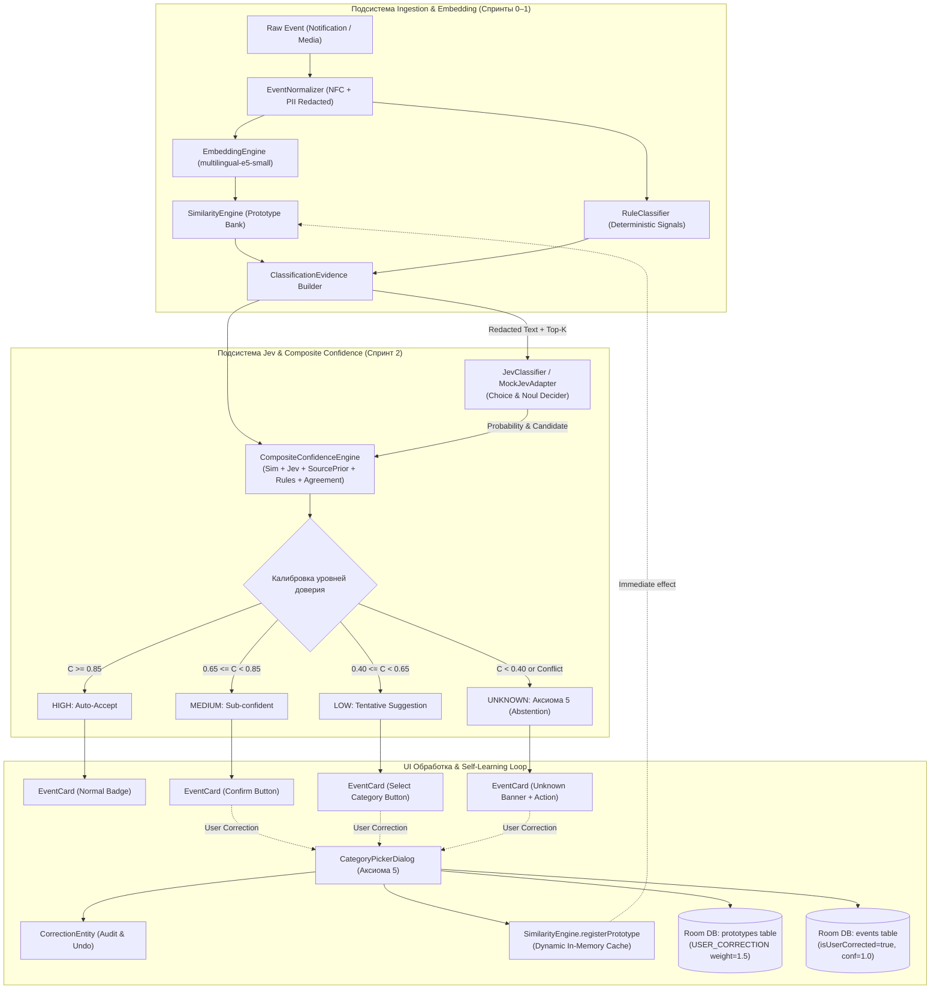

# 📋 Sprint 2 Task Decomposition — Jev Integration & Composite Confidence Engine

> **Sprint Focus:** Пункты 10, 11, 12, 13, 20, 21, 22 мастер-спецификации.  
> **Sprint Goal:** Интегрировать механизм принятия решений Jev (через изолированный контракт и Mock-адаптер без утечек PII), внедрить `CompositeConfidenceEngine` со взвешенным калиброванным скорингом и 4 уровнями уверенности (High, Medium, Low, Unknown), реализовать UI-обработку сомнительных состояний по Аксиоме 5, замкнуть контур самообучения (Self-Learning Loop) через `SimilarityEngine.registerPrototype` и подтвердить гипотезу превосходства гибридного подхода над baseline на holdout-датасете.  
> **Target Hardware:** Xiaomi Poco M7 (Snapdragon / HyperOS / Android 15) + Android Studio API 35 Emulator.  
> **Status:** Ready for Implementation (Handoff to Coder & QA).

---

## 1. Архитектурная топология Sprint 2



---

## 2. Детальная декомпозиция задач

---

### Task 2.1: Контракт `ClassificationEvidence` и интерфейс `JevClassifier` / `MockJevAdapter` (Пункт 10)
* **Тип:** Core Domain / AI Abstraction Layer
* **Приоритет:** P0 (Blocker)
* **Трудоёмкость:** 1.0 Day
* **Исполнитель:** Coder (Android Core / ML)

#### Техническое описание
Формализовать передачу контекста и свидетельств сходства (Top-K evidence) в механизм принятия решений Jev. Реализовать строгую изоляцию персональных данных (Zero PII Leakage) и создать детерминированный локальный адаптер `MockJevAdapter` для тестирования и автономной работы без сетевых зависимостей.

#### Требования к реализации
1. **Модели свидетельств (`ClassificationEvidence.kt`):**
   ```kotlin
   data class ClassificationEvidence(
       val eventId: String,
       val redactedText: String?,        // Строго после maskPii, без сырых OTP и карт
       val sourceType: EventSource,
       val sourcePackage: String,
       val topCandidates: List<CandidateEvidence>,
       val sourcePrior: Float,           // [0.0..1.0] надежность источника для категории
       val ruleEvidence: RuleEvidence?,  // Результат RuleClassifier
       val modelVersion: String = "multilingual-e5-small-int8-v1",
       val taxonomyVersion: String = "1.0-12cat",
       val timestamp: Long = System.currentTimeMillis()
   )

   data class CandidateEvidence(
       val category: Category,
       val similarity: Float,            // Косинусное сходство L2-векторов [-1.0..1.0]
       val prototypeId: String,
       val rank: Int,                    // 1..K (Top-1, Top-2 и т.д.)
       val isPersonalized: Boolean       // true, если прототип создан пользователем
   )

   data class RuleEvidence(
       val matchedCategory: Category,
       val confidence: Float,            // [0.0..1.0]
       val ruleName: String,
       val isHardOverride: Boolean       // true для жестких regex транзакций и OTP
   )
   ```
2. **Интерфейс классификатора `JevClassifier` (`JevClassifier.kt`):**
   ```kotlin
   interface JevClassifier {
       suspend fun classify(evidence: ClassificationEvidence): JevDecision
   }

   sealed interface JevDecision {
       data class Decision(
           val category: Category,
           val probability: Float,       // [0.0..1.0] откалиброванная уверенность Jev
           val modelVersion: String,
           val rationale: String? = null
       ) : JevDecision

       data class Unavailable(val reason: String) : JevDecision
   }
   ```
3. **Локальный адаптер `MockJevAdapter` (`MockJevAdapter.kt`):**
   - Симулирует контракт Jev Choice / Noul в 100% offline-режиме:
     - Анализирует разрыв между лучшим и вторым кандидатом: $\Delta_{\text{sim}} = \text{Top1.similarity} - \text{Top2.similarity}$.
     - Если детерминированное правило совпадает с Top-1 прототипом $\to$ $P(\text{category}) = \min(1.0, \text{Top1.similarity} + 0.15)$.
     - Если детерминированное правило конфликтует с Top-1 прототипом $\to$ Jev выступает арбитром: если правило имеет `isHardOverride=true`, отдает приоритет правилу; иначе понижает вероятность до спорного уровня ($P \approx 0.50$).
     - Если кандидаты отсутствуют или сходство $< 0.35$ $\to$ возвращает категорию `Category.UNKNOWN`.
   - Поддерживает флаг сбоя `forceUnavailable: Boolean` для стресс-тестирования деградации (Graceful Fallback).

#### Критерии приёмки (Gherkin)
```gherkin
Scenario: Evidence generation without PII leakage
  Given an event with raw text "Сбербанк: код 8492 подтверждает списание 500 RUB"
  When ClassificationEvidence is constructed
  Then `redactedText` contains "[REDACTED_OTP]"
  And `redactedText` does NOT contain "8492"
  And `topCandidates` contains sorted candidates with similarity in range [0.0, 1.0]

Scenario: MockJevAdapter resolves high confidence candidate
  Given ClassificationEvidence where Top-1 is "FINANCE_EXPENSE_FOOD" with similarity 0.92
  And RuleClassifier confirms "FINANCE_EXPENSE_FOOD"
  When MockJevAdapter.classify(evidence) is invoked
  Then it returns JevDecision.Decision with category "FINANCE_EXPENSE_FOOD" and probability >= 0.90
```

---

### Task 2.2: `CompositeConfidenceEngine` и 4 уровня доверия (Пункты 11, 12, 22)
* **Тип:** Core ML / Confidence Engine
* **Приоритет:** P0 (Blocker)
* **Трудоёмкость:** 1.0 Day
* **Исполнитель:** Coder (Android Core)

#### Техническое описание
Реализовать вычисление композитной уверенности $C_{\text{final}}$ на основе многосигнального свидетельства (Similarity, Jev, Source Prior, Rule, Agreement) и строгую калибровку на 4 дискретных уровня доверия: **High**, **Medium**, **Low**, **Unknown**.

#### Математическая модель и формула скоринга
1. **Базовые компоненты скоринга:**
   - $S_{\text{sim}} \in [0.0, 1.0]$: нормированное косинусное сходство Top-1 прототипа: $S_{\text{sim}} = \max(0.0, \text{similarity})$.
   - $S_{\text{Jev}} \in [0.0, 1.0]$: вероятность, назначенная Jev ($P_{\text{Jev}}$). Если Jev недоступен (`Unavailable`), вес перераспределяется.
   - $S_{\text{source}} \in [0.0, 1.0]$: априорная надежность источника (например, SMS от банковского номера 1611 или пакет `com.prisbank.app` для `FINANCE` дает $1.0$; неизвестный мессенджер дает $0.3$).
   - $S_{\text{rule}} \in [0.0, 1.0]$: оценка надежности сработавшего правила из `RuleClassifier` (при отсутствии правила $= 0.0$).
   - $S_{\text{agreement}} \in [0.0, 1.0]$: степень согласованности сигналов:
     $$S_{\text{agreement}} = 0.5 \cdot \mathbb{I}[\arg\max S_{\text{sim}} = \arg\max S_{\text{Jev}}] + 0.5 \cdot \min(1.0, 2 \cdot (\text{Top1}_{\text{sim}} - \text{Top2}_{\text{sim}}))$$
     При жестком конфликте (правило говорит `FINANCE_INCOME`, а вектор говорит `FINANCE_EXPENSE`) $S_{\text{agreement}} = 0.0$.
2. **Взвешенная формула композитной уверенности:**
   $$C_{\text{raw}} = 0.40 \cdot S_{\text{sim}} + 0.30 \cdot S_{\text{Jev}} + 0.10 \cdot S_{\text{source}} + 0.10 \cdot S_{\text{rule}} + 0.10 \cdot S_{\text{agreement}}$$
   *Примечание при отказе Jev:*
   $$C_{\text{raw\_fallback}} = \frac{0.45 \cdot S_{\text{sim}} + 0.20 \cdot S_{\text{source}} + 0.20 \cdot S_{\text{rule}} + 0.15 \cdot S_{\text{agreement}}}{1.0}$$
3. **Калиброванные диапазоны (Пороговая политика):**
   | Уровень уверенности | Диапазон $C_{\text{final}}$ | Поведение системы |
   |---|:---:|---|
   | **HIGH** | $C_{\text{final}} \ge 0.85$ | **Auto-Accept:** автоматическое сохранение категории, фоновые действия разрешены |
   | **MEDIUM** | $0.65 \le C_{\text{final}} < 0.85$ | **Sub-Confident:** назначение категории, показ пользователю с возможностью подтверждения |
   | **LOW** | $0.40 \le C_{\text{final}} < 0.65$ | **Tentative:** отображение предположения, запрет автоматизации |
   | **UNKNOWN** | $C_{\text{final}} < 0.40$ | **Abstention (Аксиома 5):** категория `UNKNOWN`, запрос ручной классификации |

4. **Класс результата `ClassificationResult.kt`:**
   ```kotlin
   enum class ConfidenceLevel { HIGH, MEDIUM, LOW, UNKNOWN }

   data class ClassificationResult(
       val eventId: String,
       val finalCategory: Category,
       val compositeConfidence: Float,
       val level: ConfidenceLevel,
       val evidence: ClassificationEvidence,
       val jevDecision: JevDecision?,
       val explanation: String
   )
   ```

#### Критерии приёмки (Gherkin)
```gherkin
Scenario: High confidence auto-acceptance
  Given S_sim = 0.92, S_Jev = 0.95, S_source = 1.0, S_rule = 0.90, S_agreement = 1.0
  When CompositeConfidenceEngine evaluates the signals
  Then compositeConfidence >= 0.85
  And level is ConfidenceLevel.HIGH

Scenario: Conflict suppression forces abstention
  Given S_sim candidate is "FINANCE_EXPENSE_FOOD" (0.75)
  And RuleClassifier strictly matches "FINANCE_INCOME" (0.95)
  When CompositeConfidenceEngine evaluates the conflicting signals
  Then S_agreement is penalized to 0.0
  And level is downgraded to MEDIUM or LOW
  And explanation mentions signal conflict
```

---

### Task 2.3: UI-обработка неизвестных и сомнительных состояний (Аксиома 5) (Пункты 12, 18)
* **Тип:** UI / Presentation Layer
* **Приоритет:** P1
* **Трудоёмкость:** 1.0 Day
* **Исполнитель:** Coder (Android UI)

#### Техническое описание
Обновить интерфейс Jetpack Compose (`TimelineScreen`, `EventCard`), добавив явное визуальное представление 4 уровней уверенности и интерактивный диалог ручной классификации для событий в состоянии `UNKNOWN` и `MEDIUM/LOW` в строгом соответствии с **Аксиомой 5** (*"Unknown — нормальное состояние, а не ошибка"*).

#### Требования к реализации
1. **Визуальная дифференциация в `EventCard.kt`:**
   - **HIGH:** Обычный бейдж категории (например, зеленый для Finance, фиолетовый для Music) + незаметный чип `✓ 92%`.
   - **MEDIUM:** Янтарный бейдж категории + иконка сомнения `?` + кнопка `"Подтвердить"` (при нажатии фиксирует категорию с `confidence = 1.0`).
   - **LOW:** Полупрозрачный пунктирный бейдж `"Возможно: {Категория}"` + кнопка `"Выбрать категорию"`.
   - **UNKNOWN:** Серый акцентный баннер карточки: *"Категория не определена"* + заметная кнопка с иконкой тега `"Указать категорию"`.
2. **Диалог выбора категории (`CategoryPickerDialog.kt`):**
   - Модальное окно или BottomSheet со списком всех 12 категорий таксономии (`Finance`, `Music`, `Study`, `Message`, `Authentication`, `Advertisement`, `Other` и др.) с фирменными иконками и краткими описаниями.
   - Защита от случайных нажатий: двухэтапное подтверждение (Confirmation step) в соответствии с Аксиомой 5 перед фиксацией изменения.
3. **Интеграция с базой данных:**
   - При выборе пользователем категории обновлять запись в Room DB: `category = selectedCategory`, `isUserCorrected = true`, `confidence = 1.0f`.
   - Инициировать событие для контура самообучения (Task 2.4).

#### Критерии приёмки (Gherkin)
```gherkin
Scenario: Unknown event renders action button
  Given an event in the timeline with level UNKNOWN and category UNKNOWN
  When EventCard is rendered in Compose
  Then it displays the "Категория не определена" label
  And displays a button "Указать категорию"

Scenario: User confirms category via CategoryPickerDialog
  Given a user taps "Указать категорию" on an UNKNOWN event
  When the user selects "FINANCE_EXPENSE_FOOD" and confirms
  Then the event category in Room is updated to "FINANCE_EXPENSE_FOOD"
  And `isUserCorrected` is set to true
  And the card updates in the timeline to show the confirmed category
```

---

### Task 2.4: Обратная связь и Self-Learning Loop (`registerPrototype`) (Пункты 13, 31)
* **Тип:** Continuous Learning / Personalization
* **Приоритет:** P0 (Blocker)
* **Трудоёмкость:** 1.0 Day
* **Исполнитель:** Coder (Android Core / Storage)

#### Техническое описание
Реализовать контур моментального дообучения системы на действиях пользователя без переобучения нейросети (Memory-based Personalization): при ручной корректировке категории в UI формировать персональный прототип, сохранять его в Room DB и регистрировать в оперативной памяти через `SimilarityEngine.registerPrototype`.

#### Требования к реализации
1. **Таблица аудита исправлений `CorrectionEntity.kt` (`AppDatabase.kt`):**
   ```kotlin
   @Entity(tableName = "user_corrections")
   data class CorrectionEntity(
       @PrimaryKey(autoGenerate = true) val id: Long = 0,
       val eventId: String,
       val previousCategory: Category,
       val correctedCategory: Category,
       val normalizedText: String,
       val sourcePackage: String,
       val timestamp: Long = System.currentTimeMillis(),
       val isUndone: Boolean = false
   )
   ```
2. **Сервис обработки коррекций `UserCorrectionHandler.kt`:**
   - При получении пользовательского выбора:
     1. Записывает факт правки в `CorrectionEntity`.
     2. Извлекает вектор события: если в `event.embedding` вектор уже сохранен — использует его; иначе вызывает `EmbeddingEngine.embed(event.normalizedText)`.
     3. Создает новый `PrototypeEntity` со свойствами:
        - `id = "custom_${UUID.randomUUID()}"`
        - `category = correctedCategory`
        - `canonicalText = event.normalizedText`
        - `weight = 1.5f` (повышенный вес персонального примера по отношению к сидам с весом 1.0)
        - `supportCount = 1`
        - `source = "USER_CORRECTION"`
        - `isUserCustom = true`
     4. Сохраняет `PrototypeEntity` в Room DB (`prototypeDao.insert(entity)`).
     5. Вызывает `similarityEngine.registerPrototype(cachedPrototype)`:
        - Мгновенное обновление `CopyOnWriteArrayList<CachedPrototype>` в RAM без необходимости перезапуска приложения или полного ребилда кэша из SQLite!
3. **Безопасность и гигиена персональных прототипов:**
   - Не сохранять прототипы, если `normalizedText` состоит исключительно из `[REDACTED_OTP]` или является пустым.
   - Лимит персональных прототипов: не более 30 пользовательских прототипов на категорию во избежание раздувания памяти (FIFO вытеснение старых).

#### Критерии приёмки (Gherkin)
```gherkin
Scenario: User correction instantly influences subsequent classification
  Given an incoming notification "Перевод на карту другу 1000" initially misclassified as "FINANCE_EXPENSE_SHOPPING"
  When the user manually corrects it to "FINANCE_TRANSFER"
  Then a new PrototypeEntity is stored in Room with source "USER_CORRECTION" and weight 1.5
  And `SimilarityEngine.registerPrototype` is invoked
  And when an identical query vector is classified again
  Then Top-1 category is "FINANCE_TRANSFER" with high confidence
```

---

### Task 2.5: Матрица сравнения качества и Gate Checkpoint Sprint 2 (Пункты 20, 21)
* **Тип:** QA / MLOps / Benchmarking
* **Приоритет:** P0 (Blocker)
* **Трудоёмкость:** 1.0 Day
* **Исполнитель:** QA / MLOps

#### Техническое описание
Разработать автоматизированный стенд оценки качества на отложенной выборке `holdout_eval.json` (252 сэмпла) для экспериментального доказательства ключевой гипотезы проекта (Пункт 40): *«Превосходит ли гибридный конвейер (Embedding + Jev/Mock + CompositeConfidence) раздельные подходы Rules-only и Embedding-only?»*

#### Требования к реализации
1. **Скрипт бенчмаркинга `scripts/evaluate_sprint2_gate.py`:**
   - Загружает `dataset/holdout_eval.json`.
   - Прогоняет каждый пример через 4 конфигурации:
     1. **Rules Only:** чистый детерминированный `RuleClassifier`.
     2. **Embedding Only:** поиск Top-1 прототипа по косинусному сходству без скоринга.
     3. **Hybrid Engine (Sprint 2):** полный конвейер (Rules + Embedding Top-K + MockJev + CompositeConfidence).
     4. **Baseline Reference:** эталонные метки датасета.
2. **Метрики сравнения:**
   - Overall Accuracy и Macro F1.
   - Per-category F1 (особенно на hard cases: `finance.income` vs `transfer`, `study.lesson` vs `study.deadline`).
   - Unknown Rate (доля событий с $C_{\text{final}} < 0.40$).
   - Latency инференса (p50, p95).
3. **Генерация артефакта отчета `build_tmp/sprint2_eval_report.json`:**
   - Полная матрица ошибок (Confusion Matrix) для гибридного конвейера.
   - Проверка выполнения критериев Gate Checkpoint.

#### Критерии приёмки (Gherkin)
```gherkin
Scenario: Sprint 2 Gate Checkpoint evaluation
  Given `dataset/holdout_eval.json` with 252 balanced samples
  When `python scripts/evaluate_sprint2_gate.py` is executed
  Then it outputs the comparison table across 4 configurations
  And confirms that Hybrid Macro F1 >= 0.90
  And confirms that Hybrid F1 exceeds Embedding-only F1 by at least +2.5%
  And Unknown rate on clean holdout is between 1% and 6%
  And generates `build_tmp/sprint2_eval_report.json` with status "GATE_PASSED"
```

---

## 3. Definition of Done (DoD) по ролям

### 👨‍💻 1. Definition of Done для Coder (Android Lead / Core Dev)
- [ ] **Архитектурный контракт:** Реализованы `ClassificationEvidence`, `CandidateEvidence`, `RuleEvidence` и интерфейс `JevClassifier`.
- [ ] **Калиброванный движок:** Реализован `CompositeConfidenceEngine` с весами `(0.40, 0.30, 0.10, 0.10, 0.10)` и детерминированным разделением на 4 уровня (`HIGH`, `MEDIUM`, `LOW`, `UNKNOWN`).
- [ ] **UI по Аксиоме 5:** В `TimelineScreen` карточки событий визуально отражают уровень уверенности; карточка `UNKNOWN` содержит кнопку выбора категории; внедрен `CategoryPickerDialog`.
- [ ] **Self-Learning Loop:** При изменении категории пользователем создается `CorrectionEntity`, генерируется `PrototypeEntity` (`weight = 1.5`), вызывается `SimilarityEngine.registerPrototype()`, и последующие схожие события немедленно классифицируются с учетом новой правки.
- [ ] **Unit Tests:** Все модули покрыты тестами (`CompositeConfidenceEngineTest`, `SelfLearningLoopTest`, `MockJevAdapterTest`). `./gradlew testDebugUnitTest` завершается с кодом 0.

### 🕵️ 2. Definition of Done для QA (Quality Assurance)
- [ ] **Holdout Gate:** Скрипт `scripts/evaluate_sprint2_gate.py` показывает Macro F1 гибридного пайплайна $\ge 0.90$ на holdout-выборке.
- [ ] **Превосходство гибрида (STOP #3):** Подтверждено преимущество Hybrid над Embedding-only ($\Delta \text{F1} \ge +2.5\%$), особенно на конфликтных финансовых транзакциях.
- [ ] **Верификация UI на устройстве:** На Poco M7 проверен сценарий: событие с низким скором корректно отображается как `UNKNOWN`, при клике на выбор категории открывается диалог, категория меняется и сохраняется в Room DB.
- [ ] **Zero PII в Evidence:** Проверено с помощью логов: в `ClassificationEvidence.redactedText` и в аргументы `JevClassifier` не попадают открытые OTP-коды или полные номера карт.

---

## 4. Sprint 2 Kill-Triggers (Критерии немедленной остановки)

> ⚠️ **КРИТЕРИИ ОСТАНОВКИ И ПИВОТА ПО СПРИНТУ 2 (STOP #3 МАСТЕР-ПЛАНА):**  
> Если в процессе выполнения спринта наступает хотя бы одно из условий, разработка немедленно **ОСТАНАВЛИВАЕТСЯ** для пересмотра архитектуры:

1. **Jev Redundancy (STOP #3):** Гибридный пайплайн (Embedding + Jev/Mock) показывает прирост Macro F1 **$< 1.0\%$** по сравнению с чистым `Embedding + Rules` на holdout-датасете $\to$ *отказ от отдельного шага Jev, фиксация архитектуры на легковесном локальном Similarity + Rules Engine*.
2. **Pipeline Latency Spike:** Полное время классификации одного события (`Normalization` + `Embedding` + `Similarity` + `Jev/Mock` + `CompositeConfidence`) на процессоре Poco M7 превышает **$60\text{ мс}$** в p95.
3. **Memory Bloat в Self-Learning:** Регистрация пользовательских прототипов вызывает утечку памяти или неконтролируемый рост кучи ($> 15\text{ MB}$ на 100 правок).
4. **PII Leakage Failure:** Обнаружена передача неэкранированного OTP-пароля или номера карты в структуру `ClassificationEvidence`.

---

## 5. Инструкция по выполнению (Handoff Sequence для Кодера)

Реализацию выполнять строго в следующем порядке:
1. **Шаг 1:** `Task 2.1` — Создать модели данных `ClassificationEvidence.kt`, `CandidateEvidence.kt`, интерфейс `JevClassifier.kt` и реализацию `MockJevAdapter.kt`.
2. **Шаг 2:** `Task 2.2` — Реализовать `CompositeConfidenceEngine.kt` с формулой композитного скоринга, перераспределением весов и enum `ConfidenceLevel`.
3. **Шаг 3:** `Task 2.4` — Создать сущность `CorrectionEntity`, обновить `AppDatabase`, реализовать `UserCorrectionHandler.kt` с вызовом `similarityEngine.registerPrototype()`.
4. **Шаг 4:** `Task 2.3` — Обновить Compose UI: бейджи уверенности в `EventCard.kt`, карточка для `UNKNOWN`, модальный диалог `CategoryPickerDialog.kt`.
5. **Шаг 5:** `Task 2.5` — Разработать `scripts/evaluate_sprint2_gate.py`, прогнать holdout-валидацию 4 режимов, зафиксировать `build_tmp/sprint2_eval_report.json`.
