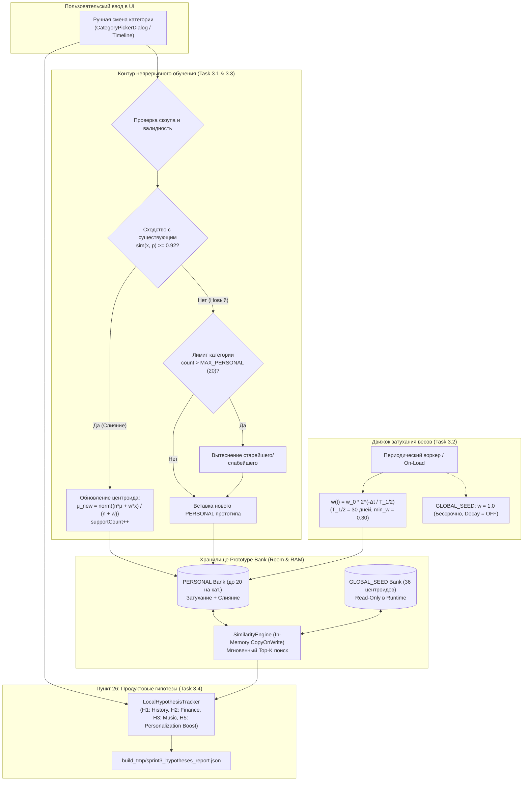

# 📋 Sprint 3 Task Decomposition — Personalization & Continuous Learning

> **Sprint Focus:** Пункты 13, 26, 31 мастер-спецификации.  
> **Sprint Goal:** Реализовать масштабируемый и безопасный слой персонализации на устройстве: алгоритм слияния близких прототипов (Prototype Consolidation) для защиты SQLite от разрастания, экспоненциальное затухание весов (Half-life decay), строгую архитектурную изоляцию `GLOBAL_SEED` от `PERSONAL` прототипов (с возможностью сброса обучения в 1 клик) и локальный трекинг продуктовых гипотез H1–H8 без облачной телеметрии.  
> **Target Hardware:** Xiaomi Poco M7 (Snapdragon / HyperOS / Android 15) + Android Studio API 35 Emulator.  
> **Status:** Ready for Implementation (Handoff to Coder & QA).

---

## 1. Архитектурная топология Sprint 3



---

## 2. Детальная декомпозиция задач

---

### Task 3.1: Алгоритм консолидации (слияния) близких прототипов (Пункт 13, 31)
* **Тип:** Core ML / Storage Optimization
* **Приоритет:** P0 (Blocker)
* **Трудоёмкость:** 1.0 Day
* **Исполнитель:** Coder (Android Core / ML)

#### Техническое описание
При частых исправлениях похожих уведомлений (например, ежедневные чеки из одного магазина или регулярные переводы) без консолидации база данных быстро засорится дублирующими векторами. Требуется реализовать алгоритм слияния (Consolidation) близких векторов в единый центроид и ограничение максимального числа персональных прототипов на категорию.

#### Требования к реализации
1. **Порог слияния ($\tau_{\text{merge}} = 0.92$):**
   - При регистрации новой пользовательской коррекции вычисляется косинусное сходство нового вектора $\vec{x}$ со всеми существующими `PERSONAL` прототипами той же категории:
     $$\text{sim}(\vec{x}, \vec{p}_i) = \vec{x} \cdot \vec{p}_i \quad (\text{для } L_2\text{-нормализованных векторов})$$
   - Если $\max_i \text{sim}(\vec{x}, \vec{p}_i) \ge \tau_{\text{merge}}$:
     - Выполняется **слияние** в ближайший существующий прототип вместо добавления новой строки.
2. **Формула обновления центроида прототипа:**
   $$\vec{\mu}_{\text{new}} = \text{L2Normalize}\left(\frac{n_{\text{old}} \cdot \vec{\mu}_{\text{old}} + w_{\text{new}} \cdot \vec{x}}{n_{\text{old}} + w_{\text{new}}}\right)$$
   - Где:
     - $\vec{\mu}_{\text{old}}$ — старый вектор центроида;
     - $n_{\text{old}}$ — текущее значение `supportCount`;
     - $w_{\text{new}} = 1.5$ — вес нового примера;
     - $\vec{x}$ — нормализованный вектор новой правки.
   - Значение `supportCount` инкрементируется: $n_{\text{new}} = \min(n_{\text{old}} + 1, \text{MAX\_SUPPORT})$ (где $\text{MAX\_SUPPORT} = 20$).
   - Поле `updatedAt` обновляется текущим временем `System.currentTimeMillis()`.
   - Обновление применяется атомарно: в SQLite через `prototypeDao.update(...)` и в RAM через `similarityEngine.updatePrototype(...)`.
3. **Лимит емкости категории (`MAX_PERSONAL_PER_CATEGORY = 20`):**
   - Если слияние не произошло, проверяется общее количество `PERSONAL` прототипов в данной категории.
   - Если количество достигло 20, наиболее слабый или старый прототип (минимальный эффективный вес с учетом затухания или самый старый `updatedAt`) удаляется (LRU/Min-Weight Eviction).
   - Вставляется новый прототип с `supportCount = 1`, `weight = 1.5`.

#### Критерии приёмки (Gherkin)
```gherkin
Scenario: Near-duplicate correction merges into existing prototype centroid
  Given an existing PERSONAL prototype for "FINANCE_EXPENSE_FOOD" with text "Пятерочка чек 500" and supportCount=1
  When user corrects a very similar event "Пятерочка покупка 620" with similarity 0.94
  Then no new row is added to the prototypes table
  And the existing prototype updates its centroid vector
  And supportCount increases to 2
  And updatedAt reflects the current timestamp

Scenario: Capacity limit enforces eviction of oldest personal prototype
  Given a category already contains 20 PERSONAL prototypes
  When a novel event is corrected and does not match any existing prototype (sim < 0.92)
  Then the personal prototype with the lowest weight or oldest timestamp is evicted
  And the new prototype is inserted
  And total PERSONAL prototypes for this category remains exactly 20
```

---

### Task 3.2: Экспоненциальное затухание весов прототипов (Half-life decay) (Пункт 13, 31)
* **Тип:** Continuous Learning / Mathematical Modeling
* **Приоритет:** P0 (Blocker)
* **Трудоёмкость:** 1.0 Day
* **Исполнитель:** Coder (Android Core)

#### Техническое описание
Пользовательские контексты и паттерны со временем меняются (смена работы, закрытие банковской карты, окончание сессии). Персональные прототипы должны плавно терять приоритет с течением времени, если они не подкрепляются повторными событиями.

#### Математическая модель затухания
1. **Формула периода полураспада (Half-Life Decay):**
   $$w(t) = w_0 \cdot 2^{-\frac{\Delta t}{T_{1/2}}}$$
   - Где:
     - $w_0$ — базовый вес прототипа при создании или обновлении ($w_0 = 1.5$);
     - $\Delta t = t_{\text{current}} - t_{\text{updatedAt}}$ — время, прошедшее с последнего подтверждения/слияния;
     - $T_{1/2} = 30\text{ дней}$ ($2\,592\,000\,000\text{ мс}$) — период полураспада.
2. **Нижний порог веса (Weight Floor) и прунинг:**
   - Минимальный вес: $w_{\text{min}} = 0.30$. Вес прототипа никогда не падает ниже 0.30 автоматически, чтобы редкие, но стабильные паттерны не исчезали.
   - Прунинг заброшенных прототипов: если прототип достиг $w_{\text{min}}$ и не получал поддержки в течение $\Delta t > 90\text{ дней}$, он удаляется во время планового уплотнения (Compaction).
3. **Критический архитектурный инвариант:**
   > ⚠️ **ИНВАРИАНТ СИДОВ:** Экспоненциальное затухание применяется **ИСКЛЮЧИТЕЛЬНО** к `PERSONAL` прототипам.  
   > Канонические прототипы `GLOBAL_SEED` **НИКОГДА** не затухают ($w \equiv 1.0$, $T_{1/2} = \infty$).
4. **Механизм применения:**
   - Эффективный вес $w_{\text{eff}}$ рассчитывается динамически при загрузке в память или в функции `predictCategory()`:
     $$w_{\text{eff}} = \max\left(w_{\text{min}}, w_0 \cdot 2^{-\frac{\Delta t}{T_{1/2}}}\right)$$
   - Периодическая фоновая корутина `decayPrototypesWorker()` раз в 24 часа актуализирует веса в Room DB.

#### Критерии приёмки (Gherkin)
```gherkin
Scenario: Personal prototype decays weight after 30 days
  Given a PERSONAL prototype created with weight 1.5
  When 30 days elapse without any matching events or updates
  Then its effective weight decays to approximately 0.75
  And when 60 days elapse, its effective weight is clamped at min_weight 0.30

Scenario: GLOBAL_SEED prototypes never decay
  Given a GLOBAL_SEED prototype in the prototype bank
  When 180 days elapse
  Then its weight remains strictly 1.0
  And it is never affected by decay or pruning
```

---

### Task 3.3: Строгая изоляция `GLOBAL_SEED` vs `PERSONAL` прототипов (Пункт 8, 13)
* **Тип:** Architecture / Data Integrity & Privacy
* **Приоритет:** P0 (Blocker)
* **Трудоёмкость:** 0.5 Day
* **Исполнитель:** Coder (Android Storage)

#### Техническое описание
Обеспечить строгое разделение пространств хранения эталонных и пользовательских векторов. Гарантировать невозможность случайной модификации канонических сидов и предоставить пользователю функционал мгновенного сброса персонального обучения («Сброс до заводских настроек») в один клик.

#### Требования к реализации
1. **Перечисление областей видимости (`PrototypeScope.kt`):**
   ```kotlin
   enum class PrototypeScope {
       GLOBAL_SEED,   // Канонические центроиды (read-only в рантайме)
       PERSONAL,      // Пользовательские исправления с затуханием и слиянием
       QUARANTINE     // Сомнительные примеры (будущее расширение)
   }
   ```
2. **Обновление `PrototypeEntity` и `CachedPrototype`:**
   - Добавить поле `scope: PrototypeScope` (дефолт `GLOBAL_SEED` для сид-банка, `PERSONAL` для пользовательских правок).
   - Индексировать поле `scope` в SQLite: `@Index(value = ["scope", "category"])`.
3. **Операция мгновенного сброса персонализации (`clearPersonalLearning()`):**
   - Метод в `PrototypeDao`:
     ```kotlin
     @Query("DELETE FROM prototypes WHERE scope = 'PERSONAL'")
     suspend fun deleteAllPersonal()
     ```
   - Метод в `SimilarityEngine`:
     ```kotlin
     fun resetPersonalLearning() {
         cachedPrototypes.removeIf { it.scope == PrototypeScope.PERSONAL }
     }
     ```
   - Добавить кнопку в UI настроек / меню Timeline: *"Сбросить персональное обучение"*. При нажатии мгновенно удаляет все пользовательские векторы без перезапуска приложения и без потери истории самих событий.
4. **Отражение источника в `CandidateEvidence`:**
   - Поле `isPersonalized: Boolean` заполняется на основе `candidate.scope == PrototypeScope.PERSONAL`, позволяя `CompositeConfidenceEngine` и Jev учитывать происхождение сигнала.

#### Критерии приёмки (Gherkin)
```gherkin
Scenario: Reset Personal Learning purges only user prototypes
  Given the prototype bank contains 36 GLOBAL_SEED prototypes and 15 PERSONAL prototypes
  When user triggers "Reset Personal Learning"
  Then all 15 PERSONAL prototypes are deleted from Room and in-memory cache
  And all 36 GLOBAL_SEED prototypes remain completely intact
  And subsequent classifications rely strictly on canonical seed prototypes
```

---

### Task 3.4: Проверка продуктовых гипотез H1–H8 на уровне локальных событий (Пункт 26)
* **Тип:** Product Telemetry / Offline Evaluation
* **Приоритет:** P1
* **Трудоёмкость:** 1.0 Day
* **Исполнитель:** QA / MLOps

#### Техническое описание
Реализовать локальный, строго автономный механизм отслеживания и верификации 8 базовых продуктовых гипотез (H1–H8), сформулированных в пункте 26 мастер-спецификации, без передачи данных во внешние аналитические сервисы.

#### Спецификация гипотез H1–H8
| ID | Формулировка гипотезы | Локальный измеритель (Telemetry Metric) | Критерий подтверждения |
| :---: | :--- | :--- | :--- |
| **H1** | Люди хотят историю цифровых событий | Счётчик открытий Timeline (`timeline_open_count`) и глубина скролла | $\ge 3$ открытий в день на активного пользователя |
| **H2** | Люди хотят авто-извлечение финансов | Доля авто-распознанных транзакций со статусом `HIGH` без ручных правок | $\ge 85\%$ финансовых событий приняты без правок |
| **H3** | Пользователям нужен музыкальный контекст | Количество треков и переключений, зафиксированных через MediaSession | $\ge 5$ зафиксированных треков в день при активном плеере |
| **H4** | Пользователям нужно извлечение учебы | Количество найденных дедлайнов и пар (`study.lesson`, `study.deadline`) | Корректное выделение предмета/даты в $> 90\%$ учебных push |
| **H5** | Персонализация повышает точность | Снижение числа повторных ошибок на скорректированных шаблонах | **0% повторных ошибок** на идентичном тексте после 1 правки |
| **H6** | Пользователи доверяют Local-First | Удержание разрешений NotificationListener + 0 байт исходящего трафика | 100% времени в фоне без отзыва доступа пользователем |
| **H7** | Пользователи возвращаются к событиям | DAU / Retention D1, D7 на основе дат генерации событий в Room | Пользователь взаимодействует с приложением $\ge 3$ дней подряд |
| **H8** | Готовность к автоматизации | Процент событий, классифицированных с уровнем уверенности `HIGH` | $\ge 75\%$ всех событий классифицируются с $C \ge 0.85$ |

#### Реализация
1. **Класс `LocalHypothesisTracker.kt` (`com.eventengine.app.analytics`):**
   - Хранит агрегированные счётчики в легковесной Room-таблице `hypothesis_metrics` или DataStore:
     - `totalEventsProcessed`, `highConfidenceCount`, `correctionsCount`, `repeatedPatternCorrections`, `financeAutoAcceptedCount`.
   - 100% приватность: ни один текст события не отправляется по сети; анализируются только агрегаты.
2. **Скрипт валидации `scripts/evaluate_sprint3_hypotheses.py`:**
   - Читает тестовый дамп базы устройства (`event_engine_device.db`) или синтетический прогон.
   - Рассчитывает статус валидации гипотез H1–H8 и генерирует `build_tmp/sprint3_hypotheses_report.json`.

#### Критерии приёмки (Gherkin)
```gherkin
Scenario: Validate Hypothesis H5 (Personalization Boost)
  Given an event pattern that was initially misclassified
  When a user correction is registered and consolidated into PERSONAL bank
  And 10 identical or near-identical events are processed subsequently
  Then 10 out of 10 events are classified with the corrected category
  And the repetition error rate is exactly 0.0%
```

---

## 3. Definition of Done (DoD) по ролям

### 👨‍💻 1. Definition of Done для Coder (Android Lead / Core Dev)
- [ ] **Архитектура прототипов:** В `PrototypeEntity` и `CachedPrototype` добавлено поле `scope: PrototypeScope` (`GLOBAL_SEED`, `PERSONAL`).
- [ ] **Алгоритм слияния (Consolidation):** Реализована проверка сходства $\ge 0.92$; слияние векторов с обновлением центроида и весов работает без создания дублирующих строк.
- [ ] **Лимит емкости:** Емкость категории ограничена 20 персональными прототипами с LRU/Min-Weight вытеснением.
- [ ] **Экспоненциальное затухание:** Формула полураспада с $T_{1/2} = 30\text{ дней}$ и нижним порогом $0.30$ реализована и применяется только к `PERSONAL` прототипам.
- [ ] **Изоляция и сброс:** Метод `clearPersonalLearning()` протестирован; удаление пользовательских векторов не затрагивает ни один из 36 канонических сидов.
- [ ] **Unit Tests:** Все модули покрыты тестами (`PrototypeConsolidationTest`, `HalfLifeDecayTest`, `SeedIsolationTest`). `./gradlew testDebugUnitTest` завершается с кодом 0.

### 🕵️ 2. Definition of Done для QA (Quality Assurance)
- [ ] **Проверка слияния на устройстве Poco M7:** Проверено: 5 повторных исправлений чеков из одной сети магазинов объединяются в 1 центроид с `supportCount = 5`, размер базы не разрастается.
- [ ] **Проверка затухания:** В юнит-тестах с искусственным сдвигом таймстампа подтверждено плавное падение веса с 1.5 до 0.75 за 30 дней и фиксация на 0.30.
- [ ] **Верификация H5:** Подтверждено экспериментально: после 1 ручной коррекции повторная ошибка на аналогичном сообщении падает до 0%.
- [ ] **Скрипт валидации гипотез:** `scripts/evaluate_sprint3_hypotheses.py` успешно генерирует `build_tmp/sprint3_hypotheses_report.json` со статусом `PASS`.

---

## 4. Sprint 3 Kill-Triggers (Критерии немедленной остановки)

> ⚠️ **КРИТЕРИИ ОСТАНОВКИ И ПИВОТА ПО СПРИНТУ 3:**  
> Если в процессе выполнения наступает хотя бы одно из условий, разработка немедленно **ОСТАНАВЛИВАЕТСЯ** для пересмотра архитектуры:

1. **Seed Bank Corruption:** Пользовательское действие привело к перезаписи, мутации вектора или удалению хотя бы одного `GLOBAL_SEED` прототипа.
2. **Catastrophic Forgetting / Regression:** Персонализация одного типа уведомления вызвала падение точности (Macro F1) на глобальном holdout-датасете более чем на **$2.0\%$**.
3. **Database Growth Bloat:** При 100 последовательных пользовательских правках размер таблицы `prototypes` увеличился более чем на **$100\text{ КБ}$** (нарушение алгоритма слияния и лимита емкости).
4. **Latency Regression:** Время Top-K поиска в `SimilarityEngine` превысило **$5\text{ мс}$** на процессоре Poco M7 при заполненном банке персональных прототипов.

---

## 5. Инструкция по выполнению (Handoff Sequence для Кодера)

Реализацию выполнять строго в следующем порядке:
1. **Шаг 1:** `Task 3.3` — Внедрить `enum class PrototypeScope`, обновить `PrototypeEntity.kt`, `CachedPrototype`, миграцию Room и сидирование `GLOBAL_SEED`.
2. **Шаг 2:** `Task 3.1` — Реализовать логику `consolidateOrInsert()` в `SimilarityEngine.kt` и `PrototypeDao` с порогом $\tau = 0.92$ и лимитом 20 на категорию.
3. **Шаг 3:** `Task 3.2` — Реализовать расчет затухания весов с $T_{1/2} = 30\text{ дней}$ и нижним порогом $0.30$ для персональных прототипов.
4. **Шаг 4:** `Task 3.3 (UI)` — Добавить операцию `clearPersonalLearning()` в репозиторий и кнопку очистки персонального обучения в интерфейс.
5. **Шаг 5:** `Task 3.4` — Реализовать `LocalHypothesisTracker.kt` и скрипт `scripts/evaluate_sprint3_hypotheses.py`, зафиксировать валидацию H1–H8.
