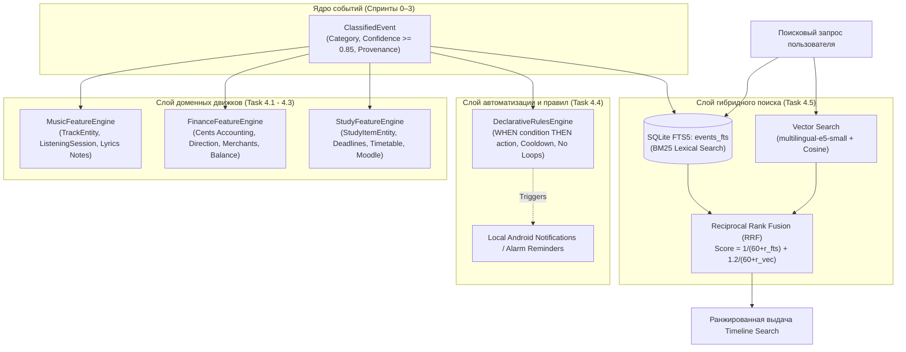

# 📋 Sprint 4 Task Decomposition — Proactive Feature Engines & Rules

> **Sprint Focus:** Пункты 14, 15, 16, 17, 19, 29, 30 мастер-спецификации.  
> **Sprint Goal:** Превратить поток классифицированных событий в прикладную пользу (MVP №2 / №3): внедрить специализированные доменные движки (`MusicFeatureEngine`, `FinanceFeatureEngine`, `StudyFeatureEngine`), декларативный движок пользовательских правил (`DeclarativeRulesEngine`), гибридный поисковый движок (`HybridRetrievalEngine` — SQLite FTS5 + векторный поиск с Reciprocal Rank Fusion) и провести валидацию на тестовом стенде Спринта 4.  
> **Target Hardware:** Xiaomi Poco M7 (Snapdragon / HyperOS / Android 15) + Android Studio API 35 Emulator.  
> **Status:** Ready for Implementation (Handoff to Coder & QA).

---

## 1. Архитектурная топология Sprint 4



---

## 2. Детальная декомпозиция задач

---

### Task 4.1: MusicFeatureEngine (Пункты 14, 29)
* **Тип:** Domain Feature Engine / Media Analytics
* **Приоритет:** P0 (Blocker)
* **Трудоёмкость:** 1.0 Day
* **Исполнитель:** Coder (Android Core)

#### Техническое описание
Реализовать доменный движок агрегации музыкального контекста: отслеживание истории прослушиваний, расчет суммарного времени, выявление любимых треков и артистов, а также поддержка локальных пользовательских заметок и легального интерфейса для текстов песен (без нарушения копирайта).

#### Требования к реализации
1. **Сущность трека `TrackEntity.kt` в Room:**
   ```kotlin
   @Entity(tableName = "music_tracks")
   data class TrackEntity(
       @PrimaryKey val trackKey: String, // SHA256(normalizedTitle + "|" + normalizedArtist + "|" + album)
       val title: String,
       val artist: String,
       val album: String = "",
       val sourcePackage: String,
       val playCount: Int = 1,
       val totalDurationMs: Long = 0L,
       val firstPlayedAt: Long = System.currentTimeMillis(),
       val lastPlayedAt: Long = System.currentTimeMillis(),
       val userNotes: String = "",       // Локальные пользовательские заметки к треку
       val isFavorite: Boolean = false   // playCount >= 5 или суммарно > 15 минут
   )
   ```
2. **Сессия прослушивания `ListeningSessionEntity.kt`:**
   - Агрегация непрерывного воспроизведения: короткие паузы ($\le 30$ сек) не разделяют сессию на две.
   - Идемпотентность: повторные push-уведомления от плеера с тем же треком не инкрементируют `playCount`, пока не начнется новая сессия или не сменится трек.
3. **Легальный контур текстов песен (Пункт 14):**
   - Строгий запрет на парсинг нелегальных сайтов без лицензии.
   - Базовый режим (100% Offline): локальные заметки пользователя к песне (`userNotes`) и структурированные метаданные.
   - Интерфейс `LyricsProvider.kt`:
     ```kotlin
     interface LyricsProvider {
         suspend fun getLyrics(track: TrackEntity): LyricsResult
     }
     ```
     С дефолтной реализацией `OfflineLyricsAdapter` (возвращает сохраненную пользовательскую заметку либо заглушку с предложением сохранить свои мысли к песне).

#### Критерии приёмки (Gherkin)
```gherkin
Scenario: Aggregating media playback into track history
  Given active playback of "Starboy" by "The Weeknd" in Spotify
  When MediaSession records STATE_PLAYING for 180 seconds
  Then TrackEntity is created or updated with totalDurationMs += 180000
  And playCount is incremented by exactly 1
  And rapid pause/resume within 15 seconds does NOT create a separate session

Scenario: Favorite track detection
  Given a track with playCount = 4
  When the track is played for the 5th time
  Then `isFavorite` flag is automatically updated to true
```

---

### Task 4.2: FinanceFeatureEngine (Пункты 15, 29)
* **Тип:** Domain Feature Engine / Financial Accounting
* **Приоритет:** P0 (Blocker)
* **Трудоёмкость:** 1.0 Day
* **Исполнитель:** Coder (Android Core / Data)

#### Техническое описание
Преобразовать финансовые уведомления в строгий, отказоустойчивый финансовый учет. Исключить ошибки округления с плавающей точкой (целочисленный учет копеек/центов), обеспечить нормализацию имен мерчантов, вычисление балансов и корректное разделение направлений транзакций (`INCOME`, `EXPENSE`, `TRANSFER`, `REFUND`).

#### Требования к реализации
1. **Сущность транзакции `FinancialTransactionEntity.kt`:**
   ```kotlin
   enum class FinancialDirection { INCOME, EXPENSE, TRANSFER, REFUND }

   @Entity(
       tableName = "financial_transactions",
       indices = [Index(value = ["eventId"], unique = true)]
   )
   data class FinancialTransactionEntity(
       @PrimaryKey(autoGenerate = true) val id: Long = 0,
       val eventId: String,              // Provenance: ссылка на исходный Event
       val direction: FinancialDirection,
       val amountCents: Long,            // Целочисленный учет: 532.50 руб = 53250L копеек (NO Float!)
       val currencyCode: String,         // "RUB", "RUP", "MDL", "USD", "EUR"
       val rawMerchant: String?,
       val normalizedMerchant: String?,  // Очистка от "OOO", "IP", "POS", "TIRASPOL", "MOSKVA"
       val category: Category,           // EXPENSE_FOOD, TRANSPORT, SHOPPING, etc.
       val timestamp: Long,
       val sourcePackage: String,
       val accountMask: String?          // "**** 1234" (только маскированные 4 цифры)
   )
   ```
2. **Правила финансовой аналитики и балансов:**
   - **`TRANSFER` не является расходом:** переводы между счетами и переводы близким не включаются в чистые траты (Net Spending).
   - **`REFUND` — не доход:** возврат средств уменьшает расход по соответствующей категории либо учитывается как корректирующая дельта.
   - Метод `getFinancialSummary(fromTimestamp: Long, toTimestamp: Long): FinanceSummary`:
     - `totalExpenseCents: Long` (сумма всех `EXPENSE` за вычетом `REFUND`)
     - `totalIncomeCents: Long` (сумма всех `INCOME`)
     - `totalTransferCents: Long` (справочная сумма `TRANSFER`)
     - `topMerchants: List<MerchantSpend>`
3. **Безопасность и PII:**
   - Полный номер карты или счета никогда не сохраняется.
   - OTP-коды строго изолированы и никогда не попадают в таблицу транзакций.

#### Критерии приёмки (Gherkin)
```gherkin
Scenario: Integer cents accounting prevents floating point drift
  Given three consecutive expense transactions: 100.10 RUB, 200.20 RUB, 300.30 RUB
  When FinanceFeatureEngine processes them
  Then amountCents stored are 10010L, 20020L, 30030L
  And total sum is exactly 60060L (600.60 RUB) without IEEE 754 precision errors

Scenario: Transfer is excluded from net expense
  Given a transfer transaction of 5000 RUP with direction TRANSFER
  And a food purchase of 350 RUP with direction EXPENSE
  When financial summary is calculated
  Then totalExpenseCents is exactly 35000L
  And totalTransferCents is 500000L
```

---

### Task 4.3: StudyFeatureEngine (Пункты 16, 29)
* **Тип:** Domain Feature Engine / Education & Timetable
* **Приоритет:** P0 (Blocker)
* **Трудоёмкость:** 1.0 Day
* **Исполнитель:** Coder (Android Core)

#### Техническое описание
Реализовать доменный движок для извлечения информации об учебном процессе (расписание пар, замены аудиторий, дедлайны лабораторных работ из чатов, Moodle и системных оповещений) с поддержкой локальных напоминаний.

#### Требования к реализации
1. **Сущность учебного элемента `StudyItemEntity.kt`:**
   ```kotlin
   enum class StudyItemType { LESSON, DEADLINE, EXAM, ANNOUNCEMENT }
   enum class StudyItemStatus { PENDING, CONFIRMED, COMPLETED, DISMISSED }

   @Entity(tableName = "study_items")
   data class StudyItemEntity(
       @PrimaryKey(autoGenerate = true) val id: Long = 0,
       val sourceEventId: String,
       val type: StudyItemType,
       val subject: String,             // "Базы данных", "Мат. анализ", "ОС"
       val title: String,               // "Лабораторная работа №3", "Лекция в ауд. 204"
       val dueAtEpochMs: Long?,         // Срок сдачи (дедлайн) или время начала пары
       val location: String = "",       // "ауд. 204", "Корпус 3", "Zoom"
       val status: StudyItemStatus = StudyItemStatus.PENDING,
       val reminderOffsetMinutes: Int = 120, // Напомнить за 2 часа
       val createdAt: Long = System.currentTimeMillis()
   )
   ```
2. **Парсер учебных паттернов и относительного времени:**
   - Распознавание дедлайнов: `"до пятницы"`, `"до 23:59"`, `"завтра к 1-й паре"`, `"сдать до 28 сентября"`.
   - Распознавание пар и замен: `"Завтра замена 2 пары в ауд. 108"`, `"Пара по Базам данных отменяется"`.
   - Распознавание шаблонов Moodle: `"Задание 'Лабораторная 3' требует внимания"`.
3. **Локальное планирование напоминаний:**
   - Планирование уведомления за $N$ минут до дедлайна через `AlarmManager` или WorkManager (без сетевых запросов).

#### Критерии приёмки (Gherkin)
```gherkin
Scenario: Deadline extraction from Telegram notification
  Given a message "Не забудьте сдать лабу №3 по Базам данных до пятницы 18:00"
  When StudyFeatureEngine parses the event
  Then a StudyItemEntity is created with type DEADLINE
  And subject is "Базы данных"
  And dueAtEpochMs corresponds to the upcoming Friday at 18:00:00 local time
  And status is PENDING
```

---

### Task 4.4: Declarative Rules Engine (Пункты 17, 30)
* **Тип:** Automation / Rule Engine
* **Приоритет:** P0 (Blocker)
* **Трудоёмкость:** 1.0 Day
* **Исполнитель:** Coder (Android Core)

#### Техническое описание
Реализовать декларативный интерпретатор правил автоматизации (DSL / JSON) формата `WHEN event MATCHES condition THEN action`. Обеспечить полную изоляцию от выполнения произвольного кода, защиту от бесконечных циклов и кулдауны срабатывания.

#### Требования к реализации
1. **Схема декларативного правила (`RuleDefinition.kt`):**
   ```kotlin
   data class RuleDefinition(
       val id: String,
       val name: String,
       val enabled: Boolean = true,
       val whenCondition: RuleCondition,
       val thenActions: List<RuleAction>,
       val cooldownSeconds: Long = 3600L,
       val lastFiredAt: Long = 0L
   )

   sealed interface RuleCondition {
       data class CategoryIs(val category: Category) : RuleCondition
       data class AmountGreater(val minCents: Long) : RuleCondition
       data class TextContains(val substring: String, val ignoreCase: Boolean = true) : RuleCondition
       data class AllOf(val conditions: List<RuleCondition>) : RuleCondition
       data class AnyOf(val conditions: List<RuleCondition>) : RuleCondition
   }

   sealed interface RuleAction {
       data class ShowNotification(val title: String, val message: String) : RuleAction
       data class MarkFavoriteTrack(val trackKey: String? = null) : RuleAction
       data class AddTag(val tag: String) : RuleAction
   }
   ```
2. **Инварианты безопасности (Safety Guarantees):**
   - **Zero Code Execution:** Никакого reflection, динамической загрузки байткода или `eval()`.
   - **Циклическая защита (Loop Prevention):** Действие правила **не имеет права** порождать новое входное событие, повторно активирующее то же правило.
   - **Rate Limiting / Cooldown:** Проверка `currentTime - lastFiredAt >= cooldownSeconds`.
3. **Хранилище правил:**
   - Хранение пользовательских правил в Room DB (`RuleEntity`) с возможностью создания, включения, выключения и редактирования.

#### Критерии приёмки (Gherkin)
```gherkin
Scenario: Rule triggers notification on large food expense
  Given a rule "WHEN category == FINANCE_EXPENSE_FOOD AND amount > 1000 RUB THEN notify 'Крупный чек'"
  When an event with category FINANCE_EXPENSE_FOOD and amount 1250 RUB arrives
  Then the rule fires and executes ShowNotification
  And if an identical event arrives 10 seconds later, the rule does NOT fire due to cooldown
```

---

### Task 4.5: Hybrid Retrieval Engine (SQLite FTS5 + Vector Cosine) (Пункт 19)
* **Тип:** Information Retrieval / Search Engine
* **Приоритет:** P0 (Blocker)
* **Трудоёмкость:** 1.0 Day
* **Исполнитель:** Coder (Android Storage / ML)

#### Техническое описание
Создать гибридный поисковый движок для мгновенного поиска по накопленной истории событий. Совместить лексический поиск по ключевым словам через SQLite FTS5 (BM25) и семантический поиск по смыслу через векторный инференс `multilingual-e5-small` с объединением результатов по алгоритму **Reciprocal Rank Fusion (RRF)**.

#### Требования к реализации
1. **Виртуальная таблица SQLite FTS5 (`EventFtsEntity.kt`):**
   - Индексирует: `normalizedText`, `appName`, `title`.
   - Автоматическая синхронизация через триггеры SQLite или DAO транзакции при добавлении/удалении событий.
2. **Алгоритм объединения рангов Reciprocal Rank Fusion (RRF):**
   - Полнотекстовый поиск возвращает список документов с рангом $r_{\text{fts}}(d)$.
   - Векторный поиск возвращает список документов с рангом $r_{\text{vec}}(d)$ (косинусное сходство вектора запроса с событиями).
   - Композитный скор документа $d$:
     $$\text{RRF}(d) = \frac{1}{60 + r_{\text{fts}}(d)} + \frac{1.2}{60 + r_{\text{vec}}(d)}$$
3. **Фильтрация и задержка:**
   - Применение фильтров: по диапазону дат, по категориям (`Category`), по источникам (`EventSource`).
   - Время гибридного поиска по базе в 5000 событий: $\le 15\text{ мс}$ на Poco M7.

#### Критерии приёмки (Gherkin)
```gherkin
Scenario: Hybrid search retrieves events by semantic concept
  Given events containing "Покупка шаурмы" and "Оплата в кафе"
  When user searches for query "еда"
  Then semantic vector search identifies both events as relevant to food
  And returns them at the top of the search results with high RRF score

Scenario: Lexical FTS5 retrieves exact unique numbers
  Given an event with text "Номер бронирования: XZ-9842"
  When user searches for exact keyword "XZ-9842"
  Then FTS5 instantly retrieves the event at Rank 1
```

---

### Task 4.6: Тестовый стенд и Quality Gate Спринта 4 (Пункты 29, 30)
* **Тип:** Testing / Quality Assurance / MLOps
* **Приоритет:** P0 (Blocker)
* **Трудоёмкость:** 1.0 Day
* **Исполнитель:** QA / MLOps

#### Техническое описание
Разработать автоматизированный тестовый стенд `scripts/evaluate_sprint4_gate.py` и набор инструментальных тестов для комплексной валидации всех доменных движков, правил и гибридного поиска.

#### Проверочные сценарии Quality Gate:
1. **Finance Verification:** 0 ошибок округления на 100 синтетических транзакциях; корректное отделение `TRANSFER` и `REFUND`.
2. **Music Verification:** Корректное формирование `TrackEntity` и подсчет времени сессий.
3. **Study Verification:** Детекция дедлайнов и пар с точностью $\ge 90\%$.
4. **Rules Verification:** Корректное срабатывание предикатов, соблюдение кулдауна, отсутствие зацикливания.
5. **Search Verification:** MRR (Mean Reciprocal Rank) $\ge 0.85$ на тестовом наборе из 30 запросов (лексических и семантических).

#### Критерии приёмки (Gherkin)
```gherkin
Scenario: Sprint 4 Quality Gate execution
  When `python scripts/evaluate_sprint4_gate.py` is executed
  Then all test suites for Finance, Music, Study, Rules, and Search pass
  And `build_tmp/sprint4_eval_report.json` is generated with status "GATE_PASSED"
```

---

## 3. Definition of Done (DoD) по ролям

### 👨‍💻 1. Definition of Done для Coder (Android Lead / Core Dev)
- [ ] **MusicFeatureEngine:** `TrackEntity` сохраняет агрегаты; сессии воспроизведения дебаунсятся; `LyricsProvider` работает в безопасном offline-режиме.
- [ ] **FinanceFeatureEngine:** Учет сумм ведется строго в целочисленных `amountCents: Long`; направления `INCOME`, `EXPENSE`, `TRANSFER`, `REFUND` рассчитываются раздельно; мерчанты нормализуются.
- [ ] **StudyFeatureEngine:** `StudyItemEntity` сохраняет тип, предмет, дедлайн; реализован парсер относительных дат и Moodle-паттернов.
- [ ] **DeclarativeRulesEngine:** Предикаты и действия работают без `eval()`; кулдаун и защита от рекурсивных циклов протестированы.
- [ ] **HybridRetrievalEngine:** Таблица FTS5 `events_fts` синхронизируется с Room; RRF-ранжирование объединяет лексический и семантический поиск.
- [ ] **Unit Tests:** Все модули покрыты тестами (`FinanceEngineTest`, `MusicEngineTest`, `StudyEngineTest`, `RulesEngineTest`, `HybridSearchTest`). `./gradlew testDebugUnitTest` = 0 ошибок.

### 🕵️ 2. Definition of Done для QA (Quality Assurance)
- [ ] На реальном Poco M7 подтверждено: воспроизведение музыки корректно инкрементирует `playCount` и время в `TrackEntity`.
- [ ] Проверено: балансы по банковским уведомлениям сходятся до копейки; переводы не искажают сумму расходов.
- [ ] Проверено: учебные уведомления ("до пятницы 18:00") создают задачу с корректным epoch-таймстампом.
- [ ] Правило с кулдауном 1 час не спамит повторными алертами при частых событиях.
- [ ] Поисковая строка находит события как по точным словам ("XZ-9842"), так и по смыслу ("еда", "поездка").
- [ ] Скрипт `scripts/evaluate_sprint4_gate.py` завершается со статусом `GATE_PASSED`.

---

## 4. Sprint 4 Kill-Triggers (Критерии немедленной остановки)

> ⚠️ **КРИТЕРИИ ОСТАНОВКИ И ПИВОТА ПО СПРИНТУ 4:**  
> Если в процессе выполнения наступает хотя бы одно из условий, разработка немедленно **ОСТАНАВЛИВАЕТСЯ** для пересмотра архитектуры:

1. **Floating Point Corruption:** Обнаружены ошибки вычисления финансового баланса из-за использования чисел с плавающей точкой (вместо `amountCents: Long`).
2. **Infinite Rule Loop:** Пользовательское правило привело к рекурсивному лавинообразному созданию событий и зависанию приложения.
3. **Copyright Violation / Cloud Leak:** Внедрен сетевой скрейпинг защищенных копирайтом текстов песен или отправка финансовых данных в облако.
4. **Search Latency Regression:** Гибридный поиск (FTS5 + Vector RRF) выполняется дольше **$30\text{ мс}$** на Poco M7 на базе в 5000 событий.

---

## 5. Инструкция по выполнению (Handoff Sequence для Кодера)

Реализацию выполнять строго в следующем порядке:
1. **Шаг 1:** `Task 4.2` — Реализовать `FinanceFeatureEngine` (целочисленный учет копеек, модель `FinancialTransactionEntity`, нормализация мерчантов).
2. **Шаг 2:** `Task 4.1` — Реализовать `MusicFeatureEngine` (`TrackEntity`, сессии прослушивания, безопасный `LyricsProvider`).
3. **Шаг 3:** `Task 4.3` — Реализовать `StudyFeatureEngine` (`StudyItemEntity`, парсер дедлайнов и расписания).
4. **Шаг 4:** `Task 4.4` — Создать `DeclarativeRulesEngine` (AST условий, действия, кулдауны, защита от циклов).
5. **Шаг 5:** `Task 4.5` — Внедрить виртуальную таблицу FTS5 в SQLite и `HybridRetrievalEngine` с формулой RRF.
6. **Шаг 6:** `Task 4.6` — Разработать `scripts/evaluate_sprint4_gate.py`, запустить валидацию и сформировать отчет `build_tmp/sprint4_eval_report.json`.
