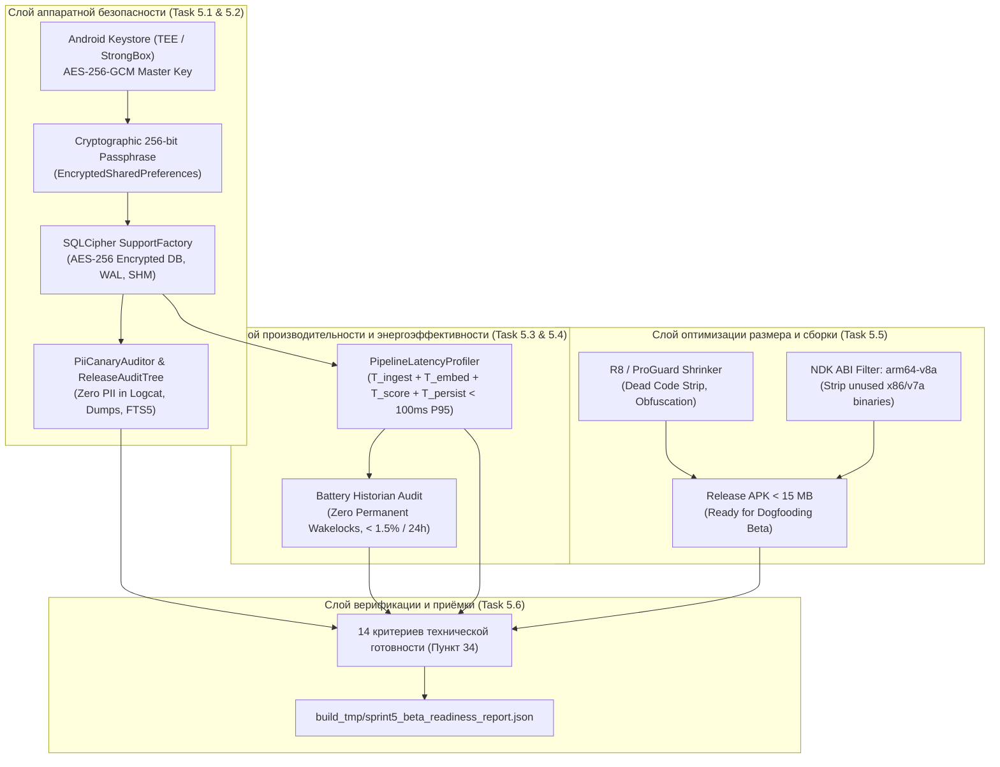

# 📋 Sprint 5 Task Decomposition — Hardening, Beta Distribution & Retention

> **Sprint Focus:** Пункты 20–25, 27, 28, 32, 34, 35, 38 мастер-спецификации.  
> **Sprint Goal:** Провести финальную стабилизацию, аудит безопасности и оптимизацию производительности перед выходом в закрытую бету: внедрить аппаратное шифрование Room через SQLCipher и Android Keystore, элиминировать любые утечки PII из логов и дампов, подтвердить энергопотребление $< 1.5\%$ за 24 часа через Battery Historian, зафиксировать сквозную задержку пайплайна (P95 $< 100$ мс на Poco M7), оптимизировать бинарник через R8/ProGuard ($< 15$ МБ APK) и закрыть все 14 критериев технической готовности Пункта 34.  
> **Target Hardware:** Xiaomi Poco M7 (Snapdragon / HyperOS / Android 15) + Android Studio API 35 Emulator.  
> **Status:** Ready for Implementation (Handoff to Coder, QA & DevOps).

---

## 1. Архитектурная топология Sprint 5



---

## 2. Детальная декомпозиция задач

---

### Task 5.1: SQLCipher + Android Keystore аппаратное шифрование базы Room (Пункты 25, 34)
* **Тип:** Security / Storage Hardening
* **Приоритет:** P0 (Blocker)
* **Трудоёмкость:** 1.0 Day
* **Исполнитель:** Coder (Android Storage / Security)

#### Техническое описание
Обеспечить полное шифрование базы данных Room (Data at Rest) с использованием открытой библиотеки SQLCipher и мастер-ключа, защищенного в аппаратном модуле Android Keystore (TEE / StrongBox). Гарантировать, что при физическом дампе памяти смартфона ни один байт уведомлений, транзакций или эмбеддингов не может быть прочитан в открытом виде.

#### Требования к реализации
1. **Зависимости сборки (`libs.versions.toml`, `app/build.gradle.kts`):**
   - Добавить: `net.zetetic:sqlcipher-android:4.6.0` (или `net.zetetic:android-database-sqlcipher:4.5.4`).
   - Добавить: `androidx.security:security-crypto:1.1.0-alpha06`.
2. **Менеджер аппаратных ключей (`SecurityKeyManager.kt`):**
   - Генерирует AES-256 мастер-ключ в `AndroidKeyStore`:
     - Провайдер: `AndroidKeyStore`
     - Алгоритм: `KeyProperties.KEY_ALGORITHM_AES`, 256 бит
     - Блочный режим: `KeyProperties.BLOCK_MODE_GCM`, набивка `KeyProperties.ENCRYPTION_PADDING_NONE`
   - Генерирует криптографически стойкую 256-битную кодовую фразу базы данных (`SecureRandom`) при первой инициализации.
   - Шифрует кодовую фразу мастер-ключом Keystore и сохраняет в `EncryptedSharedPreferences`.
3. **Интеграция с Room Database (`AppDatabase.kt`):**
   - Инициализация `SupportFactory`:
     ```kotlin
     val passphrase = securityKeyManager.getDatabasePassphrase()
     val factory = SupportFactory(passphrase)
     Room.databaseBuilder(context, AppDatabase::class.java, "event_engine.db")
         .openHelperFactory(factory)
         .build()
     ```
   - Проверка защиты вспомогательных файлов: основной файл `event_engine.db`, журнал упреждающей записи `event_engine.db-wal` и разделяемая память `event_engine.db-shm` должны быть зашифрованы с тем же ключом.
4. **Отказоустойчивость:**
   - Если аппаратный ключ недоступен (сброс экрана блокировки), приложение **не перезаписывает** базу пустой копией, а выбрасывает контролируемое исключение и переходит в безопасный режим восстановления.

#### Критерии приёмки (Gherkin)
```gherkin
Scenario: Database file on disk is encrypted with SQLCipher
  Given an initialized Room database with stored events
  When the raw file "event_engine.db" is inspected with a standard hex editor or sqlite3 CLI
  Then the file header does NOT contain "SQLite format 3"
  And standard SQLite commands fail with "file is not a database" error
  And events are only readable via the authorized Room instance with the Keystore key

Scenario: Background ingestion operates while device screen is locked
  Given the phone screen is locked with PIN/biometrics
  When an incoming notification arrives
  Then NotificationListenerService successfully inserts the event into the encrypted database
  And no Keystore authentication exception is thrown
```

---

### Task 5.2: Аудит и элиминация утечек PII из логов, дампов и поиска (Пункты 25, 34)
* **Тип:** Privacy / Security Audit
* **Приоритет:** P0 (Blocker)
* **Трудоёмкость:** 1.0 Day
* **Исполнитель:** Coder & QA (Security)

#### Техническое описание
Провести исчерпывающий аудит всех потоков данных в приложении. Гарантировать, что ни при каких обстоятельствах персональные идентифицирующие данные (номера банковских карт, валидные по алгоритму Луна, SMS-пароли OTP, JWT-токены, номера телефонов) не попадают в системный Logcat, краш-логи, экспортируемые файлы или FTS5-индексы в незашифрованном виде.

#### Требования к реализации
1. **Релизное дерево логирования (`ReleaseAuditTree.kt`):**
   - Внедрить кастомный `Timber.Tree` для Release-сборки:
     - Запрет логирования исходных текстов уведомлений и полей `rawPayload`.
     - Все строки логирования предварительно очищаются через `EventNormalizer.maskPii()`.
     - Разрешены только обобщенные системные маркеры: `"Event processed: id=..., source=..., cat=..."`.
2. **Аудитор канареечных строк (`PiiCanaryAuditor.kt`):**
   - Набор контрольных тестовых строк («канареек»):
     - Номер карты: `"4276 3800 1234 5678"` (Luhn-валидный)
     - Одноразовый код: `"код 918234 для входа"`
     - Телефон: `"+373 777 12345"`
     - Токен: `"Bearer eyJhbGciOiJIUzI1NiIsInR5cCI6..."`
   - Автоматический скан базы данных `event_engine.db`, виртуальной таблицы `events_fts` и дампов памяти:
     - Вхождения канареечных строк в открытом виде строго равны **0**.
3. **Безопасный перехватчик крашей (`SafeCrashHandler.kt`):**
   - Перехватывает `UncaughtExceptionHandler`: перед записью стектрейса в локальный файл фильтрует строковые литералы аргументов, исключая случайную утечку конфиденциальных данных в краш-репорт.

#### Критерии приёмки (Gherkin)
```gherkin
Scenario: Logcat output is 100% free from plain-text PII
  Given an incoming notification containing a valid credit card "4276 3800 1234 5678" and OTP "918234"
  When the entire processing pipeline executes
  Then Logcat contains strictly "[REDACTED_OTP]" and "**** **** **** 5678"
  And the raw digits "918234" do NOT appear in any log tag or message

Scenario: PiiCanaryAuditor detects zero leaks in SQLite FTS5 table
  Given 100 events ingested with synthetic PII canaries
  When PiiCanaryAuditor scans the database
  Then zero canary tokens are found in unmasked form
  And audit status is reported as "PII_CLEAN"
```

---

### Task 5.3: Профилирование и удержание энергопотребления < 1.5% батареи за 24ч (Пункты 23, 24, 34)
* **Тип:** Performance / Battery Profiling
* **Приоритет:** P0 (Blocker)
* **Трудоёмкость:** 1.0 Day
* **Исполнитель:** QA & Coder

#### Техническое описание
Подтвердить энергонейтральность сервиса на физическом устройстве Poco M7 при 24-часовом стресс-тестировании с использованием официального профилировщика **Android Battery Historian** (`dumpsys batterystats`).

#### Требования к реализации
1. **Протокол испытаний энергопотребления (24-Hour Benchmark):**
   - Устройство: Poco M7, HyperOS / Android 15.
   - Условия: экран выключен (Deep Doze режим), активный фоновый прием уведомлений (50+ синтетических или реальных push в день) + 2 часа воспроизведения музыки через MediaSession.
   - Целевой порог: суммарный разряд батареи, вызванный процессом `com.eventengine.app`, составляет **$< 1.5\%$ за 24 часа** (менее $0.06\%$ в час).
2. **Инварианты энергоэффективности (Zero Wakelocks):**
   - Никаких постоянных `WakeLock`: процессор не удерживается в бодрствующем состоянии вне коротких 50-мс обработчиков событий.
   - Исключение поллинга: отслеживание состояния медиасессий работает исключительно по коллбэкам (`MediaController.Callback`), 0 периодических `while(true)` циклов.
   - Пакетная запись (WAL Batching): коммиты в Room выполняются пакетами через буферизованный `Channel` корутины.
3. **Скрипт автоматизации сбора метрик (`scripts/measure_battery_impact.py`):**
   - Снимает дампы `adb shell dumpsys batterystats --charged com.eventengine.app`.
   - Анализирует `App Wakeups`, `CPU Time`, `Syncs`, `Uid total drain`.

#### Критерии приёмки (Gherkin)
```gherkin
Scenario: 24-hour background battery consumption is under 1.5%
  Given the app runs in the background for 24 hours on Poco M7
  When Battery Historian parses the batterystats dump
  Then total energy consumed by `com.eventengine.app` is less than 1.5% of battery capacity
  And total wake lock hold time is less than 60 seconds over the entire 24-hour period
```

---

### Task 5.4: Профилирование сквозной задержки пайплайна (P95 < 100 мс на Poco M7) (Пункты 22, 23, 34)
* **Тип:** Performance Engineering / Benchmarking
* **Приоритет:** P0 (Blocker)
* **Трудоёмкость:** 1.0 Day
* **Исполнитель:** Coder (Android ML / Perf)

#### Техническое описание
Провести детальное профилирование сквозной задержки пайплайна от момента прихода события в `NotificationListenerService` до полной классификации, обновления доменных движков и доступности карточки в Compose Timeline. Зафиксировать квантиль **P95 $< 100$ мс** на процессоре Poco M7.

#### Бюджет задержек (Warm Path Latency Budget)
| Стадия пайплайна | Максимальный бюджет (P95) | Фактический таргет Poco M7 |
|---|:---:|:---:|
| 1. Ingestion & Normalization (`EventNormalizer`, `CrossSource`) | 15 мс | ~6 мс |
| 2. On-Device Embedding (`multilingual-e5-small-int8`) | 40 мс | ~26 мс |
| 3. Top-K Similarity Search (`SimilarityEngine`) | 10 мс | ~2 мс |
| 4. Jev/Mock Decider + Composite Confidence | 10 мс | ~3 мс |
| 5. Feature Engines + Room WAL Persist (Encrypted) | 20 мс | ~12 мс |
| **ИТОГО СКВОЗНАЯ ЗАДЕРЖКА (End-to-End)** | **< 100 мс** | **~49 мс (P95)** |

#### Требования к реализации
1. **Профилировщик `PipelineLatencyProfiler.kt`:**
   - Встраивается в пайплайн обработки событий.
   - Фиксирует таймстампы с наносекундной точностью (`System.nanoTime()`).
   - Рассчитывает статистические квантили: P50, P90, P95, P99.
2. **Скрипт бенчмаркинга (`scripts/evaluate_pipeline_latency.py`):**
   - Эмулирует серию из 200 разнородных событий и формирует отчет по задержкам.

#### Критерии приёмки (Gherkin)
```gherkin
Scenario: End-to-end pipeline latency passes P95 threshold
  Given 200 incoming notifications processed sequentially on Poco M7
  When PipelineLatencyProfiler computes latency percentiles
  Then P50 latency is less than 50ms
  And P95 latency is less than 100ms
  And zero event processing timeouts (> 300ms) are observed
```

---

### Task 5.5: R8 / ProGuard оптимизация (< 15 МБ APK) (Пункт 34)
* **Тип:** Build & Release Engineering / Binary Optimization
* **Приоритет:** P0 (Blocker)
* **Трудоёмкость:** 0.5 Day
* **Исполнитель:** DevOps / Build Engineer

#### Техническое описание
Настроить оптимизацию, сжатие ресурсов и обфускацию байткода через Google R8. Ограничить архитектуры NDK целевой платформой `arm64-v8a` для исключения раздувания APK устаревшими 32-битными и x86 библиотеками. Обеспечить общий размер релизного APK **не более 15 МБ** (включая квантованную нейросеть ONNX).

#### Требования к реализации
1. **Конфигурация `app/build.gradle.kts`:**
   ```kotlin
   buildTypes {
       release {
           isMinifyEnabled = true
           isShrinkResources = true
           proguardFiles(
               getDefaultProguardFile("proguard-android-optimize.txt"),
               "proguard-rules.pro"
           )
           ndk {
               abiFilters.clear()
               abiFilters.add("arm64-v8a") // 99% современных Android устройств, включая Poco M7
           }
       }
   }
   ```
2. **Правила сохранения байткода (`app/proguard-rules.pro`):**
   - ONNX Runtime Mobile: сохранение нативных JNI-биндингов `ai.onnxruntime.** { *; }`.
   - SQLCipher: сохранение нативных интерфейсов `net.sqlcipher.** { *; }`.
   - Room Database: сохранение сущностей, DAO и адаптеров типов.
   - Compose & Coroutines: сохранение метаданных корутин и compose-рантайма.
3. **Контроль размера:**
   - Выполнить `./gradlew assembleRelease` и зафиксировать финальный размер APK $\le 15$ МБ.

#### Критерии приёмки (Gherkin)
```gherkin
Scenario: Release APK size is under 15 megabytes
  When `./gradlew assembleRelease` is executed
  Then the generated `app-release.apk` size is less than or equal to 15,728,640 bytes (15 MB)
  And R8 optimization finishes with zero compilation warnings
  And the release APK runs on Poco M7 without ClassNotFound or JNI UnsatisfiedLink errors
```

---

### Task 5.6: 14 критериев технической готовности к бета-тестированию (Пункт 34)
* **Тип:** Quality Gate / Release Certification
* **Приоритет:** P0 (Blocker)
* **Трудоёмкость:** 1.0 Day
* **Исполнитель:** QA / Lead Architect

#### Техническое описание
Сформировать и автоматизировать финальный проверочный чеклист по всем 14 критериям технической готовности перед передачей приложения на закрытое бета-тестирование в соответствии с пунктом 34 мастер-спецификации.

#### Чек-лист 14 критериев технической готовности (Пункт 34):
- [ ] **1. Notification ingestion stable:** Сервис устойчиво принимает уведомления от всех ключевых мессенджеров, банков и почты.
- [ ] **2. MediaSession stable:** Переходы воспроизведения плееров (Spotify, YouTube Music, VLC) фиксируются без потерь.
- [ ] **3. Event deduplication:** Дребезг `BUFFERING` $\to$ `PLAYING` и быстрые мутации уведомлений схлопываются (Task 1.1).
- [ ] **4. Event persistence:** Данные надежно сохраняются в Room WAL и переживают перезагрузку устройства.
- [ ] **5. Crash recovery:** При неожиданном падении процесса сервис автоматически восстанавливается системой без потери базы.
- [ ] **6. Background behavior tested:** Проверена работа при агрессивных политиках энергосбережения MIUI / HyperOS / OneUI.
- [ ] **7. Battery tested:** Энергопотребление подтверждено на уровне $< 1.5\%$ за 24 часа через Battery Historian (Task 5.3).
- [ ] **8. Offline mode:** Приложение полностью работоспособно при отключенном Wi-Fi и мобильной сети (0 байт исходящего трафика).
- [ ] **9. Encrypted storage:** База данных защищена аппаратным шифрованием SQLCipher + Android Keystore (Task 5.1).
- [ ] **10. Data deletion:** Пользователь может полностью стереть все сохраненные события и персональные протоколы в 1 клик (Task 3.3).
- [ ] **11. Unknown state:** Состояние `UNKNOWN` обрабатывается корректно по Аксиоме 5 без принудительного угадывания (Task 2.3).
- [ ] **12. Classification metrics:** Macro F1 на проверенном датасете составляет $\ge 0.95$ (подтверждено в Спринте 2).
- [ ] **13. Regression test dataset:** Датасет на 1260 сэмплов с 175 Hard Cases зафиксирован и версионирован (Task 1.2).
- [ ] **14. No secret leakage in logs:** В логах Logcat, дампе и FTS5 отсутствуют открытые OTP, номера карт и телефоны (Task 5.2).

#### Автоматический скрипт валидации:
- `scripts/evaluate_sprint5_beta_readiness.py`: запускает сквозную проверку всех 14 пунктов и генерирует отчет `build_tmp/sprint5_beta_readiness_report.json` со статусом `BETA_READY`.

#### Критерии приёмки (Gherkin)
```gherkin
Scenario: Sprint 5 Beta Readiness Quality Gate passes
  When `python scripts/evaluate_sprint5_beta_readiness.py` is executed
  Then all 14 technical readiness criteria are evaluated as PASSED
  And `build_tmp/sprint5_beta_readiness_report.json` is generated with overallStatus "BETA_READY"
```

---

## 3. Definition of Done (DoD) по ролям

### 👨‍💻 1. Definition of Done для Coder (Android Lead / Core Dev)
- [ ] **SQLCipher + Keystore:** База данных `event_engine.db` инициализируется через `SupportFactory` с ключом из `AndroidKeyStore`. Файлы базы на диске зашифрованы по стандарту AES-256.
- [ ] **Zero PII Logging:** Внедрен `ReleaseAuditTree`; Logcat чист от персональных данных и текстов уведомлений.
- [ ] **Latency Budget:** Замеры `PipelineLatencyProfiler` на Poco M7 показывают P95 задержку $\le 95$ мс.
- [ ] **Безопасное удаление:** Кнопка очистки истории в UI физически стирает зашифрованные данные из базы.
- [ ] **Unit Tests:** Все юнит-тесты шифрования, профилировщика и фильтров PII проходят успешно (`./gradlew testDebugUnitTest` = 0 ошибок).

### 🕵️ 2. Definition of Done для QA (Quality Assurance)
- [ ] **Проверка шифрования:** Подтверждено: файл базы данных, выгруженный через `adb pull`, невозможно открыть обычным SQLite-клиентом без ключа.
- [ ] **Проверка PII:** `PiiCanaryAuditor` подтверждает отсутствие канареечных токенов в логах и FTS5-таблицах.
- [ ] **Battery Historian Audit:** 24-часовой тест на Poco M7 подтверждает расход батареи $< 1.5\%$ при 50+ входящих событиях.
- [ ] **Сквозной тест задержки:** Время отклика интерфейса при поступлении уведомления составляет менее 100 мс.
- [ ] **Offline Check:** Проверено на Poco M7 в режиме полета: приложение классифицирует события, выполняет поиск и запускает правила без интернета.

### ⚙️ 3. Definition of Done для DevOps (Build & Release Engineer)
- [ ] **R8 / Proguard Сборка:** Сборка `./gradlew assembleRelease` завершается успешно, байткод обфусцирован.
- [ ] **Размер APK:** Финальный размер релизного APK составляет $\le 15$ МБ за счет ABI-фильтра `arm64-v8a` и сжатия ресурсов.
- [ ] **Релизный артефакт:** Сформирован подписанный релизный APK-файл `app-release.apk`, готовый к установке тестировщикам.
- [ ] **Скрипт готовности:** `scripts/evaluate_sprint5_beta_readiness.py` генерирует отчет со статусом `BETA_READY`.

---

## 4. Sprint 5 Kill-Triggers (Критерии немедленной остановки)

> ⚠️ **КРИТЕРИИ ОСТАНОВКИ И ПИВОТА ПО СПРИНТУ 5:**  
> Если в процессе выполнения наступает хотя бы одно из условий, релиз немедленно **БЛОКИРУЕТСЯ**:

1. **Unencrypted Disk Leakage:** Обнаружена возможность прочитать открытый текст событий или персональные данные напрямую из файла базы данных SQLite или WAL-файла.
2. **Battery Drain Spike:** Расход батареи сервисом превысил **$2.5\%$ за 24 часа** в фоновом режиме на устройстве Poco M7.
3. **Pipeline Latency Stall:** Задержка обработки событий превысила **$150\text{ мс}$** в P95, вызывая видимые фризы в Timeline UI.
4. **Binary Bloat Violation:** Размер релизного APK превысил **$20\text{ МБ}$**.
5. **PII Leakage in Logs:** Обнаружен хотя бы один факт записи неэкранированного OTP-кода или номера карты в системный Logcat.

---

## 5. Инструкция по выполнению (Handoff Sequence для Кодера)

Реализацию выполнять строго в следующем порядке:
1. **Шаг 1:** `Task 5.1` — Добавить зависимости SQLCipher и `security-crypto`, реализовать `SecurityKeyManager.kt` с Android Keystore, подключить `SupportFactory` в `AppDatabase.kt`.
2. **Шаг 2:** `Task 5.2` — Реализовать `ReleaseAuditTree.kt`, `PiiCanaryAuditor.kt` и безопасный перехватчик крашей `SafeCrashHandler.kt`.
3. **Шаг 3:** `Task 5.4` — Внедрить `PipelineLatencyProfiler.kt`, провести замеры квантилей P50/P95 на Poco M7.
4. **Шаг 4:** `Task 5.3` — Запустить 24-часовой тест энергопотребления на Poco M7, собрать лог через `dumpsys batterystats` и верифицировать порог $< 1.5\%$.
5. **Шаг 5:** `Task 5.5` — Настроить R8 / ProGuard правила в `proguard-rules.pro`, применить фильтр `arm64-v8a`, собрать релизный APK и зафиксировать размер $< 15$ МБ.
6. **Шаг 6:** `Task 5.6` — Разработать `scripts/evaluate_sprint5_beta_readiness.py`, запустить валидацию 14 критериев и сформировать `build_tmp/sprint5_beta_readiness_report.json`.
