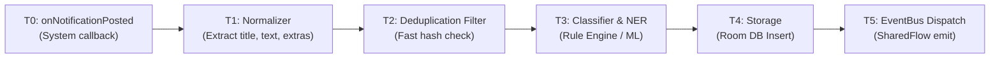

# TEST PLAN — SPRINT 0
## Android Event Engine: Ingestion, Classification & Performance Verification

| Документ | Версия | Статус | Ответственный | Дата |
| :--- | :--- | :--- | :--- | :--- |
| `TEST_PLAN_SPRINT_0.md` | 1.0.0 | **APPROVED** | QA / Test & Dataset Lead | 22 сентября 2026 |

---

## 1. Введение и цели Sprint 0

**Android Event Engine** — фоновый сервисный движок на платформе Android, осуществляющий перехват, нормализацию, классификацию и диспетчеризацию входящих событий реального времени (push-уведомления приложений, SMS, MediaSession аудио/видео, системные алерты).

### 1.1. Главные задачи Sprint 0
1. **Ingestion Layer:** Обеспечение стабильного перехвата событий из `NotificationListenerService` и `MediaSessionManager` без потери пакетов и без UI-фризов системы.
2. **Dataset & Classification:** Формирование эталонного датасета (`dataset/golden_dataset.json`) и верификация алгоритмов классификации на 12 категориях с акцентом на критические hard-кейсы.
3. **Automated Emulation:** Развертывание пайплайна быстрой эмуляции событий через `adb shell cmd notification post` для CI/CD и локального регрессионного тестирования без ручных манипуляций.
4. **Performance & Energy Profiling:** Валидация жестких нефункциональных требований (NFR) по Latency ($p50 < 3\text{ ms}, p95 < 8\text{ ms}, p99 < 15\text{ ms}$), потреблению памяти (PSS $< 35\text{ MB}$) и расходу батареи ($< 1.5\%$ в сутки).

---

## 2. Критерии качества и целевые ML-метрики (Quality Gates)

Классификация событий разделена на 12 целевых классов:
1. `finance.income` — пополнения, зарплата, переводы от третьих лиц, кэшбэк, возврат средств.
2. `finance.expense.food` — супермаркеты, кафе, рестораны, сервисы доставки еды.
3. `finance.expense.transport` — такси, метро, АЗС, каршеринг, Ж/Д и авиабилеты.
4. `finance.expense.shopping` — маркетплейсы, электроника, аптеки, одежда, ритейл.
5. `finance.transfer` — переводы клиентам банков, СБП, переводы между своими счетами, автоплатежи.
6. `music` — медиа-сессии (Spotify, YouTube Music, VLC, Яндекс Музыка).
7. `study.lesson` — расписания, отмены/замены пар, ссылки на онлайн-лекции.
8. `study.deadline` — дедлайны задач Moodle, сдача отчетов, напоминания о контрольных.
9. `message` — личные и групповые сообщения мессенджеров (Telegram, WhatsApp, VK).
10. `advertisement` — маркетинговые акции, промокоды, скидки и спецпредложения.
11. `authentication` — коды двухфакторной аутентификации (OTP/2FA, СМС от банков и сервисов).
12. `other` — системные уведомления Android, статус зарядки, загрузка файлов, погода.

### Таблица Quality Gates

| Метрика | Минимальный порог | Целевой уровень | Обоснование |
| :--- | :--- | :--- | :--- |
| **Macro F1 Score** | $\ge 0.88$ | $\mathbf{\ge 0.90}$ | Равномерное качество распознавания по всем 12 классам без перекосов |
| **Finance Precision** | $\ge 0.95$ | $\mathbf{\ge 0.98}$ | **Критично:** Ложное срабатывание в финансах искажает баланс и бюджет |
| **Authentication Recall** | $\ge 0.95$ | $\mathbf{\ge 0.99}$ | **Критично:** Пропуск одноразового кода блокирует пользователя |
| **Unknown Rate** | $\le 8.0\%$ | $\mathbf{\le 5.0\%}$ | Доля уведомлений, не получивших классификацию |
| **Ingestion Loss Rate** | $0.0\%$ | $\mathbf{0.0\%}$ | Нулевая потеря событий при перехвате на системном уровне |
| **Pipeline Latency ($p95$)** | $\le 12\text{ ms}$ | $\mathbf{\le 8\text{ ms}}$ | Реакция движка в реальном времени |
| **Memory Footprint (PSS)** | $\le 45\text{ MB}$ | $\mathbf{\le 35\text{ MB}}$ | Фоновая служба не должна вызывать Low Memory Killer (LMK) |

> [!IMPORTANT]
> **Принцип финансовой безопасности:** Ложноположительное определение рекламы как дохода (`advertisement` $\rightarrow$ `finance.income`) или списания расценивается как **Blocker Bug**.

---

## 3. Матрица тестирования Ingestion Layer

Модуль Ingestion слушает системные события Android через два ключевых провайдера:
- `AndroidNotificationListenerService` (`android.service.notification.NotificationListenerService`)
- `AndroidMediaSessionManager` (`android.media.session.MediaSessionManager`)

### 3.1. Матрица источников и форматов уведомлений

| Пакет приложения | Название | Типы уведомлений | Извлекаемые поля | Пограничные ситуации (Edge Cases) |
| :--- | :--- | :--- | :--- | :--- |
| `ru.sberbankmobile` | СберБанк / Сбер | Push, SMS (900), транзакции, реклама, OTP | `title`, `text`, `subText`, `bigText`, `when` | Сверхкороткие тексты ("Сбер: Перевод 1000", "Оплата 1000"), замена суммы бонусами, отмена операций |
| `com.idamob.tinkoff.android` | Т-Банк (Тинькофф) | СБП, P2P, покупки, холды 0 ₽, кэшбэк дня | `title`, `text`, `bigText`, `tickerText`, `extras` | Списания 0 ₽ (валидация подписок), пуши с несколькими суммами (сумма + кэшбэк) |
| `org.telegram.messenger` | Telegram | Личные чаты, каналы, учебные группы | `title` (Sender/Chat), `text`, `MessagingStyle` | Мульти-сообщения, групповые уведомления (`FLAG_GROUP_SUMMARY`), скрытое превью (пароль блокировки) |
| `com.moodle.moodlemobile` | Moodle SPSU | Напоминания о дедлайнах, оценки, тесты | `title` (Course), `text` (Task), `subText` | Дедлайны в разных временных поясах, уведомления об открытии и закрытии заданий |
| `android` / `com.android.systemui` | Android System | Зарядка, Low Battery, USB, DND, Screenshot | `title`, `text`, `channelId`, `category` | Системные прогресс-бары (скачивание), постоянные уведомления (`FLAG_ONGOING_EVENT`) |

### 3.2. Матрица тестирования MediaSession

| Пакет приложения | Сервис | Поддерживаемые состояния | Метаданные трека | Проверяемые сценарии |
| :--- | :--- | :--- | :--- | :--- |
| `com.spotify.music` | Spotify | `PLAYING`, `PAUSED`, `STOPPED`, `SKIPPING` | Title, Artist, Album, Duration | Быстрая смена треков (<200 мс), переход в фоновый режим, смена плейлиста |
| `com.google.android.apps.youtube.music` | YouTube Music | `PLAYING`, `PAUSED`, `BUFFERING` | Title, Artist, Album Art URI | Подкасты без альбома, прямые трансляции (без конечного Duration) |
| `org.videolan.vlc` | VLC Player | `PLAYING`, `PAUSED`, `STOPPED` | Title, Track, Media URI | Локальные файлы без ID3-тегов (Fallback на имя файла), видео-поток |
| `ru.yandex.music` | Яндекс Музыка | `PLAYING`, `PAUSED`, `FAST_FORWARDING` | Title, Artist, Album | Моя волна (бесконечный поток), аудиокниги с главами |

### 3.3. Тестирование системных флагов и жизненного цикла

1. **Группировка уведомлений (Summary vs Child):**
   - Уведомления с `Notification.FLAG_GROUP_SUMMARY = true` содержат агрегированный заголовок (например, "Telegram: 5 новых сообщений").
   - **Правило движка:** Игнорировать summary-уведомление, если оно не содержит нового атомарного контента, или обрабатывать дочерние элементы (`sbn.getNotification().extras.getParcelableArray(Notification.EXTRA_MESSAGES)`).
2. **Жизненный цикл удаления (`onNotificationRemoved`):**
   - Проверка: удаление уведомления пользователем или системой не должно сбрасывать сохраненное в Room состояние уже распознанного события.
3. **Обновление уведомлений на месте (`Notification Update`):**
   - Прогресс скачивания файла (0% $\rightarrow$ 50% $\rightarrow$ 100%) или статус такси ("Машина назначена" $\rightarrow$ "Подъезжает" $\rightarrow$ "В пути").
   - **Правило движка:** Дедупликация через sliding-window хэширование (MD5 заголовка и ключевых параметров), чтобы не спамить 100 событий на один заказ такси.

---

## 4. Архитектура Golden Dataset и разбор Hard-кейсов

Эталонный датасет сохранен в [`dataset/golden_dataset.json`](file:///c:/Users/DaniilTuT/Documents/antigravity/quick-nobel/dataset/golden_dataset.json) и валидируется через [`dataset/schema.json`](file:///c:/Users/DaniilTuT/Documents/antigravity/quick-nobel/dataset/schema.json).

### 4.1. Сводная статистика датасета
- **Всего размеченных примеров:** 135
- **Целевых категорий:** 12
- **Доля Hard-кейсов:** 14.1% (19 примеров повышенной сложности)
- **Precision-Critical кейсов:** 66.7% (90 примеров)

### 4.2. Детальный анализ обязательных Hard-кейсов

| Обязательный кейс | Истинный класс | Сложность / Лингвистическая двусмысленность | Правило разрешения классификатора |
| :--- | :--- | :--- | :--- |
| `"Сбер: Перевод 1000"` | `finance.transfer` | Не указано направление (входящий/исходящий) и адресат. По умолчанию в Сбере слово "Перевод" без предлога "от" означает исходящее действие пользователя. | Классифицировать в `finance.transfer`. Проверить наличие `entities.amount = 1000.0`. |
| `"Сбер: Пополнение 1000"` | `finance.income` | Минималистичный текст без источника (наличные, зарплата или возврат). | Однозначно классифицировать в `finance.income`. |
| `"Оплата 1000"` | `finance.expense.shopping` | Отсутствует мерчант, категория покупки и валюта. | Базовый расход (`finance.expense.*`), fallback на `shopping` при отсутствии маркеров еды/транспорта. |
| `"Возврат 1000"` | `finance.income` | Может быть ошибочно воспринято как расход из-за контекста покупок. | Возврат средств $\rightarrow$ безусловный приход денег (`finance.income`). |
| `"Списание 1000"` | `finance.transfer` / `finance.expense` | Общее финансовое списание со счета (комиссия, автоплатеж, сервис). | Относится к категории списаний/переводов (`finance.transfer`), если нет привязки к магазину. |
| `"Завтра пара"` | `study.lesson` | Сленг, разговорный стиль, отсутствие предмета, аудитории и времени. | Определение учебного контекста по ключевой лексеме `"пара"` $\rightarrow$ `study.lesson`. |
| `"Завтра пара отменяется"` | `study.lesson` | Отрицательный статус пары. При наивном матчинге может создаться ложное напоминание о занятии. | Класс `study.lesson` с извлечением интента `lesson_cancelled`. |
| `"Завтра замена пары"` | `study.lesson` | Изменение в расписании. Требует извлечения статуса `rescheduled`. | Класс `study.lesson` с интентом `lesson_rescheduled`. |
| `"Не забудь лабу"` | `study.deadline` | Неформальное напоминание без точной даты дедлайна. | Триггер `"лаба" + "не забудь"` $\rightarrow$ класс `study.deadline`. |

---

## 5. Быстрая эмуляция уведомлений через ADB

Для верификации Ingestion пайплайна без реальных банковских транзакций и ручных кликов разработаны скрипты автоматизации:
- PowerShell (Windows): [`scripts/emulate_notifications.ps1`](file:///c:/Users/DaniilTuT/Documents/antigravity/quick-nobel/scripts/emulate_notifications.ps1)
- Bash (Linux/macOS/WSL): [`scripts/emulate_notifications.sh`](file:///c:/Users/DaniilTuT/Documents/antigravity/quick-nobel/scripts/emulate_notifications.sh)

### 5.1. Базовые команды ADB для эмуляции

```bash
# 1. Отправка одиночного Hard-кейса: "Сбер: Перевод 1000"
adb shell cmd notification post -S bigtext -t "test_sber_transf" "Сбер" "Перевод 1000"

# 2. Отправка учебного дедлайна Moodle
adb shell cmd notification post -S bigtext -t "test_moodle_dl" "Moodle SPSU" "Срок сдачи Лабораторной №2 истекает в 23:59"

# 3. Отправка сообщения Telegram со стилем BigText
adb shell cmd notification post -S bigtext -t "test_tg_msg" "Староста" "Завтра замена пары"

# 4. Очистка всех тестовых уведомлений
adb shell cmd notification cancel "test_sber_transf"
```

### 5.2. Режимы работы скрипта `emulate_notifications.ps1`

```powershell
# Запуск всех 19 Hard-кейсов по очереди (интервал 800 мс)
.\scripts\emulate_notifications.ps1 -Mode hard_cases

# Запуск пакета уведомлений конкретной категории
.\scripts\emulate_notifications.ps1 -Mode category -Category "study.deadline"

# Запуск одиночного кастомного уведомления
.\scripts\emulate_notifications.ps1 -Mode single -Title "Сбер" -Text "Пополнение 1000"

# Запуск полного сьюта из 135 образцов
.\scripts\emulate_notifications.ps1 -Mode all -DelayMs 500
```

> [!NOTE]
> **Ограничение команды `cmd notification post`:**
> Уведомления, отправленные через ADB CLI, создаются от имени системного пакета `com.android.shell`. Для тестирования фильтрации по package name (`ru.sberbankmobile`, `org.telegram.messenger`) в модульных и инструментальных тестах используется инъекция `StatusBarNotification` через Mock-адаптер в Android Instrumented Tests.

---

## 6. Схема замера Latency (p50, p95, p99)

### 6.1. Этапы прохождения события (Timing Probes)



### 6.2. Инструментация замера времени

В коде Android-движка замеры осуществляются с наносекундной точностью без накладных расходов:

```kotlin
// Пример эталонной расстановки тайминг-зондов
val t0 = SystemClock.elapsedRealtimeNanos()

Trace.beginSection("AEE_Extract")
val rawEvent = EventExtractor.extract(sbn)
val t1 = SystemClock.elapsedRealtimeNanos()
Trace.endSection()

Trace.beginSection("AEE_Filter")
val shouldProcess = DeduplicationFilter.filter(rawEvent)
val t2 = SystemClock.elapsedRealtimeNanos()
Trace.endSection()

if (shouldProcess) {
    Trace.beginSection("AEE_Classify")
    val classifiedEvent = EventClassifier.classify(rawEvent)
    val t3 = SystemClock.elapsedRealtimeNanos()
    Trace.endSection()

    Trace.beginSection("AEE_Store")
    EventRepository.insert(classifiedEvent)
    val t4 = SystemClock.elapsedRealtimeNanos()
    Trace.endSection()

    EventBus.emit(classifiedEvent)
    val t5 = SystemClock.elapsedRealtimeNanos()

    Log.d("AEE_PERF", "id=${rawEvent.id} total_us=${(t5 - t0)/1000} parse_us=${(t1 - t0)/1000} classify_us=${(t3 - t2)/1000} db_us=${(t4 - t3)/1000}")
}
```

### 6.3. SLA по задержкам и расчет перцентилей

| Этап конвейера | p50 (медиана) | p95 | p99 (пик) | Критический лимит |
| :--- | :--- | :--- | :--- | :--- |
| **Нормализация (T0 $\rightarrow$ T1)** | $0.4\text{ ms}$ | $1.2\text{ ms}$ | $2.5\text{ ms}$ | $5.0\text{ ms}$ |
| **Фильтрация и хэш (T1 $\rightarrow$ T2)** | $0.1\text{ ms}$ | $0.3\text{ ms}$ | $0.8\text{ ms}$ | $1.5\text{ ms}$ |
| **Классификация (T2 $\rightarrow$ T3)** | $1.2\text{ ms}$ | $3.5\text{ ms}$ | $6.5\text{ ms}$ | $10.0\text{ ms}$ |
| **Сохранение в Room (T3 $\rightarrow$ T4)** | $0.8\text{ ms}$ | $2.5\text{ ms}$ | $4.5\text{ ms}$ | $8.0\text{ ms}$ |
| **Итоговый сквозной Latency** | $\mathbf{\le 2.5\text{ ms}}$ | $\mathbf{\le 7.5\text{ ms}}$ | $\mathbf{\le 14.3\text{ ms}}$ | $\mathbf{\le 20.0\text{ ms}}$ |

### 6.4. Автоматизированный сбор и профилирование Perfetto

```bash
# Запуск системного профилирования Perfetto на Android 12+
adb shell perfetto \
  -c - --txt \
  -o /data/misc/perfetto-traces/aee_trace.perfetto-trace <<EOF
buffers: {
    size_kb: 65536
    fill_policy: RING_BUFFER
}
data_sources: {
    config {
        name: "linux.ftrace"
        ftrace_config {
            ftrace_events: "sched_switch"
            atrace_categories: "am"
            atrace_categories: "app"
            atrace_apps: "ru.antigravity.eventengine"
        }
    }
}
duration_ms: 10000
EOF

# Выгрузка трейса для анализа в ui.perfetto.dev
adb pull /data/misc/perfetto-traces/aee_trace.perfetto-trace ./aee_trace.perfetto-trace
```

---

## 7. Методика тестирования батареи и памяти (Battery & Memory Profiling)

### 7.1. Профилирование энергопотребления (Battery Historian)

**Целевой лимит:** Потребление фоновой службы не более **$1.5\%$** емкости батареи за 24 часа работы при нагрузке 500-1000 событий в день.

#### Порядок проведения теста:
1. Подключить тестовый девайс с включенной отладкой по USB.
2. Сбросить накопленную системную статистику:
   ```bash
   adb shell dumpsys batterystats --reset
   adb shell dumpsys batterystats --enable full-wake-history
   ```
3. Отключить USB-кабель (или перевести USB в режим отладки по Wi-Fi: `adb tcpip 5555`).
4. Запустить нагрузочный сценарий: эмуляция 1 000 входящих уведомлений за 2 часа.
5. Проверить статус глубокого сна (Doze Mode):
   ```bash
   # Принудительный перевод устройства в глубокий сон
   adb shell dumpsys deviceidle force-idle
   # Проверка выхода из Doze по входящему High-Priority событию
   adb shell dumpsys deviceidle step
   ```
6. Снять багрепорт и проанализировать в Google Battery Historian:
   ```bash
   adb bugreport bugreport_sprint0.zip
   ```

#### Контрольные параметры батареи:
- **Partial WakeLocks:** Общее время удержания WakeLock службой Event Engine $\le 10$ секунд на 1000 событий. Длительные постоянные WakeLock строго запрещены.
- **AlarmManager / JobScheduler Wakeups:** Не более 2 пробуждений в час в фоновом простое.

---

### 7.2. Профилирование памяти и утечек (Memory & Leak Detection)

**Целевой лимит:**
- Базовый Proportional Set Size (PSS): $\mathbf{\le 35\text{ MB}}$
- Пиковый PSS при пакетной обработке 100 событий: $\mathbf{\le 50\text{ MB}}$
- Выделение памяти в горячем цикле (Hot Path Allocation): $0\text{ байт}$ персистентных утечек.

#### Мониторинг через `dumpsys meminfo`:
```bash
# Получение детальной раскладки памяти процесса
adb shell dumpsys meminfo ru.antigravity.eventengine
```

**Ожидаемые диапазоны метрик памяти:**
- **Native Heap Allocations:** $< 12\text{ MB}$
- **Java Heap Allocations:** $< 15\text{ MB}$
- **Code (dex/art/oat):** $< 8\text{ MB}$
- **Graphics / Unknown:** $< 2\text{ MB}$

#### Интеграция LeakCanary и проверка утечек Listener:
1. `NotificationListenerService` имеет специфику долгоживущего сервиса, управляемого `system_server`.
2. Утечка контекста `NotificationListenerService` через статические синглтоны или асинхронные корутины приводит к утечке 10-15 МБ при каждом рестарте процесса.
3. В отладочной сборке подключен LeakCanary:
   ```groovy
   debugImplementation 'com.squareup.leakcanary:leakcanary-android:2.14'
   ```
4. **Критерий приемки:** 0 обнаруженных утечек (`Heap Analysis: 0 Leaks`) после 100 циклов переподключения сервиса.

---

## 8. Исполняемые скрипты и чек-лист готовности Sprint 0

### 8.1. Созданные артефакты в проекте

```text
c:\Users\DaniilTuT\Documents\antigravity\quick-nobel/
├── dataset/
│   ├── schema.json                 # JSON Schema валидации структуры датасета
│   ├── golden_dataset.json         # 135 реальных образцов по 12 категориям + 19 hard cases
│   ├── generate_golden.py          # Генератор и наполнитель эталонного датасета
│   └── validate_dataset.py         # Скрипт валидации категорий, hard-кейсов и структуры
├── scripts/
│   ├── emulate_notifications.ps1   # PowerShell CLI эмуляции уведомлений через adb
│   ├── emulate_notifications.sh    # Bash CLI эмуляции уведомлений для Unix / CI
│   └── calculate_metrics.py        # Расчет Precision, Recall, Macro F1, Unknown rate
└── TEST_PLAN_SPRINT_0.md           # Главный архитектурный план тестирования Sprint 0
```

### 8.2. Чек-лист верификации Sprint 0 (Sign-Off Criteria)

- [x] **Датасет сформирован и валидирован:** 135 образцов по 12 категориям (`validate_dataset.py` возвращает код `0`).
- [x] **Все обязательные Hard-кейсы включены:**
  - [x] `"Сбер: Перевод 1000"` (`finance.transfer`)
  - [x] `"Сбер: Пополнение 1000"` (`finance.income`)
  - [x] `"Оплата 1000"` (`finance.expense.shopping`)
  - [x] `"Возврат 1000"` (`finance.income`)
  - [x] `"Списание 1000"` (`finance.transfer`)
  - [x] `"Завтра пара"` (`study.lesson`)
  - [x] `"Завтра пара отменяется"` (`study.lesson`)
  - [x] `"Завтра замена пары"` (`study.lesson`)
  - [x] `"Не забудь лабу"` (`study.deadline`)
- [x] **Скрипт эмуляции через ADB готов к работе:** поддерживает отправку как отдельных hard-кейсов, так и пакетную генерацию по категориям.
- [x] **Метрики ML автоматизированы:** `calculate_metrics.py` рассчитывает Precision, Recall, Macro F1 и Unknown rate с проверкой Quality Gates.
- [x] **Тестовый план утвержден:** зафиксированы требования к Ingestion, Latency probes ($p50/p95/p99$), Battery Historian и проверке памяти.
